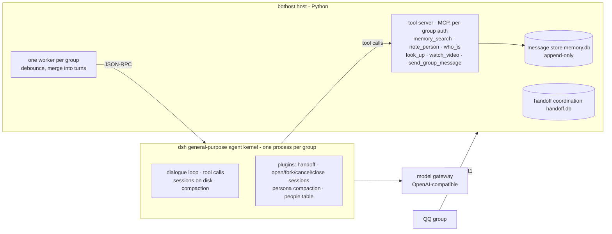
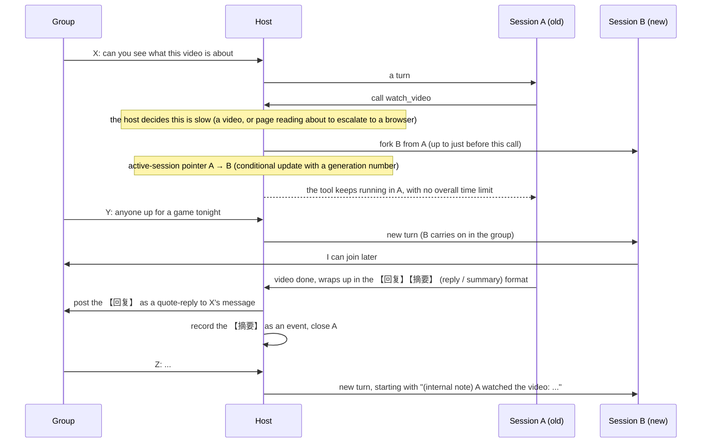
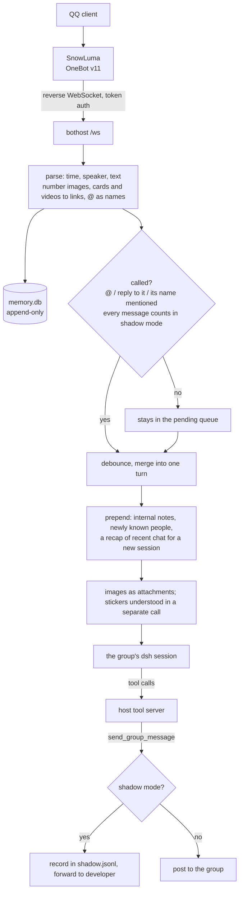

# Always Present, Never Held Up: The Architecture of groupmind

[简体中文](architecture.md) | **English**

> This is an architecture article organized around design motivation. Every mechanism is described in the same order: what problem it faces, which approaches were considered, why the current one was chosen, what it gains and what it costs, and how far it has been verified.
> The project is a **work in progress**: the bot host runs end to end in shadow mode and the memory research has fairly complete experiment records, but the bot has never posted in a real group and deployment was never finished. Anything that is a "research prototype", "not wired in" or "not verified" is said so explicitly.
> Sources for the numbers are in the [research report](research-report.en.md) and the original documents listed in the appendices (in Chinese).

## The core proposition

An agent that lives in a group chat for the long term has to meet three requirements that pull against each other:

- **Always present**: group chats go on for months or years; it has to remember the past and know the people in the group.
- **Always reachable**: anyone may @-mention it at any moment, and its response must not be blocked by something else.
- **Never fabricating**: not remembering is acceptable; misstating events, taking what others say as fact, or letting group members rewrite its rules is not.

groupmind's answer fits in three sentences. Every section below unfolds them for one concrete problem:

1. **Raw messages are the only source of truth, and are only ever appended to.** Summaries, colors, people, memes and impressions are derived artifacts that can be rebuilt; they exist only to help find the raw text.
2. **The session is short-term working memory; the message store is long-term memory.** Sessions can be compacted or discarded; the message store cannot.
3. **Slow work leaves the group-chat session.** The group-chat session only does the talking.

## 1. How a group-chat agent differs from an ordinary chat agent

An ordinary chat agent faces one person, one task, and a conversation that begins and ends. In a group chat almost every one of these is different:

| | Ordinary chat agent | Group-chat agent |
|---|---|---|
| Input | Every message is addressed to it | Most messages have nothing to do with it; several speakers interleave and several topics run at once |
| Time scale | One session, minutes to hours | Months to years, with no "end" |
| Cost of a memory failure | If it forgets, the user can ask again | Fabricating past events or misattributing who said what hurts more than forgetting |
| Trust in input | The user's words are instructions | Group members' words are **data** and cannot change system rules |
| Latency | The user is waiting | Others are waiting; if it gets stuck, the people after them are waiting too |
| Language | General language | The group's own memes, nicknames and abbreviations; people change names or use several accounts |

These differences set some basic trade-offs. Outside shadow mode, the bot **only starts a turn when it is called** (@-mentioned, replied to, or named); other messages are still stored and are handed over together the next time it is called. Messages are debounced briefly and merged into one turn instead of triggering one model call each.

> Shadow testing is the exception: the bot never really speaks, so nobody calls it; in shadow mode every message counts as a chance, and what it would say is only recorded and forwarded to the developer. There is currently **no proactive speaking**.

## 2. Overall structure: a thin host plus a general-purpose kernel



Early versions ran on AstrBot, with memory and web access written as plugins. It turned out that the things we needed (forking sessions, cancelling them, having the model write its own memo during compaction, splitting sessions by group) all required direct control over the agent's sessions, which the plugin layer could not reach. So we switched to **writing our own thin host and handing the agent loop to the general-purpose kernel dsh** (D-045):

- **The host owns "group-chat semantics"**: sending and receiving, the message store, when to start a turn, tool implementations, handoff scheduling.
- **The kernel owns "the agent itself"**: the dialogue loop, tool calls, saving sessions, context compaction. Extra capabilities the host needs are added as dsh plugins, without modifying the kernel.

The cost is being tied to a dsh version. Handoff uses several internal interfaces of dsh 0.2.1-rc.4 (the fork seed, cancellation, creating user messages); tests must be re-run after a kernel upgrade (section 7).

The ordinary OneBot message path is unremarkable; the full flow is in [Appendix A](#appendix-a-the-full-path-of-an-ordinary-message).

## 3. Context lifetime: per-group sessions, caching and compaction

### Problem

Months of a group's chat fit in no context window. But rebuilding the context from scratch every turn has two problems: every turn pays for the full input again, and the model loses its sense of "where were we just now".

### Choice: one long session per group, with an append-only prefix

Each group has its own dsh process and session. The session's prefix is kept as stable as possible so that the model provider's prefix cache keeps hitting:

- **The system prompt is fixed**: the persona, group-chat rules and meme snapshot are assembled when the process starts and stay unchanged for the life of the process.
- **The people table is updated only when the prefix has to be rebuilt anyway**: after a process restart, a new session or a compaction, the prefix is already invalid, and only then is the people table in the system prompt rewritten; people learned in between are appended at the start of the next turn's input.
- **Background results are never inserted into a request in progress**: results returned by handoff and the meanings of stickers are placed at the very start of the next turn's input, marked "(internal note, not a group message)".

Approaches given up:

- **Reassembling the context every turn (pure retrieval)**: the cache is invalidated every turn, and the model does not remember what it just said.
- **Writing dynamic information into the system prompt**: every change invalidates the whole prefix.

Whether sessions are cut daily or kept running depends on how long the provider's cache lasts (D-048). Providers whose cache lasts for days (such as DeepSeek) suit one long session; with short-lived caches, a new session is started each day and begins with a recap of the recent chat.

### Compaction: let the persona-bearing model write its own memo

When the context reaches the threshold (about 110,000 tokens by default), the kernel replaces the earlier conversation with a summary. dsh's built-in compaction prompt was written for coding assistants and produces an English "task checkpoint". groupmind replaces it with a plugin that changes only the summarization step (`deploy/dsh/compaction-persona.*`):

- The request's prefix is exactly the same as in a normal turn; only the end is replaced with a Chinese instruction: "this chat is about to be taken away from you; write a memo to yourself in your own voice", covering what was being discussed, what it promised to whom, and how it feels about people.
- The memo may end with a 【人物】 ("people") section, which the host uses to update the people table.

**Gain**: the prefix is the same, so the summary request itself also hits the cache. In one check on a synthetic group chat, 93%–97% of the input of the three summary requests hit the cache, and after compaction the model correctly answered questions about things it had been asked to remember.

**Cost**: the summary is not a reliable copy of the original. Both kinds of summary (persona and built-in) made the same mistake: describing "the message just replied to" as "not yet replied to", because the compacted range does not include the last few turns kept as they are. So the summary is only working memory; the original words still have to be looked up in the store with `memory_search`.

**How far it is verified**: the numbers above come from synthetic group chats, each approach run once; they are a "does it work" check, not a score. A small session-lifetime experiment showed that under the same context limit, a long session is cheaper than a new session each day (about half the uncached input) and can pick up the previous two days without querying the store; what really drives cost is the compaction threshold, not whether sessions are cut daily. Long-term behavior in a real group has not been tested.

## 4. Long-term memory: raw text as the foundation, derivations as the index

### Problem

The most direct approach to long-term memory is to have the model keep writing summaries and extracting facts, storing them as "knowledge about this group". The trouble is that this is **lossy and cumulative**: details a summary drops cannot be recovered, and a wrongly extracted fact becomes evidence for the next round of consolidation, sounding truer each time it is passed on. Group chat is especially easy to get wrong: several speakers interleave, there are many jokes and much irony, and who said what is often unclear.

### Choice: each kind of data does one job

| Data | Role | Can it be modified automatically? | Given to the answering model? |
|---|---|---|---|
| Raw messages | The only source of truth | No, append-only | **Yes**, recall gives the original words |
| Colors (coloring) | Cut interleaved conversation into "micro-context" segments, i.e. raw-text chunks | Rebuildable | Raw-text chunks are the injection unit |
| Color summaries | Retrieval entry points that help raw-text chunks be found | Rebuildable | **No** |
| People | Stable account → names, nicknames, impression, attitude | Yes, with history and rollback | The people table is in the system prompt |
| Memes | Two layers: general memes shared across groups, group memes kept within their group | Only via "candidates + human confirmation" | The snapshot is in the system prompt |
| Impressions, event layer | "Which events leave an impression", "the nature of a whole evening" | Research prototype | Not wired in |

**Coloring** is the most distinctive step of the project: a model reads messages in batches and marks messages belonging to the same micro-context with the same color; a color can skip unrelated messages in between. A color is both a way of chunking and a retrieval entry point.

A **fictional** example:

```text
21:02 A: who's up for barbecue tonight          ← color 1 "Friday barbecue"
21:02 B: did you watch episode 3 of that new show ← color 2 "new show, episode 3"
21:03 C: I'm in, what time                        ← color 1
21:03 D: yes, that ending came out of nowhere     ← color 2
21:04 A: nine, usual place                        ← color 1

Color 1 summary: A arranges barbecue on Friday at nine at the usual place; C joins.
```

A fixed window would cut these five lines together, and per-message retrieval would leave "nine, usual place" without context. Coloring separates them into two segments, each with a one-sentence summary.

### Retrieval: find it, but give only the raw text

The recall tool `memory_search` uses the retrieval frozen after about thirty controlled comparisons (D-028, revised once each in D-029 and D-032):

```text
question ─┬─ BM25 over summaries ───────┐
          ├─ BM25 over raw-text chunks ─┤
          ├─ vectors over summaries ────┤ top 5 per route
          └─ vectors over raw chunks ───┘
                    ▼
       global reciprocal rank fusion (RRF)
                    ▼
  pack raw-text chunks in rank order up to 1,500 characters; duplicate messages appear once → to the model
```

Recent messages that have not been colored yet are searched one by one with keywords, returning the matching line with its surrounding context. When the vector service is unreachable, only keywords are used; when the index is broken, everything is searched message by message. The tool's description says: "quotes must match the original; if nothing is found, say you don't recall — don't make things up".

Key choices and the approaches given up (experiments in the research report):

- **Giving only summaries**: 10–21 percentage points below giving raw-text chunks. So summaries only serve as retrieval entry points.
- **A single route**: BM25 and vectors each miss questions the other finds; fusing all four routes is best.
- **Taking many candidates per route**: with 20–30 per route, chunks that rank mediocre in several routes accumulate score and push out evidence that ranks first in only one route. 3–10 per route is a plateau.
- **Merging similar colors from adjacent batches into long chunks**: the evidence-inclusion rate drops significantly, because one long chunk can fill the whole budget.

**Cost**: coloring is offline batch processing, paying one model call per 150 messages. Coloring after going live was designed to be triggered "when the main session cold-starts or compacts" (D-047), but **only the counting is wired in**: the host records how many messages have not been colored yet, but coloring itself is not wired into bothost. So in the live system, recent messages rely on per-message keyword search.

**How far it is verified**: the frozen version's end-to-end accuracy on the two development groups is 84.1% and 71.1%, but it **has not been validated on an independent test set**. The advantage of coloring itself (as a way of chunking) over fixed windows is not solid: 4.1 and 2.5 percentage points higher on the two groups, the latter not significant; most of the gain comes from multi-route fusion and shallow candidate lists. In addition, the model almost never puts one message into more than one color, which differs from the design (research report RQ2).

### Knowing people

People are tracked by **stable account**, not by nickname: in one development group, 27 of 104 people had changed their name, and merging by name would split them into 40 extra identities; human annotation also found people using two or three accounts at the same time.

The bot gets to know people in two ways (D-055):

- It calls `note_person` to record nicknames, impressions and attitudes, or to say that two names are the same person. Impressions and attitudes are replaced by newer ones, nicknames accumulate, and every change has history and can be undone.
- When writing a compaction memo, it adds to them in the final 【人物】 section.

The people table is shared across groups and placed in full in the system prompt, updated only when the prefix has to be rebuilt anyway (section 3).

**How far it is verified**: during shadow testing the bot recorded only 5 entries by itself; quality cannot be assessed yet.

### Memes

The research findings on memes are blunt: the model understands roughly half of general internet slang, barely understands the group's own memes, and a chat snippet using the word does not help. So group memes must come from a meme table. The table's candidates are mined from history by an offline script, confirmed by a human, written into a snapshot and placed in the system prompt; automatic rewrites are not allowed (D-039). Candidate mining is currently where most memes are lost (research report RQ6).

### Impressions and the event layer (research prototypes)

These two parts live in `bench/` and are **not wired into the bot**:

- **Event layer** (side path): on top of raw-text chunks, it records "a continuous stretch of chat", "parallel sub-topics" and "a topic resurfacing on another day", storing only references, to answer questions such as "the most chaotic night" that chunk-level retrieval cannot.
- **Impression formation**: the model reads the chat in chronological order, knowing only what came before, and says which things would leave an impression and how deep; at recall time it gives the gist, the original words, or nothing, depending on the depth. The mechanism runs; it has not been compared against human impressions.

## 5. Slow work: session handoff

### Problem

Watching a video or reading a page that needs a browser often takes minutes. Each group has only one worker and turns are serial. If the group-chat session stopped to wait, nobody who @-mentioned it during those minutes would get a response.

The earliest approach was to put time limits everywhere: 300 seconds per turn, 180 seconds per tool call, and after 160 seconds of video, reply "not done yet" so the model would ask again next turn. This wasted calls, depended on the model remembering to come back, and still blocked the group.

### Approaches considered

| Approach | Problem |
|---|---|
| The group-chat session waits | The whole group is blocked |
| The tool replies "not ready yet" and is polled later | Depends on the model remembering to come back; every poll is a full model call |
| When the background work finishes, insert the result into the running session | Inserting a message while the session is generating disrupts the conversation and breaks the cache prefix |
| **Fork the session (adopted)** | The old session finishes the task in the background; a forked new session carries on in the group |

### How it works



Some details:

- **Only the host decides when to hand off**: currently in exactly two cases — watching a video, and page reading about to escalate from an ordinary request to a browser. There is no timer and no extra model call to decide.
- **The fork point is just before the call was made**: the new session has the same prefix as the old one (so the cache still hits), and there is no broken record of "a call without a result".
- **The old session's wrap-up format**: when a tool result returns to a session that no longer handles the group, a note is appended asking it not to post to the group any more, and to write only a 【回复】 (one or two sentences, posted as a quote-reply to the original message) and a 【摘要】 (a JSON object: what it observed, what it inferred, the conclusion, sources, what it could not do, facts worth remembering, people it got to know). Only what it really saw.
- **How results return to the group chat**: the host posts the 【回复】 as a quote-reply to the original message; the 【摘要】 is recorded as an event and handed to the new session as an internal note at the start of its next turn. Events are numbered, and are marked delivered only after the model has actually read them.
- **Retired sessions are closed**: dsh's SDK protocol itself offers no fork, cancel or close, and a session once opened stays in memory. So the host's plugin opens, holds and closes sessions.

### How failures are handled

| Situation | Handling |
|---|---|
| A group already has 2 background tasks, or 4 are running overall | Handoff is refused; the call runs as usual in the original session |
| Forking the session fails | Nothing changes; the call runs as usual in the original session |
| The same call asks for a handoff again | The same task is returned; no second fork |
| A background session produces no events for a long time and is not executing a tool | Judged stalled (600 seconds by default); only that session is cancelled; the process and other sessions are unaffected |
| It has still not stopped 60 seconds after cancellation | The turn is recorded as an error; the process is not killed |
| A background task errors or is cancelled | A failure event is recorded; the new session's next turn sees "it got stuck and was cancelled" or "it hit an error" |
| The host restarts | On startup, tasks still running are marked failed ("the bot restarted; the background task was interrupted") |

**Gain**: slow work no longer blocks the group chat, and the host no longer needs an overall time limit per turn. In a memory test with 30 consecutive handoffs, closing retired sessions left 1 live session (31 without closing), with resident memory of 262 MB vs 290 MB. The gap is small because forked sessions share history objects with the original.

**Costs and known defects**:

- **Tool calls longer than 5 minutes always fail**: dsh calls tools over HTTP, and Node's built-in header timeout is 300 seconds; the "tool calls may take up to 1 hour" setting does not reach that layer. Videos that take more than 5 minutes to process fail this way.
- **A long fact-check that is not handed off blocks the group**: handoff happens only when page reading escalates to a browser; a fact-check that only searches without reading pages keeps occupying the group-chat session (one turn took 563 seconds in practice).
- It depends on internal interfaces of dsh 0.2.1-rc.4, and the old session's wrap-up depends on the model following the format.

**How far it is verified**: end-to-end tests with a fake model and a fake OneBot (13 handoff tests) cover handoff, stall cancellation, and memory after consecutive handoffs; real fact-checks and video watching have run in shadow testing. The bot has never posted in a real group, and how quote-replies look in QQ has not been seen.

## 6. Looking outward: fact-checking, reading web pages and watching videos

### Separating fact-checking from the persona

Search results and web pages are long (one page ran to 65,000 characters). Putting them straight into the group-chat session would fill the context and let the persona-bearing model's role influence factual judgment. So `look_up` **opens a separate short conversation without the persona** inside the host to search and read pages (D-050): each page read returns about 9,000 characters of text and 40 links, the helper makes at most 6 calls, and finally hands back only a conclusion (at most 1,500 characters) together with what was searched and which pages were or were not read. The group-chat session can ask follow-up questions by number; the helper continues its own conversation, with the pages it already read still in front of it.

### Tiered escalation for reading pages

```text
search provider's page-reading API ──(can't read)──► request with a browser TLS fingerprint ──(blocked by anti-bot, or nearly empty page)──► real Chrome (windowed, Xvfb) ──► Camoufox
        │                                                                                                              ▲
        └─ sites known to defeat the API skip this tier                          sites known to need a browser start here ─┘
```

The cheapest tier comes first, and each tier is used only when the previous one failed, was blocked, or returned a nearly empty page (the update to D-050 moved the page-reading API to the first tier). The reader remembers which sites should skip the API and which must use a browser. Escalating to a browser is exactly the point that triggers session handoff.

### Safety boundaries

- **Page reading**: ordinary requests have SSRF protection; every connection the browser makes goes through a local forward proxy that resolves the host itself, refuses private, loopback, link-local and similar addresses, and connects to the very address it checked. The browser tool itself offers no shell, files or downloads.
- **Group members' words are data**: chat content cannot change configuration or memory rules; what others say is not fact.
- **The tool server authenticates per group**: each group's dsh process receives a random token, from which the tool server knows which group is calling; the handoff plugin listens only on the loopback address, and each request also carries a random token.

### Watching videos

`watch_video` reuses the project's own video reader: download, compress, split by the model's inline size limit, send each piece to a video model, then merge; for Bilibili links the page text is fetched as well. When a download is refused, it retries with the cookies from the bot's own browser. It is the other trigger for handoff.

**How far it is verified**: real fact-checks and video watching have run in shadow testing; video files sent directly in QQ have been switched to direct download but not yet run on real messages; the browser tier's "remember which sites need a browser" may remember wrongly.

## 7. Kernel, host and isolation

### The boundary between host and kernel

- **One dsh process per group**, using the `sdk-minimal` profile plus the host's patch. Groups never wait for each other; there is a global concurrency limit.
- **The tools live in the host process**: speaking, retrieval, knowing people, fact-checking and watching videos are exposed to dsh over MCP. dsh's own session also has shell and file tools, with one workspace directory per group.
- **Keys come only from environment variables**; configuration files and the persona are outside the repository.

### Isolation in the actual deployment

The shadow-test deployment is **a dedicated WSL2 distribution on a Windows PC** (Ubuntu 24.04, named `qqbot`), with the host running as an ordinary user `bot`, and the QQ protocol endpoint SnowLuma running on the Windows side (D-053). Isolation comes from three stacked layers:

| Layer | What it does | What it does not do |
|---|---|---|
| WSL distribution | Separate from the user's other environments; the default user is the non-root `bot` | `wsl.conf` does not disable Windows interop or automatic mounting, so the Windows drives are still visible inside the distribution |
| dsh sandbox policy | The shell may write only to its own workspace (`workspace-write`) | Does not restrict reading or network access |
| Host tools | Per-group token authentication; page reading has SSRF protection and a guard proxy | — |

In other words, **there is currently no container sandbox**. Docker was considered back in the AstrBot era and rejected because the deployment machine was short of memory and disk (D-011); isolation now relies mainly on "a dedicated WSL distribution + an ordinary user + write-only-to-workspace". The comment in the patch says so too: dsh's policy only limits writes, and real isolation has to come from where the whole process runs. Disabling WSL interop and automatic mounting, or switching to a container, has not been done.

## 8. Status and limitations

- **Implemented and running in shadow testing**: per-group sessions with persona compaction, memory retrieval, knowing people, fact-checking, watching videos, understanding stickers, session handoff.
- **Research prototypes, not wired in**: coloring after going live (only counting is wired in), the event layer, impression formation, the recall-policy layer.
- **Not verified**: actually posting, proactive speaking (does not exist), the frozen version on an independent test set, human blind evaluation of "human-likeness", tool calls longer than 5 minutes.
- **Deployment is very unfriendly**: it has only run in the author's own Windows + WSL environment, relying on scheduled tasks and a script for pushing updates by hand; paths, accounts and the model gateway all carry traces of the author's environment.

## 9. Principles worth taking away

1. **Append-only raw text, plus everything rebuildable.** Anything derived can be wrong; as long as the raw text is there, it can be recomputed and traced.
2. **Summaries are for finding; raw text is for answering.** This is the most stable experimental finding of the project.
3. **Keep the prefix fixed; append the changes.** The people table, background results and sticker meanings all follow this rule, buying caching and continuity.
4. **Slow work leaves the session that talks.** Handoff stops "being present" and "getting things done" from blocking each other.
5. **State which layer of isolation you actually have.** "Writes only to the workspace" is not a sandbox.

---

## Appendix A: The full path of an ordinary message



## Appendix B: Decision index

| Topic | Decision record (`DECISIONS.md`, in Chinese) |
|---|---|
| Switch to a thin host + general-purpose kernel; history and new messages in one store | D-045 |
| The frozen retrieval and its revisions; the recall tool uses the frozen version | D-028, D-029, D-032, D-046 |
| When to color after going live (not wired in) | D-047 |
| Compaction summaries written by the persona-bearing model; session lifetime | D-048 |
| A persona-free fact-checking helper; tiered page reading (the D-050 update is authoritative) | D-040, D-042, D-050 |
| Watching videos | D-041, D-051 |
| Session handoff | D-052 |
| WSL deployment and shadow mode | D-053 |
| The bot gets to know people by itself | D-055 |
| Two-layer meme table and how it is updated | D-033, D-039 |
| Docker rejected early on | D-005, D-011 |

## Appendix C: Where to read the original material

| To learn about | Read |
|---|---|
| Experiment design, results and limitations | [Research report](research-report.en.md) |
| The current system, code map, known issues | [docs/handover-2026-11-16.md](../handover-2026-11-16.md) (Chinese) |
| Audit and implementation reports on session handoff | [docs/research/2026-11-session-handoff-report-v2.md](../research/2026-11-session-handoff-report-v2.md) (Chinese) |
| Persona compaction and session lifetime | [docs/research/2026-11-persona-compaction-and-session-lifetime.md](../research/2026-11-persona-compaction-and-session-lifetime.md) (Chinese) |
| The reasoning behind each decision | [DECISIONS.md](../../DECISIONS.md) (Chinese) |
| Deployment | [deploy/wsl/README.md](../../deploy/wsl/README.md) (Chinese) |
