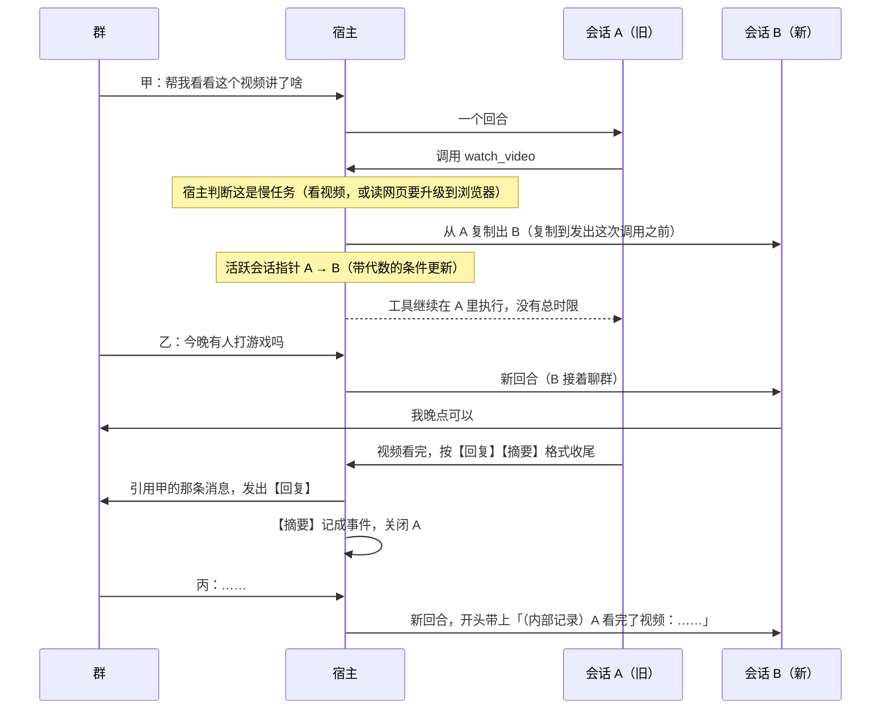
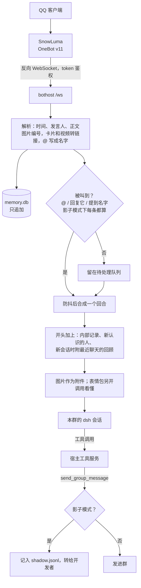

# 一直在场，又不被任何一件事拖住：groupmind 的架构

**简体中文** | [English](architecture.en.md)

> 这是一篇按设计动机组织的架构文章。每个机制都按同一个顺序讲：遇到什么问题，考虑过哪些做法，为什么选现在这个，得到了什么、付出了什么，以及验证到了哪一步。
> 项目是**半成品**：机器人宿主在影子模式下跑通了，记忆研究有比较完整的实验记录，但从没有在真实的群里发过言，部署也没有收尾。文中凡是「研究原型」「未接入」「未验证」的地方，都会直接写明。
> 数字的出处见 [研究报告](research-report.md) 和文末附录里列出的原始文档。

## 核心命题

一个长期待在群里的 Agent，要同时满足三个互相拉扯的要求：

- **一直在场**：群聊会持续几个月甚至几年，它要记得以前的事、认识群里的人；
- **随叫随到**：任何时候都可能有人 @ 它，回应不能被别的事情卡住；
- **不能编造**：记不清可以，说错事、把别人的话当成事实、被群友的话改掉规则，都不行。

groupmind 的回答可以概括成三句话，后面每一节都是这三句话在某个具体问题上的展开：

1. **原始消息是唯一的事实来源，只追加、不改写**；摘要、颜色、人物、梗、印象都是可以重建的派生物，只用来帮忙找到原文。
2. **会话是短期工作记忆，消息库是长期记忆**；会话可以被压缩、被丢弃，消息库不会。
3. **慢的事离开群聊会话去做**；群聊会话只负责说话。

## 1. 群聊 Agent 和普通对话 Agent 有什么不同

普通的对话 Agent 面对的是一个人、一个任务、一段有始有终的对话。群聊里的情况几乎每一条都不一样：

| | 普通对话 Agent | 群聊 Agent |
|---|---|---|
| 输入 | 每条消息都是对它说的 | 大部分消息和它无关；多人交错，几条话题同时进行 |
| 时间尺度 | 一次会话，几分钟到几小时 | 几个月到几年，没有「结束」 |
| 记忆失败的代价 | 忘了可以再问 | 编造旧事、记错是谁说的，比忘记更伤人 |
| 输入的可信度 | 用户的话就是指令 | 群友的话是**数据**，不能改变系统规则 |
| 延迟 | 用户在等 | 别人在等；而且它一卡住，后面的人也在等 |
| 语言 | 通用语言 | 本群的梗、外号、缩写；有人改名、一人多号 |

这些差别决定了几个基本取舍。机器人在非影子模式下**只在被叫到时才开始一个回合**（被 @、被回复、或者有人提到它的名字），其他消息照样入库，等下一次被叫到时一起交给它看。消息先等一小会儿（防抖）再合成一个回合，而不是每条消息都调用一次模型。

> 影子测试是例外：机器人不真正发言，没人会叫它，所以影子模式下每条消息都算一次机会，它要说的话只记下来、转给开发者看。目前**没有主动发话**的功能。

## 2. 总体结构：薄宿主加通用内核


早期版本跑在 AstrBot 上，记忆、联网都写成插件。后来发现，要做的几件事（会话复制、取消、压缩时让模型自己写备忘、按群切分会话）都需要直接控制 Agent 的会话，插件层够不着。于是换成**自己写一个薄宿主，把 Agent 循环交给通用内核 dsh**（D-045）：

- **宿主负责「群聊语义」**：收发消息、消息库、什么时候开始一个回合、工具的实现、接力的调度。
- **内核负责「Agent 本身」**：对话循环、工具调用、会话保存、上下文压缩。宿主需要的额外能力用 dsh 插件补，不改内核。

代价是绑定了 dsh 的版本。接力用到了 dsh 0.2.1-rc.4 的几个内部接口（复制会话的种子、取消、创建用户消息），升级内核后必须重跑测试（第 7 节）。

普通的 OneBot 消息路径没什么特别，完整流程放在 [附录 A](#附录-a一条普通消息的完整路径)。

## 3. 上下文的寿命：每群会话、缓存与压缩

### 问题

一个群几个月的聊天，任何上下文窗口都装不下。可如果每一轮都从零组装上下文，又会遇到两个问题：每次都要重新付全部输入的钱；模型也失去了「刚才聊到哪了」的连续感。

### 选择：每群一个长会话，前缀只追加

每个群有自己的 dsh 进程和会话。会话的前缀尽量不变，这样模型服务的前缀缓存能一直命中：

- **系统提示固定**：人设、群聊规则、梗快照在进程启动时拼好，整个进程生命周期内不变。
- **人物表只在「反正要重建前缀」时更新**：进程重启、新会话、压缩之后，前缀本来就失效了，这时才重写系统提示里的人物表；其间新认识的人，追加在下一轮输入的开头。
- **后台结果不插进正在进行的请求**：接力回来的结果、表情包的含义，都以「（内部记录，不是群消息）」的形式放在下一轮输入的最前面。

放弃的做法：

- **每轮重新组装上下文（纯检索式）**：缓存每轮失效，而且模型不记得刚才说过什么。
- **把动态信息写进系统提示**：每次改动都让整个前缀失效。

会话按天切还是一直延续，取决于模型服务的缓存有多长（D-048）。缓存能保留几天的服务（如 DeepSeek）适合一个长会话；缓存短的服务按天开新会话，新会话开头带一段最近的聊天作为回顾。

### 压缩：让带人设的模型自己写备忘

上下文涨到阈值（默认约 11 万 token）时，内核把早期对话换成摘要。dsh 内置的压缩指令是为编程助手写的，产出英文的「任务检查点」。groupmind 换了一个插件，只改「写摘要」这一步（`deploy/dsh/compaction-persona.*`）：

- 请求的前缀和平时一轮完全相同，只在末尾换成一段中文指令：「这些聊天马上要从你眼前拿走，用你自己的口吻写一段只给自己看的备忘」，内容包括刚才在聊什么、答应过谁什么、对谁有什么感觉。
- 备忘最后可以带一段【人物】，宿主据此更新人物表。

**收益**：前缀相同，所以摘要请求本身也能命中缓存。在一次合成群聊的检查里，三次摘要请求的输入有 93%–97% 命中缓存；压缩之后回问「之前托你记的事」，都答对了。

**代价**：摘要不是可靠的原文。两种摘要（人设版和内置版）都出现过同一个错误：把「刚回过的那句」写成「还没回」，因为被压缩的范围不含留下的最后几轮。所以摘要只是工作记忆，原话仍然要用 `memory_search` 去库里查。

**验证到哪一步**：上面的数字来自合成群聊、每种做法跑一次，是「能不能用」的检查，不是评分。会话寿命的小实验显示，在同一个上下文上限下，长会话比每天新会话便宜（未命中缓存的输入约为一半），也不用查库就能接上前两天的事；真正决定花销的是压缩阈值，而不是会话按不按天切。真实群里的长期表现还没有测过。

## 4. 长期记忆：原文为本，派生为索引

### 问题

最直接的长期记忆做法是让模型不断写摘要、抽事实，存成一份「关于这个群的知识」。它的问题在于**有损且会累积**：摘要丢掉的细节找不回来；抽错的事实会在下一次整理时被当成依据，越传越像真的。群聊又特别容易抽错：多人交错、玩笑和反讽多、谁说的经常不清楚。

### 选择：每种数据只做一件事

| 数据 | 职责 | 能否被自动修改 | 交给回答模型吗 |
|---|---|---|---|
| 原始消息 | 唯一的事实来源 | 否，只追加 | **是**，回忆时给的就是原话 |
| 颜色（上色） | 把交错的对话切成「微语境」片段，也就是原文块 | 可重建 | 原文块是注入单位 |
| 颜色摘要 | 检索入口，帮原文块被找到 | 可重建 | **否** |
| 人物 | 稳定账号 → 名字、外号、印象、态度 | 可以，有历史、可回滚 | 人物表放在系统提示里 |
| 梗 | 两层：通用梗跨群共享，本群梗只留在本群 | 只走「候选 + 人工确认」 | 快照放在系统提示里 |
| 印象、事件层 | 「哪些事会留下印象」「一整晚的性质」 | 研究原型 | 未接入 |

**上色**是这个项目最有特色的一步：模型按批读消息，把属于同一段微语境的消息标成同一个颜色；一个颜色可以跳过中间无关的消息。颜色同时是分块方式和检索入口。

一个**虚构的**例子：

```text
21:02 甲：今晚谁去吃烧烤                    ← 颜色 1「周五烧烤」
21:02 乙：那个新番第三集看了吗              ← 颜色 2「新番第三集」
21:03 丙：我去，几点                        ← 颜色 1
21:03 丁：看了，结尾那段太突然了            ← 颜色 2
21:04 甲：九点，老地方                      ← 颜色 1

颜色 1 摘要：甲约周五晚九点在老地方吃烧烤，丙参加。
```

固定窗口会把这五行切在一起，逐条检索又会让「九点，老地方」失去语境。上色把它们分成两段，各自带一句摘要。

### 检索：找得到，但只交原文

回忆工具 `memory_search` 用的是经过约三十组对照实验冻结下来的检索（D-028，之后 D-029、D-032 各修订一次）：

```text
问题 ─┬─ BM25 搜摘要 ──────┐
      ├─ BM25 搜原文块 ────┤
      ├─ 向量搜摘要 ───────┤ 每路取前 5
      └─ 向量搜原文块 ─────┘
                ▼
       全局倒数排名融合（RRF）
                ▼
  按名次装入原文块，1500 字为止，重复消息只出现一次 → 交给模型
```

还没上色的近期消息，用关键词逐条搜，返回命中的那一句和前后文。向量服务连不上时只用关键词；索引坏了时全部逐条搜。工具的说明里写着：「引用要与原文一致，查不到就说没印象，不要编」。

几个关键选择和被放弃的方案（实验见研究报告）：

- **只交摘要**：比交原文块低 10–21 个百分点。所以摘要只做检索入口。
- **单一路线**：BM25 和向量各有找不到的题，四路融合最好。
- **每路取很多候选**：每路取 20–30 个时，在几路里都排得一般的块会累加分数，把只在一路排第一的证据挤出预算。每路 3–10 个是平台。
- **把相邻批次的相近颜色合并成长块**：证据进入率显著下降，因为一个长块就能占满预算。

**代价**：上色是离线批处理，要为每 150 条消息付一次模型调用。上线后的上色原本设计在「主会话冷启动或压缩时」触发（D-047），**目前只接了计数**：宿主会记录有多少消息还没上色，上色本身还没有接进 bothost。所以线上系统里，近期消息靠逐条关键词检索。

**验证到哪一步**：冻结版在两个开发群上的端到端准确率是 84.1% 和 71.1%，但**还没有在独立的测试集上验证**。上色本身（作为分块方式）相对固定窗口的优势并不稳固：在两个群上分别高 4.1 和 2.5 个百分点，后者不显著；最大的收益来自多路融合和浅候选。另外，模型实际上几乎不给一条消息上多个颜色，这和设计不同（研究报告 RQ2）。

### 认识人

人物按**稳定账号**管理，不按昵称：一个开发群里 104 人中有 27 人改过名，按名字归并会多分裂出 40 个身份；人工标注还发现有人同时用两三个账号。

机器人有两种方式认识人（D-055）：

- 调用 `note_person` 记下外号、印象、态度，或者说明两个名字是同一个人。印象和态度会被新的替换，外号会累加，所有修改都有历史、可以撤销。
- 写压缩备忘时，在最后一段【人物】里顺带补充。

人物表跨群共用，整张放在系统提示里，只在前缀反正要重建时更新（第 3 节）。

**验证到哪一步**：影子测试期间机器人自己只记下了 5 条，质量还谈不上评估。

### 梗

梗的研究结论很直接：模型对通用网络用语懂一半左右，对本群的梗基本不懂，给它一段用到这个词的聊天也没用。所以本群梗必须靠梗表。梗表由离线脚本从历史里挖出候选，经人工确认后写进快照，放在系统提示里；不允许自动改写（D-039）。挖候选这一步目前漏得最多（研究报告 RQ6）。

### 印象和事件层（研究原型）

这两部分在 `bench/` 里，**没有接入机器人**：

- **事件层**（旁路）：在原文块之上记录「一段连续的聊天」「并行的子话题」「跨日的话题重提」，只存引用，用来回答「最乱的那个晚上」这类块级检索答不了的问题。
- **印象形成**：模型按时间顺序把聊天读一遍，读的时候只知道此前的事，说出哪些会留下印象、多深；回忆时按印象深浅给大意、原话或什么都不给。机制能跑通，还没有和人的印象做过对照。

## 5. 慢任务：会话接力

### 问题

看一段视频、读一个要开浏览器才能读的网页，常常要几分钟。每个群只有一个 worker，回合是串行的。如果群聊会话停下来等，这几分钟里谁 @ 它都没有反应。

最早的做法是给每处都加时限：回合 300 秒、工具调用 180 秒、看视频 160 秒后先回「还没看完」，让模型下一轮再来问。这既浪费调用，也依赖模型记得回来问，而且仍然会挡住群。

### 考虑过的做法

| 做法 | 问题 |
|---|---|
| 群聊会话等着 | 整个群被挡住 |
| 工具先回「还没好」，之后轮询 | 依赖模型记得回来；每次轮询都是一次完整的模型调用 |
| 后台做完后，把结果插进正在进行的会话 | 会话正在生成时插入消息，会打乱对话，也会破坏缓存前缀 |
| **复制会话（采用）** | 旧会话在后台做完这件事，复制出的新会话接着聊群 |

### 怎么运作



几个细节：

- **什么时候接力，只由宿主决定**：目前只有两种情况，看视频，以及读网页要从普通请求升级到浏览器。没有定时器，也不额外调用模型来判断。
- **复制点在发出那次调用之前**：新会话的前缀和旧会话相同（缓存还能命中），也不会出现「有调用、没结果」的残缺记录。
- **旧会话的收尾格式**：工具结果回到一个已经不负责群聊的会话时，后面会附一段说明，要求它不要再发群消息，只写【回复】（一两句，会引用原消息发出）和【摘要】（一个 JSON：看到了什么、推断了什么、结论、来源、没做成的部分、值得记住的事、新认识的人）。只写真的看到的。
- **结果怎么回到群聊**：【回复】由宿主引用原来那条消息发出；【摘要】记成事件，在新会话的下一轮开头作为内部记录交给它。事件有序号，只有模型真的读过之后才标记为已送达。
- **退休的会话会被关闭**：dsh 的 SDK 协议本身不提供复制、取消和关闭，会话一旦打开就一直留在内存里。所以由宿主的插件来打开、持有和关闭会话。

### 失败怎么处理

| 情况 | 处理 |
|---|---|
| 一个群已有 2 个后台任务，或全局已有 4 个 | 拒绝接力，这次调用在原会话里照常执行 |
| 复制会话失败 | 什么都不变，这次调用在原会话里照常执行 |
| 同一次调用再次请求接力 | 返回同一个任务，不会复制两次 |
| 后台会话长时间没有任何事件，也不在执行工具 | 判定为卡死（默认 600 秒），只取消这一个会话；进程和别的会话不受影响 |
| 取消后 60 秒仍没停下 | 这一回合记为出错，不杀进程 |
| 后台任务出错或被取消 | 记成失败事件，新会话下一轮会看到「停住不动，取消了」或「出错了」 |
| 宿主重启 | 启动时把仍在运行的任务标为失败（「机器人重启，后台任务中断了」） |

**收益**：慢任务不再挡住群聊；宿主不再需要为回合设总时长上限。连续接力 30 次的内存测试里，关闭退休会话后只剩 1 个活着的会话（不关闭时是 31 个），常驻内存 262 MB 对 290 MB。差距不大，是因为复制出的会话和原会话共用历史对象。

**代价和已知缺陷**：

- **工具调用超过 5 分钟一定失败**：dsh 通过 HTTP 调用工具，Node 自带的请求头超时是 300 秒，配置里的「工具调用最长 1 小时」管不到这一层。处理时间超过 5 分钟的视频会这样失败。
- **没有交给后台的长查证会挡住群**：只有读网页要升级到浏览器时才接力；只搜索、不读页的查证会一直占着群聊会话（实测一个回合 563 秒）。
- 依赖 dsh 0.2.1-rc.4 的内部接口；旧会话的收尾依赖模型按格式写。

**验证到哪一步**：用假模型和假 OneBot 的端到端测试（13 个接力测试）覆盖了接力、卡死取消和连续接力后的内存；影子测试中跑过真实的查证和看视频。没有在真实的群里发过言，引用回复在 QQ 里的显示效果也没看过。

## 6. 向外看：查证、读网页和看视频

### 查证和人设分开

搜索结果和网页都很长（一个网页有过 6.5 万字），直接放进群聊会话，会把上下文挤满，也会让带着人设的模型在事实判断上受角色影响。所以 `look_up` 在宿主里**另开一段不带人设的短对话**去搜索、读网页（D-050）：每次读页返回约 9,000 字正文和 40 个链接，帮手最多调用 6 次，最后只交回一段结论（1,500 字以内），附上搜了什么、哪些页读了或没读。群聊会话可以凭编号追问，帮手接着自己的对话往下查，已读的页面还在它眼前。

### 读网页分层升级

```text
搜索服务商的读页接口 ──(读不了)──► 带浏览器 TLS 指纹的请求 ──(被反爬拦下，或页面几乎是空的)──► 真 Chrome（有界面，Xvfb）──► Camoufox
        │                                                                                      ▲
        └─ 已知读不了的站点跳过这一层                         已知要浏览器的站点直接从这里开始 ─┘
```

最便宜的一层在前，每一层只在上一层失败、被拦或拿到几乎空白的页面时才用（D-050 的更新把读页接口放到了第一层）。读取器会记住哪些站点要跳过读页接口、哪些站点必须用浏览器。升级到浏览器这一步正是会话接力的触发点。

### 安全边界

- **网页读取**：普通请求带 SSRF 防护；浏览器的每个连接都经过一个本地转发代理，代理自己解析域名，拒绝私有、回环、链路本地等地址，并且连接的就是它检查过的那个地址。浏览器工具本身不提供 shell、文件和下载。
- **群友的话是数据**：聊天内容不能改变配置或记忆规则；他人的说法不等于事实。
- **工具服务按群鉴权**：每个群的 dsh 进程拿到一个随机 token，工具服务据此知道是哪个群在调用；接力插件只监听回环地址，每个请求也要带随机 token。

### 看视频

`watch_video` 复用项目自己的视频读取器：下载、压缩、按模型内联上限切片、逐段交给视频模型，再合并；B 站链接另外取页面文字。下载被拒时，用机器人自己浏览器里的 cookie 再试一次。它是接力的另一个触发点。

**验证到哪一步**：影子测试里跑过真实的查证和看视频；QQ 里直接发的视频文件已改成直接下载，还没在真实消息上跑过；浏览器档「自动记住哪些站点需要浏览器」可能记错。

## 7. 内核、宿主与隔离

### 宿主与内核的边界

- **每群一个 dsh 进程**，用 `sdk-minimal` profile 加宿主的补丁。群与群互不等待；全局有一个并发上限。
- **工具都在宿主进程里**：发言、检索、认识人、查证、看视频，通过 MCP 暴露给 dsh。dsh 自己的会话里也有 shell 和文件工具，工作区是每个群一个目录。
- **密钥只来自环境变量**，配置文件和人设都在仓库外。

### 实际部署里的隔离

影子测试的部署方式是：**Windows PC 上一个单独的 WSL2 发行版**（Ubuntu 24.04，名为 `qqbot`），宿主以普通用户 `bot` 运行，QQ 协议端 SnowLuma 跑在 Windows 侧（D-053）。具体的隔离由三层叠加而成：

| 层 | 做了什么 | 没做什么 |
|---|---|---|
| WSL 发行版 | 和用户的其他环境分开；默认用户是非 root 的 `bot` | `wsl.conf` 没有关闭 Windows 互操作和自动挂载，Windows 磁盘在发行版里仍然可见 |
| dsh 沙箱策略 | shell 只能写自己的工作区（`workspace-write`） | 不限制读取，也不限制网络 |
| 宿主的工具 | 按群 token 鉴权；网页读取有 SSRF 防护和守卫代理 | — |

也就是说，**目前没有容器沙箱**。早期 AstrBot 时代考虑过 Docker，因为部署机内存和磁盘紧张被否决（D-011）；现在的隔离主要靠「单独的 WSL 发行版 + 普通用户 + 只写工作区」。补丁里的注释也写明了：dsh 的策略只限制写入，真正的隔离要靠整个进程运行的位置。关闭 WSL 互操作和自动挂载、或者换成容器，都还没有做。

## 8. 现状与限制

- **已实现并在影子测试中运行**：每群会话与带人设的压缩、记忆检索、认识人、查证、看视频、表情包理解、会话接力。
- **研究原型，未接入**：上线后的上色（只接了计数）、事件层、印象形成、回忆策略层。
- **未验证**：真实发言、主动发话（不存在）、冻结版在独立测试集上的表现、「像不像人」的人工盲评、工具调用超过 5 分钟的情况。
- **部署很不友好**：只在作者自己的 Windows + WSL 环境里跑过，依赖计划任务和手工推送更新的脚本；路径、账号和模型网关都带着作者环境的痕迹。

## 9. 几条可以带走的原则

1. **只追加的原文，加上可以重建的一切。** 派生出来的东西都可能错，只要原文还在，就能重算、能追溯。
2. **摘要用来找，原文用来答。** 这是本项目最稳定的一条实验结论。
3. **前缀不动，变化追加。** 人物表、后台结果、表情包含义都遵守这一条，换来缓存和连续性。
4. **慢的事离开说话的会话。** 接力让「在场」和「做事」不再互相阻塞。
5. **隔离写清楚做到了哪一层。** 「只写工作区」不等于沙箱。

---

## 附录 A：一条普通消息的完整路径



## 附录 B：决策索引

| 主题 | 决策记录（`DECISIONS.md`） |
|---|---|
| 换成薄宿主 + 通用内核；历史和新消息同一个库 | D-045 |
| 冻结版检索及其修订；回忆工具使用冻结版 | D-028、D-029、D-032、D-046 |
| 上线后上色的触发时机（未接入） | D-047 |
| 压缩摘要由带人设的模型写；会话寿命 | D-048 |
| 查证帮手不带人设；读网页的分层（以 D-050 的更新为准） | D-040、D-042、D-050 |
| 看视频 | D-041、D-051 |
| 会话接力 | D-052 |
| WSL 部署与影子模式 | D-053 |
| 机器人自己认识人 | D-055 |
| 梗表分层与更新方式 | D-033、D-039 |
| 早期否决 Docker | D-005、D-011 |

## 附录 C：从哪里读原始资料

| 想了解 | 读 |
|---|---|
| 实验设计、结果与局限 | [研究报告](research-report.md) |
| 当前系统、代码地图、已知问题 | [docs/handover-2026-11-16.md](../handover-2026-11-16.md) |
| 会话接力的审计和实施报告 | [docs/research/2026-11-session-handoff-report-v2.md](../research/2026-11-session-handoff-report-v2.md) |
| 带人设的压缩与会话寿命 | [docs/research/2026-11-persona-compaction-and-session-lifetime.md](../research/2026-11-persona-compaction-and-session-lifetime.md) |
| 每个决定的来龙去脉 | [DECISIONS.md](../../DECISIONS.md) |
| 部署 | [deploy/wsl/README.md](../../deploy/wsl/README.md) |
