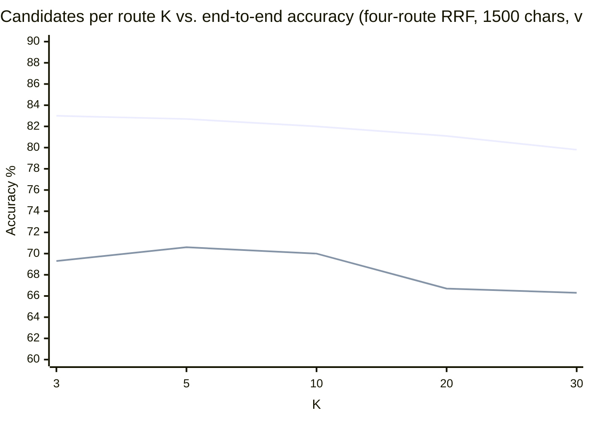

# Open Questions in Group-Chat Memory: groupmind Research Report (Overview)

[简体中文](research-report.md) | **English**

> This document organizes groupmind's memory experiments from October–November 2026 by research question: why each experiment was run, what it controlled, what it compared, what it found, and how far the conclusions can be trusted.
> The original records are unchanged, and every conclusion can be traced through [Appendix A](#appendix-a-tracing-the-conclusions) (sources in Chinese): the phase-one reports [v1](../research/2026-11-memory-stage-report.md), [v2](../research/2026-11-memory-stage-report-v2.md) and [v3](../research/2026-11-memory-stage-report-v3.md), the experiment results [memory-benchmark-results.md](../memory-benchmark-results.md), the experiment ledger [memory-benchmark-ledger.md](../memory-benchmark-ledger.md), and the dated research notes under `docs/research/`.
> This document contains no real chat content. Groups are always referred to by codes; all numbers are aggregate statistics; example conversations are fictional and labeled as such.

## Abstract

We wanted to know how an agent living in a Chinese QQ group as a "group member" can accurately recall what happened in the group months later. The system keeps every raw message. A model "colors" messages into micro-context segments, each with a one-sentence summary; retrieval indexes both the summaries and the raw-text chunks, and what is given to the answering model is raw text.

Main findings on two real development groups:

| Finding | Strength of evidence |
|---|---|
| The model must be given raw text: giving only summaries scores 10.8–20.9 percentage points below raw-text chunks | Significant on both groups |
| Four-route retrieval (summary/raw × BM25/vector) fused with only the top 5 per route is the best configuration; the initial version beat a fixed window with the same budget by 12.5 and 17.2 percentage points | Significant on both groups; "top 5" was picked on the same questions, and its differences from top 3 and top 10 are not significant |
| The bottleneck is finding the evidence, not using it: once the evidence is in the context, the model answers about 93–95% correctly | Consistent on both groups |
| The advantage of coloring as a way of chunking, over fixed windows, is **not solid**; the model almost never puts one message into several colors; merging colors into long chunks makes things significantly worse | First item: 4.1 points higher on one group (the original record gives no interval), not significant on the other; the last two are consistent on both groups |
| The model barely understands group-specific memes, and context does not help; a meme table helps, but candidate mining loses the most | Consistent direction, small samples |
| "Human-likeness" needs a different yardstick; the impression-formation and recall-policy mechanisms run | Not validated by humans |

All findings come from the development sets. The frozen version has not been validated on an independent test set.

---

## 1. Research questions

| ID | Question | Section |
|---|---|---|
| RQ1 | When recalling, should the model be given raw text or summaries? | 3 |
| RQ2 | Is coloring (chunking by micro-context) better than fixed windows? Does the model really assign multiple colors? | 4 |
| RQ3 | What do keyword retrieval and vector retrieval each contribute? | 5 |
| RQ4 | How should routes be fused, how deep should each go, and how should results be packed into the budget? | 6 |
| RQ5 | Where do the remaining errors come from? | 7 |
| RQ6 | Does the model understand the group's memes? Does a meme table help? | 8 |
| RQ7 | How should people be identified? | 9 |
| RQ8 | How can memory be made "human-like", and how can that be measured? | 10 |

A few engineering experiments (compaction, session lifetime, handoff memory) are in section 11; they are usability checks, not scores.

---

## 2. Experimental setup

### 2.1 Data

The data comes from the user's own QQ chat export. Groups were selected by aggregate statistics without looking at content. Before anything was sent to a model, names were replaced with pseudonyms, contact details and long numbers were masked, and messages matching high-sensitivity terms were withheld.

| | DEV-1 | DEV-2 |
|---|---:|---:|
| Messages after cleaning | 15,841 | 46,200 |
| Speakers | 104 | 81 |
| Time span | about 116 days | about 78 days |
| Sensitive messages withheld | 77 | 202 |
| Colors (context segments) | 828 | 2,451 |

There are also validation groups and **frozen groups**. The frozen groups were sealed from the start — never colored or viewed — and kept for the final test; every number in this document comes from the two development groups.

### 2.2 Questions

The main experiments use **cross-week QA items** (`bench/tasks/silver.py`):

1. From messages more than 7 days before the cutoff, segments of 40 messages are sampled, stratified by time;
2. A question-writing model writes 0–2 questions per segment, phrased the way a group member would casually ask and reworded where possible, and lists the IDs of the evidence messages;
3. A separate call looks only at the evidence and judges whether each question is valid.

This gave 440 questions for DEV-1 and 436 for DEV-2. The median evidence is only 2 messages, and the median distance from the evidence to the time of asking is 97 and 73 days.

A **fictional** example:

```text
Evidence (fictional):  Mar 2, A: that hotpot place we went to on Saturdays closed — it's a barbecue place now
Question (fictional):  What happened to the hotpot place everyone used to go to?
Reference answer:      It closed and became a barbecue place
```

**Two known limitations of the questions**:

- **Human review covers only part of them**: the 105 questions of DEV-1's first round were reviewed by three people, who removed only 1; the 335 questions of DEV-1's second round and DEV-2's 436 questions were not reviewed by humans.
- **The same model wrote the questions, colored the messages and wrote the summaries**: question wording may naturally sit close to the summaries, which favors "retrieval by summary".

Each question is asked once while its answer is visible; another 150 are also asked before the answer appears, to see whether the system says "no record".

### 2.3 Models

| Use | Model |
|---|---|
| Question writing, coloring, answering | `gemini-3.8-flash-high` |
| Judge | `gpt-6.1-sol` (a different model family from the answering model); the earliest round used a Gemini judge, with 96–98% agreement between the two |
| Embeddings | `qwen3.7-text-embedding-flash` (V0, V2); `qwen3.7-text-embedding` (M1) |
| Labeling recall samples | `deepseek-chat` |
| Impression formation | `gemini-3.8-flash-high` |
| Compaction and session experiments | `deepseek-flash` |

226 human-checked judgments agreed with the judge 99.6% of the time.

### 2.4 Metrics, budget and temporal visibility

- **Temporal visibility**: enforced by the framework; retrieval can only see colors that ended before the time of asking, so answers cannot leak.
- **Injection budget**: mostly 1,500 characters. Chunks are added in rank order and packing stops when the next one does not fit; duplicate messages are counted once. The other setting is "filtering": a cheap model first picks the relevant candidates, with no character limit.
- **End-to-end accuracy** (primary metric): correct questions ÷ all questions. An empty answer (mostly safety refusals) counts as a failure.
- **Effective-answer accuracy**: correct questions ÷ questions with a non-empty answer. Refused questions may be easier or harder than average, so this is reported for reference only and not used for ranking.
- **Evidence-inclusion rate**: the share of questions whose injected content contains at least one evidence message.
- **Retrieval-level recall R@k**: the share of questions where a route's top k chunks contain the evidence; retrieval only, no answering model.

### 2.5 Statistics

Schemes are compared question by question, with bootstrap 95% confidence intervals for the difference; a difference is called "significant" only if the interval excludes 0. **No correction for multiple comparisons** was applied, so comparisons that only just pass should be considered weak evidence. Identical answer requests are reused by hash, and abandoned experiments are kept in the ledger.

### 2.6 Configuration versions: which experiments can be compared

The experiments span several configuration changes. **Only results under the same versions can be compared directly**; each experiment below states which versions it used.

| Dimension | Version | Meaning |
|---|---|---|
| Vectors | V0 | Queries and documents not distinguished; no retrieval instruction on queries (the original implementation) |
| | V2 | Queries and documents distinguished, retrieval instruction on queries (the frozen version from D-029) |
| | M1 | V2's configuration with a larger embedding model (candidate, not adopted) |
| Coloring post-processing | A | Original coloring |
| | B | De-duplication of the batch-overlap region without changing chunk boundaries (the frozen version from D-032) |
| Scoring | v1 | Visible questions only; empty answers count as wrong |
| | v3 | Three states (correct/wrong/empty), end-to-end as the primary metric. v1 and v3 give the same end-to-end numbers; v3 also reports effective-answer accuracy |
| | v2 | Drops questions refused under any scheme (sensitivity analysis only) |

---

## 3. RQ1: When recalling, raw text or summaries?

**Motivation.** Summaries are short, so more events fit in the same budget; raw text is long but loses no detail. Many memory systems store summaries or extracted facts by default.

**Hypothesis.** If questions ask about details, giving only summaries will be significantly worse; retrieving by summary and then giving raw text can get the best of both.

**Fixed**: BM25 retrieval, coloring A, no vectors, the same answering model and judge, a 1,500-character budget. **Varied**: what is retrieved and what is given to the model.

| Scheme | Retrieval | Given to the model | DEV-1 | DEV-2 |
|---|---|---|---:|---:|
| A | BM25 over raw-text chunks | Raw text | 74.3 | 56.0 |
| B | BM25 over summaries | Summaries | 53.4 | 45.2 |
| C | BM25 over summaries | Raw text | 70.9 | 55.0 |

(End-to-end accuracy %, scoring v1/v3.)

**Result.** B is 20.9 and 10.8 percentage points below A, significant on both groups. Notably, B's "evidence-inclusion rate" is not low (the summary of the color containing the evidence was found), but the summary lacks the details needed to answer. C is close to A. The conclusion is the same under the "filtering" setting.

**Interpretation and limitations.** Question wording may favor summaries (section 2.2), yet giving only summaries was still worst, which makes the conclusion more credible. This matches the direction of an existing controlled experiment [5]: chunks that keep the raw text beat storing only extracted results.

**Effect on the design.** Summaries serve only as retrieval entry points; answering always uses raw text. This became a premise of every later scheme.

## 4. RQ2: Is coloring better than fixed windows? Does the model really assign multiple colors?

### 4.1 How useful is coloring as a way of chunking?

**Motivation.** Group chat interleaves, so a fixed window mixes unrelated talk together, while a single message is too short. The idea of coloring is to group messages of the same micro-context together even when other talk sits between them.

**Hypothesis.** Under the same budget, raw text chunked by color gets the evidence into the context more often than a fixed window, with a larger advantage on questions with low lexical overlap (reworded questions).

**First-round retrieval-level experiment** (106 early DEV-1 questions, BM25 only, whether the top 10 contain the evidence):

| Scheme | R@10 | vs. "BM25 + 10-message window" | 40 questions with low lexical overlap |
|---|---:|---|---|
| Search colored raw-text chunks | 81.1 | +8.5 (+1.9, +15.1), significant | +17.5 (+2.5, +32.5), significant |
| Search color summaries | 76.4 | +3.8 (−5.7, +13.2) | +22.5 (+2.5, +42.5), significant |
| Single messages | 57.5 | −15.1, significant | −15.0, significant |

But a color chunk averages 15.6 messages, larger than a 10-message window. When the budget is controlled by "how many messages were read", color chunks only catch up with windows at 100 messages and fall behind at small budgets.

**QA level** (1,500-character budget, BM25, coloring A, scoring v1): searching colored raw-text chunks beat a 10-message window by 4.1 percentage points (DEV-1; the original record gives no paired interval) and 2.5 points (DEV-2, −2.2 to +7.5, not significant).

**Conclusion.** The advantage of coloring as a way of chunking is **not solid**: it helps on questions with low lexical overlap, but overall it did not beat windows significantly on both groups. Most of the gains seen later come from multi-route fusion and shallow candidate lists (RQ4). Coloring's more important role may be making the "retrieval by summary" route possible.

### 4.2 A counter-intuitive finding: the model barely assigns multiple colors

The design allows a message to belong to several colors, and the first statistics showed about 13% of covered messages belonging to more than one. A batch-by-batch check found:

- **almost no multi-color messages within a batch**: only 3 and 30 in the two groups;
- the statistical "13% multi-color" came almost entirely from the 20 messages of overlap between adjacent batches being colored once by each batch.

In other words, the model was effectively doing **near-single-label local segmentation**; the "multiple colors" design was never really realized.

### 4.3 A counter-intuitive finding: merging colors into long chunks makes things worse

Since the overlap region produced two similar colors, a natural idea is to merge them. We compared several treatments (vectors V2, four routes, top 5 per route, 1,500 characters):

| Treatment | What it does | Evidence-inclusion rate (vs. original) |
|---|---|---|
| merged-v1 | Merge matching colors from adjacent batches into one, possibly across many batches | **−5.9 / −7.3, significant on both groups** |
| dedup-v1 | Keep overlap-region messages only in the earlier batch's color | −0.9 / −0.9, not significant; QA level −0.7 / −1.1, not significant |
| B | De-duplicate only for indexing and ranking; inject the original chunks | −0.5 / −0.5, not significant; QA level −1.4 / −0.2, not significant |
| C | B plus a layer of "global topics" | +0.2 / −1.4, not significant |

After merging, the longest color spanned 8 batches (one color ran to 379 messages), and a single long chunk could fill the whole 1,500-character budget. **Retrieval quality depends on local segment structure, not on bigger chunks.**

**Effect on the design.** The frozen version adopts B (D-032): it did not improve accuracy, and was kept because it removes duplicates without changing chunk boundaries. The real structural problems (the model does not assign multiple colors on its own, and colors cannot continue across batches) need to be solved at the coloring stage, for example by carrying a batch's unfinished colors into the next batch; that requires re-coloring and has not been done.

## 5. RQ3: What do keywords and vectors each contribute?

**Motivation.** Chinese group chat has short sentences and much slang, which may hurt pure vectors; but keywords cannot find questions that were reworded.

This question is answered in three steps. **The three steps use different conditions and must not be compared with each other.**

### 5.1 Single-route QA (vectors V0, coloring A, 1,500 characters)

A single vector route (over raw-text chunks) scored 73.2 / 57.8 end to end, against 74.3 / 56.0 for a single BM25 route; on every route and at every candidate depth, vector evidence recall was below the corresponding BM25 route. The conclusion at the time was that "vectors alone are worse than BM25".

### 5.2 Retrieval-level ablation: the problem was configuration (retrieval only, no answering model)

An audit found that the vector calls did not match the design: queries and documents were not distinguished, and queries carried no retrieval instruction; the Qwen3 Embedding paper [7] explicitly uses an "instruction + query" input.

**Fixed**: the two keyword routes unchanged; four routes, top 5 per route, 1,500 characters, coloring A. **Varied**: only the vector call configuration and model.

| Vector configuration | DEV-1 raw-text route R@5 | DEV-2 raw-text route R@5 | Frozen version's evidence-inclusion rate (vs. V0) |
|---|---:|---:|---|
| V0 | 73.0 | 49.8 | — |
| V2 | 80.7 | 63.5 | +1.1 / +1.4 |
| M1 | 84.5 | 67.2 | +2.3 / +3.4 |
| Reference: BM25 raw-text route | 80.7 | 59.4 | |

With the correct configuration, the vector raw-text route matched (DEV-1) or exceeded (DEV-2) BM25, with the largest gains on questions with low lexical overlap. Two side findings: removing pseudonyms made the raw-text route significantly worse, which suggests "who said it" is itself a useful retrieval signal; and prepending the summary to the raw text made things worse.

But **only a small part of the recall gain reached the context**: vector-route R@5 rose by 6–17 percentage points, while the evidence-inclusion rate after fusion rose by only 1–3 points, because the keyword routes had already found most of the evidence.

### 5.3 QA level: how much of the recall gain becomes accuracy?

**Fixed**: four routes, top 5 per route, 1,500 characters, coloring A, the same answering model and judge. **Varied**: vectors V0 / V2 / M1.

| Comparison | DEV-1 end to end | DEV-2 end to end |
|---|---|---|
| V2 − V0 | **+2.7 (+0.5, +5.2)** | +0.7 (−2.3, +3.4) |
| M1 − V0 | +2.0 (−0.9, +4.8) | +2.8 (−0.2, +6.0) |
| M1 − V2 | −0.7 (−3.4, +2.0) | +2.1 (−0.7, +4.8) |

A sign test over both groups combined: V2 vs. V0 p≈0.10, M1 vs. V0 p≈0.03. Question by question, nearly every question whose evidence newly got in became correct, but such questions are only 2–3% of the total; questions where "both sides have the evidence" also show symmetric random fluctuation, and part of V2's significant gain on DEV-1 comes from that fluctuation, so it cannot all be credited to recall.

**Effect on the design.** The frozen version switched to V2 (D-029): same model, zero extra cost. M1 is a candidate improvement to be decided after validation on the test set.

## 6. RQ4: How to fuse routes, how deep to go, and how to pack the budget?

### 6.1 How fusion evolved

| Stage | Scheme | DEV-1 | DEV-2 |
|---|---|---:|---:|
| Two keyword routes, 30 candidates per route | D@1500 | 75.2 | 60.3 |
| Vectors added, four routes, 30 per route | DV | 79.8 | 66.3 |
| Four routes, 10 per route, packed strictly in RRF rank order | E1 | 82.0 | 70.0 |
| Four routes, 5 per route | K5 (initial frozen version) | 82.7 | 70.6 |

(Vectors V0, coloring A, 1,500 characters, end to end %.)

### 6.2 Candidate depth

**Hypothesis.** The more candidates per route, the higher the recall and the higher the accuracy.

**Fixed**: four routes, global RRF (k=60), strict packing into 1,500 characters, vectors V0, coloring A. **Varied**: candidates per route, K.



**The result contradicts the hypothesis.** Going from K=10 to 20 and 30 was significantly worse on DEV-2 (K20−K10 −3.2, K30−K10 −3.7). The share of questions whose "evidence is among the candidates but was not packed into the budget" rises steadily with K: from 4.1% to 10.7% on DEV-1, and from 6.7% to 22.7% on DEV-2.

**Mechanism.** RRF gives the top-ranked item of a route a score of 1/61 ≈ 0.016, while a chunk ranked 12th in two routes gets 2/72 ≈ 0.028. The larger K is, the more chunks that "rank mediocre in several routes" there are, and their accumulated scores push key evidence that ranks first in only one route out of the budget.

**Limitations.** The differences between 3, 5 and 10 per route are not significant; 5 was chosen because it ranked first or near first on both groups and had the highest evidence-inclusion rate, and it was picked on the same set of questions. Retested with vectors V2, top 5 per route was still best on both groups (its difference from K10 not significant).

### 6.3 Packing into the budget

| Packing method | Four routes, vs. strict RRF (E1) |
|---|---|
| Take from the routes in turn (E2) | +0.7 / −0.7, not significant |
| Reserve a fixed number of characters per route (E3) | −23.9 / −17.9, significantly worse |
| Discount RRF scores by "newly added characters" (E4) | −10.7 / −12.2, significantly worse |

The large drops for E3 and E4 are **mainly implementation defects**, not evidence against the idea of "guaranteed slots per route": among questions E1 answered correctly and E3 got wrong, the vast majority were cases where the long chunk containing the evidence was discarded. Another guaranteed-slot implementation (2–3 chunks per route first, then filled up by RRF) did not show this problem, but did not beat the gain from reducing candidate depth either.

### 6.4 The frozen version's lineage

| Version | What changed | DEV-1 | DEV-2 |
|---|---|---:|---:|
| 10-message window baseline | Same 1,500 characters | 70.2 | 53.4 |
| ① Initial (D-028) | Four routes, top 5 per route, vectors V0, coloring A | 82.7 | 70.6 |
| ② ① + vectors V2 (D-029) | Only the vector call configuration | 85.5 | 71.3 |
| ③ ② + coloring B (D-032, current) | Only how the overlap region is indexed | 84.1 | 71.1 |

- ① vs. the window baseline: +12.5, +17.2, significant on both groups.
- ② vs. ①: DEV-1 +2.7 (+0.5, +5.2), significant; DEV-2 +0.7 (−2.3, +3.4), not significant.
- ③ vs. ②: DEV-1 −1.4 (−3.4, +0.7), DEV-2 −0.2 (−2.5, +2.1), neither significant.

## 7. RQ5: Where do the remaining errors come from?

**Once the evidence is in, the model uses it well.** Under the initial frozen version, the model answered 92.9% (DEV-1) and 94.6% (DEV-2) of questions correctly when the evidence entered the context. Of the 28 such questions DEV-1 got wrong, 10 were empty answers.

**The main loss is evidence that did not get in.** On DEV-2, 28% of questions had no evidence in the context. Part of this is "among the candidates but squeezed out by the budget" (initial frozen version: DEV-1 5.5%, DEV-2 7.6%); the rest was not in any route's top 5.

**For the few questions answered wrongly even though the evidence was present**, the evidence chunks were on average further back, with more distracting text before them. This points the same way as the finding that performance drops when relevant information is in the middle of a long context [6], but our injection is only about 1.3k characters — very different conditions — and no causal test was done.

**Three further checks**:

- **Can retrieval scores decide "don't recall"?** Comparing the top BM25 score for the same query with the answer visible and not visible gives a discriminative power of only AUC 0.55–0.61, close to chance. Whether to recall should be left to the model.
- **Is a filtering model worth it?** On the 106 early questions, first having a cheap model pick the relevant candidates cut the injected messages from 71 to 11 on average, with an accuracy difference of −1.9 (−8.5, +4.7), not significant.
- **Safety refusals.** About 2.2% of the answering model's calls returned empty; the empty-answer rate per scheme ranged from 0.2% to 3.4%, and the more numerous and mixed the injected content, the more likely it was. So the primary metric counts empty answers as failures; after dropping questions refused under any scheme (scoring v2), the direction of the conclusions is unchanged, and only a few comparisons that just passed became non-significant.

## 8. RQ6: Does the model understand the group's memes?

### 8.1 How much does the model know without memory?

**Setup**: 71 words whose meanings were confirmed by two rounds of human labeling, split per D-033 into a general layer (56) and a group layer (15); the answering model has no memory at all, and the judge scores "right / wrong / don't know".

| Condition | General layer | Group layer |
|---|---:|---:|
| Word only | 48.2% | 26.7% |
| Word + a chat snippet using it (3 messages) | 64.7% | 26.7% |

- Context significantly helps the general layer: +17.6 (+3.9, +31.4), small sample.
- The group layer has only 15 words; 4 were answered correctly, unchanged with context, and the share of "don't know" answers rose from 47% to 60%. One chat snippet is not enough to infer a group-specific meaning.
- The model answers "don't know" about 30% of the time, and when it does give an explanation it is mostly right, so "don't know" can serve as a signal to consult the meme table or search the web.

### 8.2 Does a meme table help?

**Setup**: DEV-1; the table is built only from messages in the first 70% of the time span and tested on the last 30%; 85 questions, 40 words, and the words were not human-confirmed.

| Test | No memory | Raw-text retrieval | Meme table |
|---|---:|---:|---:|
| Free fill-in, recalling by context only | 10.6% | 10.6% | 15.3–17.6% (two ways of building the table, both significant) |
| Four-way multiple choice (all options are table words) | 64.7% | — | 78.8% (look up the entry), 80.0% (5 historical example sentences) |

When looking for relevant history by context alone, raw-text retrieval almost never finds the target word (only 2–5% of results contain it). The meme table finds some, but its recall is still very low, and this is the main bottleneck for the next step.

### 8.3 Where are candidates lost?

One annotator labeled 33 entries from the machine-built meme table: 23 correct (69.7%), 6 partly correct, 4 incorrect. By type: 26 general internet terms, 4 catchphrases, 3 nicknames, and **0 group-specific memes**.

A sample of candidates the machine discarded showed that the **evidence threshold** (at least 5 occurrences, 3 people, 2 days) is the main leak: among 15 sampled candidates that failed the threshold, two-thirds were real terms, and a third of those were group memes (only 15 samples; this is an inference).

**Effect on the design.** The meme table has two layers (D-033); updates go through "candidates + human confirmation + rebuilt snapshot", never automatic rewrites (D-039); the next step is to relax or rewrite the evidence threshold. Among related open-source implementations, MaiBot's slang learning [9] decides whether a word is slang by checking whether "the meaning inferred from context" agrees with "the meaning inferred from the word alone"; none of the projects we surveyed goes beyond "storing an explanation", and none measures whether the bot has really "learned" the term.

## 9. RQ7: How should people be identified?

- In DEV-1, 27 of 104 people changed their name; merging by name would split them into 40 extra identities. Since no two people share a name, "finding people by name" scores 100%, so that metric has no discriminative power.
- Human annotation identified 11 people across 18 accounts; 6 people each had 2–3 accounts **with overlapping activity**, not switched accounts.
- Of the 9 nicknames labeled, 3 never appear in this group's record at all; they come from other groups or from outside.

**Effect on the design.** People are tracked by stable account, with support for several accounts per person; the people table is shared across groups.

## 10. RQ8: How can memory be made "human-like"?

The research above uses QA accuracy as its yardstick. But "being like a group member" has another side: people do not remember chats from months ago in perfect detail. This part **switches yardsticks**; all results so far only show that the mechanisms are feasible and **have not been validated by humans**.

### 10.1 From mechanisms to behavior

Mechanistic research from cognitive science (complementary learning systems [10], emotional modulation of consolidation [11], event segmentation [12, 13]) gives no behavioral numbers to tune against. Existing "human-like memory" systems [14, 15] all use hand-set decay constants, and none has had humans judge "how human-like" they are; the only one with serious human evaluation, MADial-Bench [16], shows that human-likeness can only be judged by people and that automatic metrics disagree with human rankings. Another study [17] found that models do not forget what is in their context and show no serial-position effect, so human-likeness cannot be expected to come from the model itself.

Turning to behavioral data on how people recall conversations: 20 minutes after a three-person conversation, people can recall only 12–30% of it, but about 96% of what they recall is correct, and about 96% of the attributions of who said it are correct [18]. So "human-like" is mainly about **low coverage, the gist, and appropriately hedged wording**, not about misremembering. Another study warns that memory consolidation can turn hedged statements into confident facts [19], so the original uncertain wording should be kept in storage.

### 10.2 How group members themselves recall (labeling pilot)

**Setup**: in the two development groups, messages containing recall markers (such as 记得 "remember", 上次 "last time", 来着 "what was it again") were found by regular expressions and labeled by `deepseek-chat` with their surrounding context; **the labels were not checked by humans**.

- Recalls of in-group conversation are only 14–20%; most recalls are about experiences outside the group; only 126 usable samples across both groups.
- Only 2–3% quote the original words; about 60% give the gist and about 30% only mention that something happened; about 20% use uncertain wording.
- "Which original message does this recall refer to" is not reliable: the same 42 recalls were judged once by each of two models; 24 were matched to an original message by at least one model, and the two models pointed to the same line for only 4.
- Quote-replies are not recall: across both groups, 10,792 quote-replies have a median gap of about half a minute to the quoted message, 99% within 4.5 hours, and only 6 quote a message more than a day old.

Based on this we wrote a **recall-policy layer v0**: without calling a model, it uses "who said it, how long ago, whether it was a joke, whether it was brought up again later" to decide, for each piece of evidence, whether to give the original words, the gist, only that it happened, or nothing. In a dry run, the memory text given to the answering model dropped from about 1,280 characters to 210–540. **No answers have been generated with it, and there has been no blind evaluation.**

### 10.3 Impression formation

The user rejected "fading by time elapsed" and asked for the model to form impressions of events (D-044).

**Setup**: the chat is cut by day and read by the model in chronological order; for each segment the model knows only what came before and its own sense of "what this group is usually like"; it outputs the events in this segment that would leave an impression, their depth (deep / medium / shallow), the reason and the gist, and for deep impressions one or two original sentences. Time itself is not an input. Only the development groups were used.

- **"Most of it drifts by like passing clouds" did emerge**: messages that left an impression were 12–16% of the total, more than half of the days left nothing, and the number of impressions per month did not decline over time.
- **Whether "some sentence is remembered vividly" depends on one sentence in the prompt**: with "deep ones are rare; don't exaggerate", DEV-1 had 0 deep impressions in five months; without it, there were 6, with 11 sentences remembered verbatim. The threshold is set by wording, and there is currently no basis for saying which is more human-like.
- **The gist is too short**: each event's gist is limited to 40 characters, while an event's median length is 45–51 messages; asked the benchmark questions, it mostly answered "I don't remember" or "only roughly". The benchmark questions were written to probe details and are a rather harsh test for impression-based memory.
- Compared with what group members themselves later brought up, no relationship was visible (only about 30 samples per group, and the correspondences were not checked).
- **Whether the model's impressions match a human's has not been tested at all**; the blind-evaluation page is ready, but the evaluation has not been completed.

This part is close in spirit to Generative Agents' [20] "recency × importance × relevance" and EM-LLM's [21] "segmenting events by surprise", but it has no time decay; impressions form "at the moment of reading".

## 11. Engineering experiments: usability checks

These experiments use synthetic data and run each approach once; they answer "does it work", not "how well".

| Question | Setup | Result |
|---|---|---|
| Can the persona-bearing model write its own compaction summary? | Synthetic three-person group chat, `deepseek-flash`, dsh 0.2.1-rc.4, a small window to force compaction | Yes. 93–97% of the summary request's input hit the cache; follow-up questions after compaction answered 2/2 and 3/3. Both the persona and built-in versions described "the message just replied to" as "not yet replied to" |
| A new session each day, or one long session? | Three simulated days, the same small window | The long session made 34 calls vs. 44, with about half the uncached input, and answered directly from its summary on day three; cost is driven by the compaction threshold |
| Does memory keep growing with consecutive handoffs? | One turn of about 400,000 characters of synthetic text, then 30 consecutive handoffs | Closing retired sessions left 1 live session (31 without closing); resident memory 262 MB vs. 290 MB |

## 12. External reference points

- **Reproducing a public benchmark**: on GroupMemBench's [3] Technology subset (213 questions), per-message BM25 scored 44.6% overall (95% CI 38.5–51.2), against 46.0% reported in the paper. Used to confirm the evaluation framework is broadly sound, not to compare schemes.
- **How public benchmarks differ**: LoCoMo [1] and LongMemEval [2] are mostly two-party dialogues; GroupMemBench and SocialMemBench [4] are synthetic English group chats; none include the short messages, slang, nickname changes and interleaving of Chinese group chats.
- **Related findings**: a recent study points out that naive raw-text retrieval often matches complex memory systems on several memory benchmarks [22]. Our results point the same way (raw text and simple fusion work best), but we did not compare directly with memory frameworks such as Mem0 [23] or MemGPT [24] on the same data.

## 13. Limitations and next steps

**Limitations**

- Only two development groups; the questions are model-generated and mostly not human-reviewed; parameters were chosen on the development sets; the frozen version has not been validated on an independent test set.
- The same model wrote the questions, the coloring and the summaries; the judge is also a model.
- No correction for multiple comparisons; several comparisons only just pass the significance threshold.
- Coloring used one model and one prompt; other segmentation methods (such as predicting reply relations first and then clustering) were not compared.
- None of the "human-like" work has had human blind evaluation.

**Next steps**

- A final test on the frozen groups (testing M1 at the same time).
- Improve coloring: let colors continue across batches and encourage multiple colors, then evaluate with the retrieval-level experiments here.
- Relax or rewrite the meme table's evidence threshold, and check it against the existing human annotations.
- Deciding "whether to recall at all", using the last few chat messages as the query, and proactive mentions.
- Human blind evaluation of impressions and the recall-policy layer; interference tests (whether irrelevant memories get forced into the conversation) and cross-group leakage tests.

---

## Appendix A: Tracing the conclusions

| Conclusion | Original record (in Chinese) |
|---|---|
| Setup, question construction, human review, cost | [Phase-one report v1](../research/2026-11-memory-stage-report.md), sections 2, 4, 5 |
| Raw text vs. summaries (RQ1) | Report v1 section 6; [results document](../memory-benchmark-results.md), "主实验" (main experiment) |
| Coloring vs. windows at the retrieval level (RQ2) | Results document, "Q2：跨周问题" (cross-week questions) |
| Multi-color comes almost entirely from batch overlap; merging, de-duplication, layering (RQ2) | Results document, "更正", "上色修正", "重叠重复与分层", "B 问答层补测" |
| Keywords and vectors, vector ablation (RQ3) | Report v1 section 7; results document, "向量配置消融", "更好的向量能否变成准确率" |
| Fusion, candidate depth, packing (RQ4) | Report v1 section 8; results document, "打包与保底", "候选深度 K", "候选深度 K 的 V2 补测" |
| Scoring | [Report v3](../research/2026-11-memory-stage-report-v3.md); [v2](../research/2026-11-memory-stage-report-v2.md) (sensitivity analysis) |
| Error analysis (RQ5) | Report v1 section 9; results document, "Q3" |
| Memes (RQ6) | Results document, "Q9：梗", "梗表与人物：第一轮人工打标", "梗基线" |
| People (RQ7) | Results document, "Q5：身份", "梗表与人物：第一轮人工打标" |
| Human-likeness (RQ8) | [Directions survey](../research/2026-11-humanlike-memory-directions.md), [recall pilot](../research/2026-11-recall-pilot.md), [impression formation](../research/2026-11-impression-formation.md), [cognitive notes](../research/2026-11-cognitive-memory-notes.md) |
| Engineering experiments | [Compaction and session lifetime](../research/2026-11-persona-compaction-and-session-lifetime.md), [handoff report v2](../research/2026-11-session-handoff-report-v2.md) |
| Conditions and usage of each experiment | [Experiment ledger](../memory-benchmark-ledger.md) |

## References

All of the references below are cited in the project's research documents, which mark how thoroughly each source was checked (full text, abstract, or search-result summary). Where a source was marked "abstract", this document cites only the direction of its findings and did not check its specific numbers.

**Memory benchmarks**

1. Maharana, A. et al. *Evaluating Very Long-Term Conversational Memory of LLM Agents* (LoCoMo). ACL 2024.
2. Wu, D., Wang, H., Yu, W., Zhang, Y., Chang, K.-W., Yu, D. *LongMemEval: Benchmarking Chat Assistants on Long-Term Interactive Memory.* ICLR 2025. arXiv:2410.10813.
3. Yang, J., Lai, K.-H., Wang, X., Chang, S., Harari, Y., Gabrilovich, E. *GroupMemBench: Benchmarking LLM Agent Memory in Multi-Party Conversations.* arXiv:2605.14498, 2026.
4. Owolabi, O. *SocialMemBench: Are AI Memory Systems Ready for Social Group Settings?* arXiv:2605.17789, 2026.
- Li, Y. et al. *Locomo-Plus: Beyond-Factual Cognitive Memory Evaluation Framework for LLM Agents.* arXiv:2602.10715, 2026. (We borrowed its method of filtering out lexically similar distractors.)

**Retrieval and long context**

5. An, T. *Fidelity Before Structure: Verbatim Chunks Beat Lossy Artifact Extraction in Long-Conversation LLM Memory.* arXiv:2601.00821, 2026.
6. Liu, N. F. et al. *Lost in the Middle: How Language Models Use Long Contexts.* TACL, 2024. arXiv:2307.03172.
7. Zhang, Y. et al. *Qwen3 Embedding: Advancing Text Embedding and Reranking Through Foundation Models.* arXiv:2506.05176, 2025.
8. Cormack, G. V., Clarke, C. L. A., Büttcher, S. *Reciprocal Rank Fusion Outperforms Condorcet and Individual Rank Learning Methods.* SIGIR 2009.

**Group-chat bots and knowledge acquisition**

9. MaiBot (slang learning and the A_Memorix memory module). https://github.com/MaiM-with-u/MaiBot

**Cognitive science**

10. Kumaran, D., Hassabis, D., McClelland, J. L. *What Learning Systems do Intelligent Agents Need? Complementary Learning Systems Theory Updated.* Trends in Cognitive Sciences 20(7), 512–534, 2016. doi:10.1016/j.tics.2016.05.004
11. McGaugh, J. L. *The amygdala modulates the consolidation of memories of emotionally arousing experiences.* Annual Review of Neuroscience 27, 1–28, 2004. doi:10.1146/annurev.neuro.27.070203.144157
12. Zacks, J. M. et al. Work on event segmentation, 2007.
13. Baldassano, C. et al. *Discovering Event Structure in Continuous Narrative Perception and Memory.* Neuron, 2017.
- Also consulted: Conway & Pleydell-Pearce (2000), self-memory system model of autobiographical memory; Talarico & Rubin (2003), flashbulb memories; Tse et al. (2007), schemas and rapid consolidation; Bjork & Bjork, reviews on forgetting and retrieval.

**Human-like memory and conversational recall**

14. Hou, Y., Tamoto, H., Miyashita, H. *"My agent understands me better": Integrating Dynamic Human-like Memory Recall and Consolidation in LLM-Based Agents.* CHI EA '24. arXiv:2404.00573.
15. Kerestecioglu et al. *Human-Inspired Memory Architecture for LLM Agents.* arXiv:2605.08538, 2026.
16. *MADial-Bench.* NAACL 2025. arXiv:2409.15240.
17. *Analyzing Memory Effects in Large Language Models through the Lens of Cognitive Psychology.* arXiv:2509.17138.
18. Brown-Schmidt, Jaeger, Lord & Benjamin. *Remembering conversation in group settings.* Memory & Cognition, 2024.
19. Kwon, A. *Manufactured Confidence: How Memory Consolidation Turns Hearsay into Confident Facts.* arXiv:2606.29279, 2026.
- Also consulted: *Forgetful but Faithful* (arXiv:2512.12856); Zhong et al., *Random Tree Model of Meaningful Memory* (arXiv:2412.01806); Bietti & Mayor (2023), *A longitudinal study of conversational remembering in WhatsApp group messages*, Memory, Mind & Media 2, e5; Chen, Molina, Liao & Cho (2026), *AI Never Forgets*, CHI '26; Tsfasman et al. (2024), the MeMo corpus (arXiv:2409.13715).

**Agent memory systems**

20. Park, J. S. et al. *Generative Agents: Interactive Simulacra of Human Behavior.* UIST 2023. arXiv:2304.03442.
21. Fountas, Z. et al. *Human-like Episodic Memory for Infinite Context LLMs* (EM-LLM). ICLR 2025. arXiv:2407.09450.
22. Bao et al. *Is Complex Agentic Memory Always Needed? Naive RAG Is Stronger Than We Thought.* arXiv:2610.30755, 2026.
23. Chhikara, P. et al. *Mem0: Building Production-Ready AI Agents with Scalable Long-Term Memory.* arXiv:2504.19413, 2025.
24. Packer, C. et al. *MemGPT: Towards LLMs as Operating Systems.* arXiv:2310.08560, 2023.

**Engineering references on session compaction**: the context-compaction documentation of OpenClaw, Hermes Agent, NanoClaw and AstrBot; see [compaction-in-other-bots.md](../research/2026-11-compaction-in-other-bots.md) (in Chinese).
