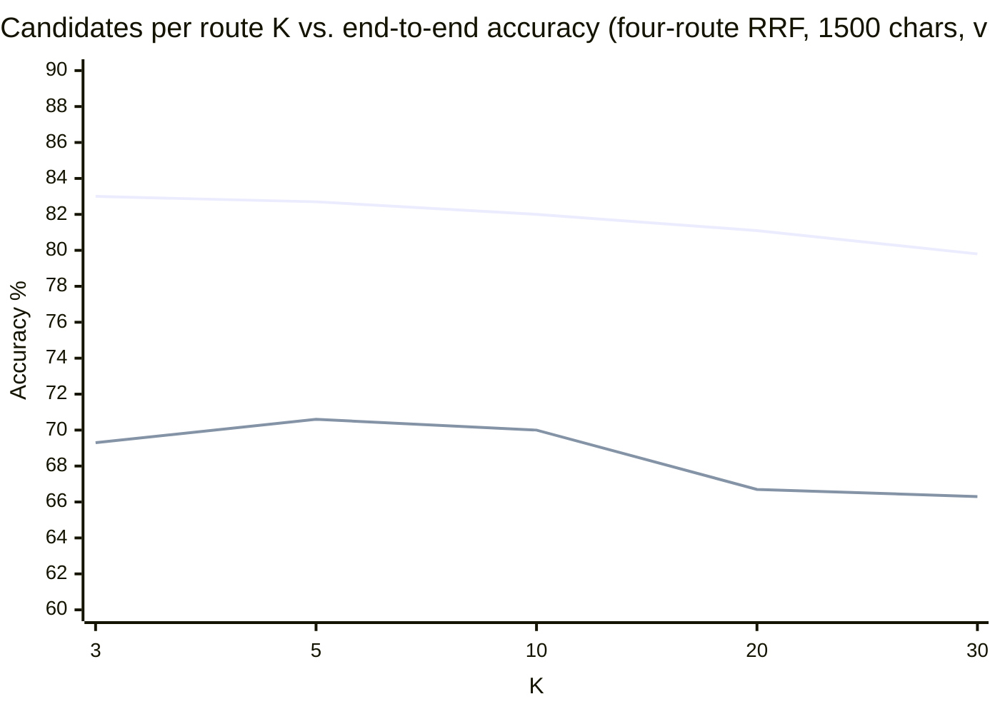

# Open Questions in Group-Chat Memory: groupmind Research Report (Overview)

[简体中文](research-report.md) | **English**

> This document presents groupmind's memory experiments from October–November 2026. It first explains the concepts used later, then goes through the experiments by research question: why each was run, what it set out to test, what it controlled, what it compared, what the data shows, how far it can be trusted, and what it means for the design.
> The original records are unchanged, and every conclusion can be traced through [Appendix A](#appendix-a-tracing-the-conclusions) (sources in Chinese): the phase-one reports [v1](../research/2026-11-memory-stage-report.md), [v2](../research/2026-11-memory-stage-report-v2.md) and [v3](../research/2026-11-memory-stage-report-v3.md), the experiment results [memory-benchmark-results.md](../memory-benchmark-results.md), the experiment ledger [memory-benchmark-ledger.md](../memory-benchmark-ledger.md), and the dated research notes under `docs/research/`.
> This document contains no real chat content. Groups are always referred to by codes, all numbers are aggregate statistics, and example conversations are fictional.

## Abstract

We wanted to know how an agent living in a Chinese QQ group as a "group member" can accurately recall what happened in the group months later.

A common role-play memory design is "chat history → summaries → a vector index of the summaries → retrieve summaries and inject them". groupmind takes another route: it keeps every raw message and has a model "color" messages into micro-context segments; summaries serve only as retrieval entry points, and what the answering model receives is always raw text. The retrieval consists of three layers of design: **coloring (how to chunk)**, **multi-route retrieval (how to search)** and **raw-text injection (what to give the model)**. This document measures their contributions separately.

Main findings on two real development groups:

| Finding | Strength of evidence |
|---|---|
| **The contribution of raw-text injection is the clearest**: with the same summary-based retrieval, changing only what the model receives from summaries to raw text raises accuracy by 17.5 and 9.8 percentage points | Consistent on both groups; giving only summaries scores 10.8–20.9 points below raw-text chunks, significant on both groups |
| **Multi-route retrieval contributes the most**: on top of color chunks, adding the summary route and the vector routes and cutting candidates per route from 30 to 5 adds 8.4 and 14.6 points in total | The step that adds the vector routes is significant on both groups |
| **Coloring as a way of chunking contributes little, and not robustly**: under the same budget, color chunks beat 10-message windows by 4.1 and 2.6 points | No interval reported on one group; not significant on the other |
| The bottleneck is finding the evidence, not using it: once it is in the context, the model answers about 93–95% correctly | Consistent on both groups |
| Counter-intuitive: the model almost never puts one message into more than one color; merging colors into long chunks makes things significantly worse | Consistent on both groups |
| The model barely understands group-specific memes, and context does not help; a meme table helps, but candidate mining loses the most | Consistent direction, small samples |
| "Human-likeness" needs a different yardstick; the impression-formation and recall-policy mechanisms run | Not validated by humans |

All findings come from the development sets. The full retrieval (the frozen version) has not been validated on an independent test set.

---

## 1. Background: why not just use "summary memory"

The long-term memory of many AI RolePlay tools is a pipeline: **chat history → summaries → a vector index of the summaries → retrieve summaries and inject them into the context**. One example that can be checked against source code is RisuAI's HypaMemory ([`hypav2.ts`](https://github.com/kwaroran/RisuAI/blob/7be37f64fce428868559963db3e966ade1808f1c/src/ts/process/memory/hypav2.ts)): when the context exceeds its limit, the oldest messages are given to a model to summarize; the summary is split and embedded; the last few messages are used to retrieve similar summary pieces; the summaries are injected into the context, and the raw messages that were summarized no longer enter it. Some tools do it differently: SillyTavern's chat vectorization indexes raw messages by default and places the original messages in the context on a match ([docs](https://docs.sillytavern.app/extensions/chat-vectorization/)). So this is a common pattern, not what every role-play system does.

In long-running group chats this pattern has three problems:

1. **Summaries lose details.** Questions are often about details: "what time was that", "which version did he recommend". These are exactly what summaries drop first.
2. **Group chat interleaves.** Several topics run at once; summarizing by time window mixes unrelated talk together and easily misremembers who said what.
3. **Evidence cannot be traced.** Summaries are written by a model and may be wrong; if answering has only the summary, there is no way to go back and check the original words, and errors become the basis of the next consolidation.

So we set out a few ideas: **keep the raw text**; **chunk by context rather than by time**; **use summaries only to help the raw text be found**. These correspond to coloring, multi-route retrieval and raw-text injection; the experiments below test whether each holds and how much it contributes.

## 2. Some concepts first

### 2.1 Coloring, colors, raw-text chunks and color summaries

A **micro-context** is a complete small context: one matter, one question and its answer, one joke. **Coloring** means having a model read a batch of messages and mark the messages that belong to the same micro-context with the same **color**. A color can skip unrelated messages in between, and in principle a message can belong to several colors.

Each color produces two things:

- **The raw-text chunk** (also called the color chunk): all the original messages in the color. Median about 170 characters and 11 messages.
- **The color summary**: one or two sentences the model writes for the color, median about 57 characters, required to keep proper nouns, person codes, numbers and slang.

A **fictional** example:

```text
21:02 A: who's up for barbecue tonight     ← color 1
21:02 B: seen episode 3 of the new show?   ← color 2
21:03 C: I'm in, what time                 ← color 1
21:03 D: yes, that ending was so abrupt    ← color 2
21:04 A: nine, usual place                 ← color 1

Color 1's raw-text chunk: the three lines marked "color 1" above
Color 1's summary:        A arranges barbecue Friday at nine at the usual place; C joins
```

The baseline is the **fixed window**: ignore context and cut a chunk every 10 (or 5) messages in time order.

### 2.2 Retrieval routes, BM25 and vectors

A **retrieval route** is one combination of "which method, over which text". The project has four:

| Route | Text searched | Method |
|---|---|---|
| Keyword · summary | Color summaries | BM25 |
| Keyword · raw | Raw-text chunks | BM25 |
| Vector · summary | Color summaries | Vector similarity |
| Vector · raw | Raw-text chunks ("pseudonym: text") | Vector similarity |

**BM25** is the classic keyword-retrieval score: the more often, and the rarer, the query's words appear in a piece of text, the higher the score. Chinese is first segmented with jieba. **Vector retrieval** turns the query and the text into vectors and ranks by semantic similarity, so it can find content phrased differently.

### 2.3 Candidate depth and RRF

Each route produces its own ranking. **Candidate depth K** is how many of each route's top results take part in the merge.

**RRF (reciprocal rank fusion)** is the method for merging several rankings: a chunk ranked r-th in a route gets 1/(60 + r), and the routes' scores are added up. It looks only at ranks and ignores the scale of each route's raw scores. For example:

```text
Chunk X: ranked 1st in only one route        → 1/61         ≈ 0.016
Chunk Y: ranked 12th in two routes           → 1/72 + 1/72  ≈ 0.028
```

Y scores higher than X. This will matter later.

### 2.4 Injection budget, evidence and evidence-inclusion rate

The **injection budget** is how much memory text is given to the answering model; in the main experiments it is 1,500 characters. The merged chunks are packed in descending score order, stopping when the next one does not fit; each message is counted only once.

**Evidence** is the few original messages, marked when the question was written, that can answer the question (median only 2). The **evidence-inclusion rate** is the share of questions whose injected content contains at least one evidence message. It measures "was it found", separately from "was it answered correctly". **Retrieval-level recall R@k** is the share of questions where one route's top k contain the evidence; retrieval only, without the answering model.

### 2.5 What counts as correct, and what counts as significant

- **End-to-end accuracy** (primary metric): correct questions ÷ all questions. An empty answer (mostly the model's safety refusal) counts as not correct.
- **Effective-answer accuracy**: correct questions ÷ questions with an answer. Refused questions may be easier or harder than average; for reference only.
- **Paired comparison**: two schemes are compared question by question on the same questions, with bootstrap 95% confidence intervals for the difference; a difference is called "significant" only if the interval excludes 0. **No correction for multiple comparisons** was applied, so comparisons that only just pass are weak evidence.
- **Temporal visibility**: each question has an asking time, and retrieval can only see colors that ended before it, so answers cannot leak.

### 2.6 The frozen version

The retrieval configuration settled on after a series of experiments is called the **frozen version**: four routes, top 5 per route, merged with RRF, raw text packed in rank order up to 1,500 characters. The bot's recall tool uses it after going live. It was revised twice after being frozen (section 8).

---

## 3. Experimental setup

### 3.1 Data

The data comes from our own QQ chat export. Groups were selected by aggregate statistics without looking at content. Before anything was sent to a model, names were replaced with pseudonyms, contact details and long numbers were masked, and messages matching high-sensitivity terms were withheld.

| | DEV-1 | DEV-2 |
|---|---:|---:|
| Messages after cleaning | 15,841 | 46,200 |
| Speakers | 104 | 81 |
| Time span | about 116 days | about 78 days |
| Sensitive messages withheld | 77 | 202 |
| Colors | 828 | 2,451 |

There are also validation groups and **frozen groups**. The frozen groups were sealed from the start — never colored or viewed — and kept for the final test; every number in this document comes from the two development groups.

### 3.2 Questions

The main experiments use **cross-week QA items**: from chat more than 7 days before the cutoff, segments of 40 messages are sampled stratified by time; a question-writing model writes 0–2 questions per segment, phrased the way a group member would casually ask and reworded where possible, listing the IDs of the evidence messages; a separate call looks only at the evidence and judges whether each question is valid. This gave 440 questions for DEV-1 and 436 for DEV-2. The median distance from the evidence to the time of asking is 97 and 73 days.

A **fictional** example:

```text
Evidence:          Mar 2, A: that hotpot place we went to on Saturdays closed — it's a barbecue place now
Question:          What happened to the hotpot place everyone used to go to?
Reference answer:  It closed and became a barbecue place
```

Each question is asked once while its answer is visible; another 150 are also asked before the answer appears, to see whether the system says "no record".

**Two known limitations of the questions**:

- **Human review covers only part of them**: the 105 questions of DEV-1's first round were reviewed by three people, who removed only 1; the other 771 were not human-reviewed.
- **The same model wrote the questions, colored the messages and wrote the summaries**: question wording may naturally sit close to the summaries, favoring "retrieval by summary".

### 3.3 Models

| Use | Model |
|---|---|
| Question writing, coloring, answering | `gemini-3.8-flash-high` |
| Judge | `gpt-6.1-sol` (a different model family from the answering model); the earliest round used a Gemini judge, with 96–98% agreement between the two |
| Embeddings | `qwen3.7-text-embedding-flash` (V0, V2); `qwen3.7-text-embedding` (M1) |
| Labeling recall samples | `deepseek-chat` |
| Impression formation | `gemini-3.8-flash-high` |
| Compaction and session experiments | `deepseek-flash` |

226 human-checked judgments agreed with the judge 99.6% of the time.

### 3.4 Configuration versions

The experiments span several configuration changes. **Only results under the same versions can be compared directly**; each experiment states which versions it used.

| Dimension | Version | Meaning |
|---|---|---|
| Vectors | V0 | Queries and documents not distinguished; no retrieval instruction on queries (the original implementation) |
| | V2 | Queries and documents distinguished, retrieval instruction on queries (the frozen version from D-029) |
| | M1 | V2's configuration with a larger embedding model (candidate, not adopted) |
| Coloring post-processing | A | Original coloring |
| | B | De-duplication of the batch-overlap region without changing chunk boundaries (the frozen version from D-032) |
| Scoring | v1 | Visible questions only; empty answers count as wrong |
| | v3 | Three states (correct/wrong/empty); same end-to-end numbers as v1, plus effective-answer accuracy |
| | v2 | Drops questions refused under any scheme (sensitivity analysis only) |

---

## 4. How much each layer of the design contributes

This section answers the question most easily misread: the frozen version is much better than fixed windows — **which layer does the gain come from?**

### 4.1 From windows to the frozen version, one step at a time

Each step in the path below changes only one thing. Conditions throughout: vectors V0, coloring A, a 1,500-character budget, scoring v1; DEV-1 / DEV-2 end-to-end accuracy (%):

| Step | Scheme | DEV-1 | DEV-2 | Change at this step | Paired comparison |
|---|---|---:|---:|---|---|
| 0 | BM25 over 10-message windows | 70.2 | 53.4 | — | — |
| 1 | BM25 over **colored raw-text chunks** | 74.3 | 56.0 | +4.1 / +2.6 | DEV-1: no interval in the original record; DEV-2: +2.5 (−2.2, +7.5) under v2 scoring, not significant |
| 2 | Add a **BM25 summary route**, merged with RRF (30 per route) | 75.2 | 60.3 | +0.9 / +4.4 | DEV-1 not significant; DEV-2 significant under v1 (+0.2, +8.5), not significant under v2 |
| 3 | Add **the two vector routes** (four routes, 30 per route) | 79.8 | 66.3 | +4.5 / +6.0 | **Significant on both groups** |
| 4 | **Only 5 per route** | 82.7 | 70.6 | +2.9 / +4.3 | On DEV-2, 30 per route is significantly worse than 10 per route |

**How to read this table**:

- **Coloring as a way of chunking** (step 1) brings the smallest gain, and not a robust one. Its advantage is larger on questions with low lexical overlap (reworded questions; section 6.1).
- **Multi-route retrieval** (steps 2–4) contributes most of the gain: from 74.3 / 56.0 to 82.7 / 70.6, +8.4 / +14.6 in total. The most certain step is adding the vector routes.
- Note that **the summary route is itself a by-product of coloring**. Without coloring there would be no color summaries to search. So part of the "multi-route retrieval" gain should be credited to coloring as the provider of "a second retrieval entry point", not to coloring as a way of chunking.

### 4.2 How much raw-text injection contributes on its own

Raw-text injection and retrieval are different things. To isolate it, keep the retrieval fixed and change only what the model receives:

| Scheme | How it searches | What the model receives | DEV-1 | DEV-2 |
|---|---|---|---:|---:|
| B | BM25 over summaries | **Summaries** | 53.4 | 45.2 |
| C | BM25 over summaries (same) | **Raw-text chunks** | 70.9 | 55.0 |

With identical retrieval, changing only the injected content from summaries to raw text raises accuracy by 17.5 and 9.8 percentage points (the original record does not give a paired interval for this particular pair; but "summaries only" is 20.9 and 10.8 points below "BM25 over raw text, give raw text", significant on both groups). This is the layer with the clearest evidence.

### 4.3 Summary

| Design | Evidence | Conclusion |
|---|---|---|
| Raw-text injection | Consistent direction, large effect, related comparisons significant | Holds; became a premise of every later scheme |
| Multi-route retrieval with shallow candidates | Adding the vector routes significant on both groups; overly deep candidates significantly worse | Holds; the largest contribution |
| Coloring as a way of chunking | Small gain, not significant on one group | Weak evidence; its other role is to provide the summary route |

The following sections go through the experiments for each layer.

---

## 5. RQ1: Raw text or summaries for the model?

**Why.** Summaries are short, so more events fit in the same budget; raw text is long but loses no detail. Many memory systems store summaries by default, and we wanted to know how much that costs for group-chat QA.

**Hypothesis.** Since the questions ask about details, giving only summaries will be significantly worse; retrieving by summary and then giving raw text can get the best of both.

**Conditions.** Fixed: BM25, coloring A, no vectors, 1,500 characters, the same answering model and judge. Varied: what is searched and what the model receives.

| Scheme | Search | Model receives | DEV-1 | DEV-2 |
|---|---|---|---:|---:|
| A | Raw-text chunks | Raw text | 74.3 | 56.0 |
| B | Summaries | Summaries | 53.4 | 45.2 |
| C | Summaries | Raw text | 70.9 | 55.0 |

**Result.** B is 20.9 and 10.8 points below A, significant on both groups. Interestingly, B's evidence-inclusion rate is not low (the summary of the color containing the evidence was found), but the summary lacks the details needed to answer. C is close to A: summaries work as a retrieval entry point. Under the "let a cheap model filter candidates, no character limit" setting, the conclusion is the same.

**Can it be trusted?** Question wording may favor summaries (section 3.2), yet giving only summaries was still worst, which makes the conclusion more credible. It also matches the direction of an existing controlled experiment: chunks that keep the raw text beat storing only extracted results [5].

**Effect on the design.** Summaries serve only as retrieval entry points; answering always uses raw text.

## 6. RQ2: Is coloring better than fixed windows? Does the model really assign multiple colors?

### 6.1 How well it works as a way of chunking

**Why.** Coloring costs money (one model call per 150 messages). If it is no better than fixed windows, it isn't needed.

**Hypothesis.** Under the same budget, chunking by color gets the evidence in more often than fixed windows, with a larger advantage on reworded questions.

**First-round retrieval-level experiment** (106 early DEV-1 questions, BM25 only, whether the top 10 contain the evidence):

| Scheme | R@10 | vs. "10-message window" | 40 questions with low lexical overlap |
|---|---:|---|---|
| Search colored raw-text chunks | 81.1 | +8.5 (+1.9, +15.1), significant | +17.5 (+2.5, +32.5), significant |
| Search color summaries | 76.4 | +3.8 (−5.7, +13.2) | +22.5 (+2.5, +42.5), significant |
| Single messages | 57.5 | −15.1, significant | −15.0, significant |

But there is a trap here: a color chunk averages 15.6 messages, more than a 10-message window, so "the top 10" naturally covers more messages. When the budget is instead controlled by "how many messages were read", color chunks only catch up with windows at 100 messages and fall behind at small budgets.

**QA level** (section 4, step 1): at the same 1,500 characters, color chunks beat 10-message windows by 4.1 and 2.6 points; not significant on DEV-2.

**Conclusion.** The advantage of coloring as a way of chunking is not robust: it helps on reworded questions, but overall it did not beat windows significantly on both groups.

### 6.2 A counter-intuitive finding: the model barely assigns multiple colors

The design allows a message to belong to several colors, and the first statistics showed about 13% of covered messages belonging to more than one. A batch-by-batch check found **almost no multi-color messages within a batch** (only 3 and 30 in the two groups). That 13% came almost entirely from the 20 messages of overlap between adjacent batches being colored once by each batch.

In other words, the model was effectively doing **near-single-label local segmentation**; the "multiple colors" design was never really realized.

### 6.3 A counter-intuitive finding: merging colors into long chunks makes things worse

Since the overlap region produced two similar colors, a natural idea is to merge them. We compared several treatments (vectors V2, four routes, top 5 per route, 1,500 characters):

| Treatment | What it does | Evidence-inclusion rate (vs. original) |
|---|---|---|
| Merging (merged-v1) | Merge matching colors from adjacent batches into one, possibly across many batches | **−5.9 / −7.3, significant on both groups** |
| De-duplication (dedup-v1) | Keep overlap-region messages only in the earlier batch's color | −0.9 / −0.9, not significant; QA level −0.7 / −1.1, not significant |
| B | De-duplicate only for indexing and ranking; inject the original chunks | −0.5 / −0.5, not significant; QA level −1.4 / −0.2, not significant |
| C | B plus a layer of "global topics" | +0.2 / −1.4, not significant |

After merging, the longest color spanned 8 batches (one color ran to 379 messages), and a single long chunk could fill the whole 1,500-character budget. **Retrieval quality depends on local segment structure, not on bigger chunks.**

**Effect on the design.** The frozen version adopts B (D-032): it did not improve accuracy, and was kept because it removes duplicates without changing chunk boundaries. The real structural problems (the model does not assign multiple colors on its own, and colors cannot continue across batches) need to be solved at the coloring stage, for example by carrying a batch's unfinished colors into the next batch; that requires re-coloring and has not been done.

## 7. RQ3: What do keywords and vectors each contribute?

**Why.** Chinese group chat has short sentences and much slang, which may hurt vectors; but keywords cannot find reworded questions. We wanted to know whether the two complement each other.

This question is answered in three steps. **The three steps use different conditions and must not be compared with each other.**

### 7.1 The first conclusion: vectors are worse than BM25

Under vectors V0, coloring A and 1,500 characters, a single vector route (over raw-text chunks) scored 73.2 / 57.8 end to end, against 74.3 / 56.0 for a single BM25 route; on every route and at every candidate depth, vector evidence recall was below the corresponding BM25 route.

### 7.2 Ablation: the problem was configuration

A later audit found that the vector calls did not match the design: queries and documents were not distinguished, and queries carried no retrieval instruction; the Qwen3 Embedding paper [7] explicitly uses an "instruction + query" input. This step **looks only at retrieval, without the answering model**; the two keyword routes, four routes, top 5 per route, 1,500 characters and coloring A are fixed, and only the vector call configuration and model change:

| Vector configuration | DEV-1 raw-text route R@5 | DEV-2 raw-text route R@5 | Frozen version's evidence-inclusion rate (vs. V0) |
|---|---:|---:|---|
| V0 | 73.0 | 49.8 | — |
| V2 | 80.7 | 63.5 | +1.1 / +1.4 |
| M1 | 84.5 | 67.2 | +2.3 / +3.4 |
| Reference: BM25 raw-text route | 80.7 | 59.4 | |

With the correct configuration, the vector raw-text route matched (DEV-1) or exceeded (DEV-2) BM25, with the largest gains on questions with low lexical overlap. Two side findings: removing pseudonyms made the raw-text route significantly worse, which suggests "who said it" is itself a useful retrieval signal; prepending the summary to the raw text made things worse.

But only a small part of the recall gain reached the context: vector-route R@5 rose by 6–17 points, while the evidence-inclusion rate after fusion rose by only 1–3 points, because the keyword routes had already found most of the evidence.

### 7.3 QA level: how much becomes accuracy?

Four routes, top 5 per route, 1,500 characters and coloring A fixed; only the vectors change:

| Comparison | DEV-1 end to end | DEV-2 end to end |
|---|---|---|
| V2 − V0 | **+2.7 (+0.5, +5.2)** | +0.7 (−2.3, +3.4) |
| M1 − V0 | +2.0 (−0.9, +4.8) | +2.8 (−0.2, +6.0) |
| M1 − V2 | −0.7 (−3.4, +2.0) | +2.1 (−0.7, +4.8) |

A sign test over both groups combined: V2 vs. V0 p≈0.10, M1 vs. V0 p≈0.03. Question by question, nearly every question whose evidence newly got in became correct, but such questions are only 2–3% of the total; questions where "both sides have the evidence" also show symmetric random fluctuation, and part of V2's significant gain on DEV-1 comes from that fluctuation, so it cannot all be credited to recall.

**Effect on the design.** The frozen version switched to V2 (D-029): same model, zero extra cost. M1 is a candidate to be decided after validation on the test set.

## 8. RQ4: How to fuse routes, how deep to go, and how to pack the budget?

### 8.1 Candidate depth: is more always better?

**Hypothesis.** The more candidates per route, the higher the recall and the higher the accuracy.

**Conditions.** Four routes, RRF, strict packing into 1,500 characters, vectors V0 and coloring A fixed; only the candidates per route, K, change.



**The result contradicts the hypothesis.** Going from K=10 to 20 and 30 was significantly worse on DEV-2 (K20−K10 −3.2, K30−K10 −3.7). The share of questions whose "evidence is among the candidates but was not packed into the budget" rises steadily with K: from 4.1% to 10.7% on DEV-1, and from 6.7% to 22.7% on DEV-2.

**The reason** is the example in section 2.3: the larger K is, the more chunks that "rank mediocre in several routes" there are, and their accumulated RRF scores overtake chunks that rank first in only one route, pushing the key evidence out of the budget.

**Can it be trusted?** The differences between 3, 5 and 10 per route are not significant; 5 was chosen because it ranked first or near first on both groups and had the highest evidence-inclusion rate, and it was picked on the same set of questions. Retested with vectors V2, top 5 per route was still best on both groups (its difference from K10 not significant).

### 8.2 Packing into the budget

| Packing method (four routes) | vs. "pack strictly in RRF rank order" |
|---|---|
| Take from the routes in turn | +0.7 / −0.7, not significant |
| Reserve a fixed number of characters per route | −23.9 / −17.9, significantly worse |
| Discount RRF scores by "newly added characters" | −10.7 / −12.2, significantly worse |

The large drops for the last two are **mainly implementation defects**, not evidence against the idea of "guaranteed slots per route": among questions the strict method answered correctly and these got wrong, the vast majority were cases where the long chunk containing the evidence was discarded. Another guaranteed-slot implementation (2–3 chunks per route first, then filled up by RRF) did not have this problem, but did not beat the gain from reducing candidate depth either.

### 8.3 The frozen version's lineage

| Version | What changed | DEV-1 | DEV-2 |
|---|---|---:|---:|
| 10-message window baseline | Same 1,500 characters | 70.2 | 53.4 |
| ① Initial (D-028) | Four routes, top 5 per route, vectors V0, coloring A | 82.7 | 70.6 |
| ② ① + vectors V2 (D-029) | Only the vector call configuration | 85.5 | 71.3 |
| ③ ② + coloring B (D-032, current) | Only how the overlap region is indexed | 84.1 | 71.1 |

① vs. the window baseline: +12.5, +17.2, significant on both groups; ② vs. ① significant only on DEV-1 (+2.7); ③ vs. ② not significant on either.

## 9. RQ5: Where do the remaining errors come from?

**Once the evidence is in, the model uses it well.** Under the initial frozen version, the model answered 92.9% (DEV-1) and 94.6% (DEV-2) of questions correctly when the evidence entered the context. Of the 28 such questions DEV-1 got wrong, 10 were empty answers.

**The main loss is evidence that did not get in.** On DEV-2, 28% of questions had no evidence in the context. Part of this is "among the candidates but squeezed out by the budget" (DEV-1 5.5%, DEV-2 7.6%); the rest was not in any route's top 5. So the next thing to improve is recall, not answering.

**For the few questions answered wrongly even though the evidence was present**, the evidence chunks were on average further back, with more distracting text before them. This points the same way as the finding that performance drops when relevant information is in the middle of a long context [6], but our injection is only about 1.3k characters — very different conditions — and no causal test was done.

Three further checks:

- **Can retrieval scores decide "don't recall"?** Comparing the top BM25 score for the same query with the answer visible and not visible gives a discriminative power of only AUC 0.55–0.61, close to chance. Whether to recall should be left to the model.
- **Is filtering with a cheap model worth it?** On the 106 early questions, the injected messages dropped from 71 to 11 on average, with an accuracy difference of −1.9 (−8.5, +4.7), not significant.
- **Safety refusals.** About 2.2% of the answering model's calls returned empty; the empty-answer rate per scheme ranged from 0.2% to 3.4%, and the more numerous and mixed the injected content, the more likely it was. So the primary metric counts empty answers as not correct; after dropping questions refused under any scheme (scoring v2), the direction of the conclusions is unchanged, and only a few comparisons that just passed became non-significant.

## 10. RQ6: Does the model understand the group's memes?

### 10.1 How much does the model know without memory?

**Why.** If the model already understands the group's memes, a meme table is unnecessary.

**Setup.** 71 words whose meanings were confirmed by two rounds of human labeling, split into a general layer (56) and a group layer (15); the answering model has no memory at all, and the judge scores "right / wrong / don't know".

| Condition | General layer | Group layer |
|---|---:|---:|
| Word only | 48.2% | 26.7% |
| Word + a chat snippet using it (3 messages) | 64.7% | 26.7% |

Context significantly helps the general layer (+17.6, 95% CI +3.9 to +31.4; small sample). The group layer has only 15 words; 4 were answered correctly, unchanged with context, and the share of "don't know" answers rose from 47% to 60%: one chat snippet is not enough to infer a group-specific meaning. The model answers "don't know" about 30% of the time, and when it does explain it is mostly right, so "don't know" can serve as a signal to consult the meme table or search the web.

### 10.2 Does a meme table help?

**Setup.** DEV-1; the table is built only from messages in the first 70% of the time span and tested on the last 30%; 85 questions, 40 words, and the words were not human-confirmed.

| Test | No memory | Raw-text retrieval | Meme table |
|---|---:|---:|---:|
| Free fill-in, recalling by context only | 10.6% | 10.6% | 15.3–17.6% (two ways of building the table, both significant) |
| Four-way multiple choice (all options are table words) | 64.7% | — | 78.8% (look up the entry), 80.0% (5 historical example sentences) |

When looking for relevant history by context alone, raw-text retrieval almost never finds the target word (only 2–5% of results contain it). The meme table finds some, but its recall is still very low.

### 10.3 Where are candidates lost?

One annotator labeled 33 entries from the machine-built meme table: 23 correct (69.7%), 6 partly correct, 4 incorrect. By type: 26 general internet terms, 4 catchphrases, 3 nicknames, and **0 group-specific memes**. A sample of discarded candidates showed that the **evidence threshold** (at least 5 occurrences, 3 people, 2 days) is the main leak: among 15 sampled candidates that failed the threshold, two-thirds were real terms, and a third of those were group memes (only 15 samples; this is an inference).

**Effect on the design.** The meme table has two layers (D-033), updates go through "candidates + human confirmation + rebuilt snapshot" (D-039), and the next step is to relax or rewrite the evidence threshold. Among related open-source implementations, MaiBot's slang learning [9] decides whether a word is slang by checking whether "the meaning inferred from context" agrees with "the meaning inferred from the word alone"; none of the projects we surveyed goes beyond "storing an explanation", and none measures whether the bot has really "learned" the term.

## 11. RQ7: How should people be identified?

- In DEV-1, 27 of 104 people changed their name; merging by name would split them into 40 extra identities. Since no two people share a name, "finding people by name" scores 100%, so that metric has no discriminative power.
- Human annotation identified 11 people across 18 accounts; 6 people each had 2–3 accounts **with overlapping activity**, not switched accounts.
- Of the 9 nicknames labeled, 3 never appear in this group's record at all; they come from other groups or from outside.

**Effect on the design.** People are tracked by stable account, with support for several accounts per person; the people table is shared across groups.

## 12. RQ8: How can memory be made "human-like"?

The research above uses QA accuracy as its yardstick. But "being like a group member" has another side: people do not remember chats from months ago in perfect detail. This part **switches yardsticks**; all results so far only show that the mechanisms are feasible and **have not been validated by humans**.

### 12.1 From mechanisms to behavior

Mechanistic research from cognitive science (complementary learning systems [10], emotional modulation of consolidation [11], event segmentation [12, 13]) gives no behavioral numbers to tune against. Existing "human-like memory" systems [14, 15] all use hand-set decay constants, and none has had humans judge "how human-like" they are; the only one with serious human evaluation, MADial-Bench [16], shows that human-likeness can only be judged by people. Another study [17] found that models do not forget what is in their context and show no serial-position effect, so human-likeness cannot be expected to come from the model itself.

Behavioral data on how people recall conversations gives a more concrete target: 20 minutes after a three-person conversation, people can recall only 12–30% of it, but about 96% of what they recall is correct, and about 96% of the attributions of who said it are correct [18]. So "human-like" is mainly about **low coverage, the gist, and appropriately hedged wording**, not about misremembering. Another study warns that memory consolidation can turn hedged statements into confident facts [19], so the original uncertain wording should be kept in storage.

### 12.2 How group members themselves recall

**Setup.** In the two development groups, messages containing recall markers (such as 记得 "remember", 上次 "last time", 来着 "what was it again") were found by regular expressions and labeled by `deepseek-chat` with their surrounding context; **the labels were not checked by humans**.

- Recalls of in-group conversation are only 14–20%; most recalls are about experiences outside the group; only 126 usable samples across both groups.
- Only 2–3% quote the original words; about 60% give the gist and about 30% only mention that something happened; about 20% use uncertain wording.
- "Which original message does this recall refer to" is not reliable: the same 42 recalls were judged once by each of two models; 24 were matched to an original message by at least one model, and the two models pointed to the same line for only 4.
- Quote-replies are not recall: across both groups, 10,792 quote-replies have a median gap of about half a minute to the quoted message, 99% within 4.5 hours, and only 6 quote a message more than a day old.

Based on this we wrote a **recall-policy layer v0**: without calling a model, it uses "who said it, how long ago, whether it was a joke, whether it was brought up again later" to decide, for each piece of evidence, whether to give the original words, the gist, only that it happened, or nothing. In a dry run, the memory text given to the answering model dropped from about 1,280 characters to 210–540. **No answers have been generated with it, and there has been no blind evaluation.**

### 12.3 Impression formation

We dropped "fading by time elapsed" and instead have the model form impressions of events (D-044).

**Setup.** The chat is cut by day and read by the model in chronological order; for each segment the model knows only what came before and its own sense of "what this group is usually like"; it outputs the events in this segment that would leave an impression, their depth (deep / medium / shallow), the reason and the gist, and for deep impressions one or two original sentences. Time itself is not an input. Only the development groups were used.

- **"Most of it drifts by like passing clouds" did emerge**: messages that left an impression were 12–16% of the total, more than half of the days left nothing, and the number of impressions per month did not decline over time.
- **Whether "some sentence is remembered vividly" depends on one sentence in the prompt**: with "deep ones are rare; don't exaggerate", DEV-1 had 0 deep impressions in five months; without it, there were 6, with 11 sentences remembered verbatim. The threshold is set by wording, and there is currently no basis for saying which is more human-like.
- **The gist is too short**: each event's gist is limited to 40 characters, while an event's median length is 45–51 messages; asked the benchmark questions, it mostly answered "I don't remember" or "only roughly". The benchmark questions were written to probe details and are a rather harsh test for impression-based memory.
- Compared with what group members themselves later brought up, no relationship was visible (only about 30 samples per group, and the correspondences were not checked).
- **Whether the model's impressions match a human's has not been tested at all**; the blind-evaluation page is ready, but the evaluation has not been completed.

This part is close in spirit to Generative Agents' [20] "recency × importance × relevance" and EM-LLM's [21] "segmenting events by surprise", but it has no time decay; impressions form "at the moment of reading".

## 13. Engineering experiments: usability checks

These experiments use synthetic data and run each approach once; they answer "does it work", not "how well".

| Question | Setup | Result |
|---|---|---|
| Can the persona-bearing model write its own compaction summary? | Synthetic three-person group chat, `deepseek-flash`, dsh 0.2.1-rc.4, a small window to force compaction | Yes. 93–97% of the summary request's input hit the cache; follow-up questions after compaction answered 2/2 and 3/3. Both the persona and built-in versions described "the message just replied to" as "not yet replied to" |
| A new session each day, or one long session? | Three simulated days, the same small window | The long session made 34 calls vs. 44, with about half the uncached input, and answered directly from its summary on day three; cost is driven by the compaction threshold |
| Does memory keep growing with consecutive handoffs? | One turn of about 400,000 characters of synthetic text, then 30 consecutive handoffs | Closing retired sessions left 1 live session (31 without closing); resident memory 262 MB vs. 290 MB |

## 14. External reference points

- **Reproducing a public benchmark**: on GroupMemBench's [3] Technology subset (213 questions), per-message BM25 scored 44.6% overall (95% CI 38.5–51.2), against 46.0% reported in the paper. Used to confirm the evaluation framework is broadly sound, not to compare schemes.
- **How public benchmarks differ**: LoCoMo [1] and LongMemEval [2] are mostly two-party dialogues; GroupMemBench and SocialMemBench [4] are synthetic English group chats; none include the short messages, slang, nickname changes and interleaving of Chinese group chats.
- **Related findings**: a recent study points out that naive raw-text retrieval often matches complex memory systems on several memory benchmarks [22]. Our results point the same way (raw text and simple fusion work best), but we did not compare directly with memory frameworks such as Mem0 [23] or MemGPT [24] on the same data.

## 15. Limitations and next steps

**Limitations**

- Only two development groups; the questions are model-generated and mostly not human-reviewed; parameters were chosen on the development sets; the frozen version has not been validated on an independent test set.
- The same model wrote the questions, the coloring and the summaries; the judge is also a model.
- No correction for multiple comparisons; several comparisons only just pass the significance threshold. In the step-by-step comparison of section 4, two steps have no paired interval in the original records.
- Coloring used one model and one prompt; other segmentation methods (such as predicting reply relations first and then clustering) were not compared.
- None of the "human-like" work has had human blind evaluation.

**Next steps**

- A final test on the frozen groups (testing M1 at the same time).
- Improve coloring: let colors continue across batches and encourage multiple colors, then evaluate with the retrieval-level experiments here.
- Relax or rewrite the meme table's evidence threshold, and check it against the existing human annotations.
- Deciding "whether to recall at all", using the last few chat messages as the query, and proactive mentions.
- Human blind evaluation of impressions and the recall-policy layer; interference tests (whether irrelevant memories get forced into the conversation) and cross-group leakage tests.

---

## Appendix A: Tracing the conclusions

| Conclusion | Original record (in Chinese) |
|---|---|
| Setup, question construction, human review, cost | [Phase-one report v1](../research/2026-11-memory-stage-report.md), sections 2, 4, 5 |
| Step-by-step contributions (section 4), raw text vs. summaries (RQ1) | Report v1 sections 5.1 and 6; [v2](../research/2026-11-memory-stage-report-v2.md) section 5.2; [results document](../memory-benchmark-results.md), "主实验" (main experiment) |
| Coloring vs. windows (RQ2) | Results document, "Q2：跨周问题" (cross-week questions) |
| Multi-color comes almost entirely from batch overlap; merging, de-duplication, layering (RQ2) | Results document, "更正", "上色修正", "重叠重复与分层", "B 问答层补测" |
| Keywords and vectors, vector ablation (RQ3) | Report v1 section 7; results document, "向量配置消融", "更好的向量能否变成准确率" |
| Fusion, candidate depth, packing (RQ4) | Report v1 section 8; results document, "打包与保底", "候选深度 K", "候选深度 K 的 V2 补测" |
| Scoring | [Report v3](../research/2026-11-memory-stage-report-v3.md); v2 (sensitivity analysis) |
| Error analysis (RQ5) | Report v1 section 9; results document, "Q3" |
| Memes (RQ6) | Results document, "Q9：梗", "梗表与人物：第一轮人工打标", "梗基线" |
| People (RQ7) | Results document, "Q5：身份", "梗表与人物：第一轮人工打标" |
| Human-likeness (RQ8) | [Directions survey](../research/2026-11-humanlike-memory-directions.md), [recall pilot](../research/2026-11-recall-pilot.md), [impression formation](../research/2026-11-impression-formation.md), [cognitive notes](../research/2026-11-cognitive-memory-notes.md) |
| Engineering experiments | [Compaction and session lifetime](../research/2026-11-persona-compaction-and-session-lifetime.md), [handoff report v2](../research/2026-11-session-handoff-report-v2.md) |
| Conditions and usage of each experiment | [Experiment ledger](../memory-benchmark-ledger.md) |

## References

All of the references below are cited in the project's research documents (RisuAI and SillyTavern in the background section are comparisons added by this document; their links are in the text). The project documents mark how thoroughly each source was checked (full text, abstract, or search-result summary). Where a source was marked "abstract", this document cites only the direction of its findings and did not check its specific numbers.

**Memory benchmarks**

1. Maharana, A. et al. *Evaluating Very Long-Term Conversational Memory of LLM Agents* (LoCoMo). ACL 2024.
2. Wu, D., Wang, H., Yu, W., Zhang, Y., Chang, K.-W., Yu, D. *LongMemEval: Benchmarking Chat Assistants on Long-Term Interactive Memory.* ICLR 2025. arXiv:2410.10813.
3. Yang, J., Lai, K.-H., Wang, X., Chang, S., Harari, Y., Gabrilovich, E. *GroupMemBench: Benchmarking LLM Agent Memory in Multi-Party Conversations.* arXiv:2605.14498, 2026.
4. Owolabi, O. *SocialMemBench: Are AI Memory Systems Ready for Social Group Settings?* arXiv:2605.17789, 2026.
- Li, Y. et al. *Locomo-Plus: Beyond-Factual Cognitive Memory Evaluation Framework for LLM Agents.* arXiv:2602.10715, 2026. (We borrowed its method of filtering out lexically similar distractors.)

**Retrieval and long context**

5. An, T. *Fidelity Before Structure: Verbatim Chunks Beat Lossy Artifact Extraction in Long-Conversation LLM Memory.* arXiv:2601.00821, 2026.
6. Liu, N. F. et al. *Lost in the Middle: How Language Models Use Long Contexts.* TACL, 2024. arXiv:2307.03172.
7. Zhang, Y. et al. *Qwen3 Embedding: Advancing Text Embedding and Reranking Through Foundation Models.* arXiv:2506.05176, 2025.
8. Cormack, G. V., Clarke, C. L. A., Büttcher, S. *Reciprocal Rank Fusion Outperforms Condorcet and Individual Rank Learning Methods.* SIGIR 2009.

**Group-chat bots and knowledge acquisition**

9. MaiBot (slang learning and the A_Memorix memory module). https://github.com/MaiM-with-u/MaiBot

**Cognitive science**

10. Kumaran, D., Hassabis, D., McClelland, J. L. *What Learning Systems do Intelligent Agents Need? Complementary Learning Systems Theory Updated.* Trends in Cognitive Sciences 20(7), 512–534, 2016. doi:10.1016/j.tics.2016.05.004
11. McGaugh, J. L. *The amygdala modulates the consolidation of memories of emotionally arousing experiences.* Annual Review of Neuroscience 27, 1–28, 2004. doi:10.1146/annurev.neuro.27.070203.144157
12. Zacks, J. M. et al. Work on event segmentation, 2007.
13. Baldassano, C. et al. *Discovering Event Structure in Continuous Narrative Perception and Memory.* Neuron, 2017.
- Also consulted: Conway & Pleydell-Pearce (2000), self-memory system model of autobiographical memory; Talarico & Rubin (2003), flashbulb memories; Tse et al. (2007), schemas and rapid consolidation; Bjork & Bjork, reviews on forgetting and retrieval.

**Human-like memory and conversational recall**

14. Hou, Y., Tamoto, H., Miyashita, H. *"My agent understands me better": Integrating Dynamic Human-like Memory Recall and Consolidation in LLM-Based Agents.* CHI EA '24. arXiv:2404.00573.
15. Kerestecioglu et al. *Human-Inspired Memory Architecture for LLM Agents.* arXiv:2605.08538, 2026.
16. *MADial-Bench.* NAACL 2025. arXiv:2409.15240.
17. *Analyzing Memory Effects in Large Language Models through the Lens of Cognitive Psychology.* arXiv:2509.17138.
18. Brown-Schmidt, Jaeger, Lord & Benjamin. *Remembering conversation in group settings.* Memory & Cognition, 2024.
19. Kwon, A. *Manufactured Confidence: How Memory Consolidation Turns Hearsay into Confident Facts.* arXiv:2606.29279, 2026.
- Also consulted: *Forgetful but Faithful* (arXiv:2512.12856); Zhong et al., *Random Tree Model of Meaningful Memory* (arXiv:2412.01806); Bietti & Mayor (2023), *A longitudinal study of conversational remembering in WhatsApp group messages*, Memory, Mind & Media 2, e5; Chen, Molina, Liao & Cho (2026), *AI Never Forgets*, CHI '26; Tsfasman et al. (2024), the MeMo corpus (arXiv:2409.13715).

**Agent memory systems**

20. Park, J. S. et al. *Generative Agents: Interactive Simulacra of Human Behavior.* UIST 2023. arXiv:2304.03442.
21. Fountas, Z. et al. *Human-like Episodic Memory for Infinite Context LLMs* (EM-LLM). ICLR 2025. arXiv:2407.09450.
22. Bao et al. *Is Complex Agentic Memory Always Needed? Naive RAG Is Stronger Than We Thought.* arXiv:2610.30755, 2026.
23. Chhikara, P. et al. *Mem0: Building Production-Ready AI Agents with Scalable Long-Term Memory.* arXiv:2504.19413, 2025.
24. Packer, C. et al. *MemGPT: Towards LLMs as Operating Systems.* arXiv:2310.08560, 2023.

**Engineering references on session compaction**: the context-compaction documentation of OpenClaw, Hermes Agent, NanoClaw and AstrBot; see [compaction-in-other-bots.md](../research/2026-11-compaction-in-other-bots.md) (in Chinese).
