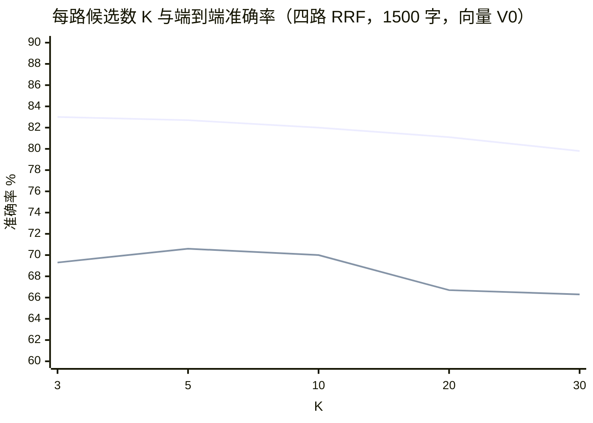

# 群聊记忆的几个问题：groupmind 研究报告（概览）

**简体中文** | [English](research-report.en.md)

> 本文介绍 groupmind 在 2026 年 10–11 月做的记忆实验。它先解释后面要用到的概念，再按研究问题讲每组实验：为什么做、想检验什么、控制了什么、比较了什么、数据说明了什么、能信到什么程度、对设计有什么影响。
> 原始记录保持不变，每个结论都能在 [附录 A](#附录-a结论溯源) 里找到出处：第一阶段报告 [v1](../research/2026-11-memory-stage-report.md)、[v2](../research/2026-11-memory-stage-report-v2.md)、[v3](../research/2026-11-memory-stage-report-v3.md)，实验结果 [memory-benchmark-results.md](../memory-benchmark-results.md)，实验台账 [memory-benchmark-ledger.md](../memory-benchmark-ledger.md)，以及 `docs/research/` 下按日期的研究笔记。
> 本文不含真实聊天内容。群一律用代号，数字都是汇总统计，举例用的对话都是虚构的。

## 摘要

我们想知道：一个以「群友」身份待在中文 QQ 群里的 Agent，怎样才能在几个月后准确地想起群里发生过的事。

常见的角色扮演记忆是「历史对话 → 摘要 → 摘要的向量索引 → 检索摘要并注入」。groupmind 换了一条路：保留全部原始消息，由模型把消息「上色」成微语境片段；摘要只当检索入口，交给回答模型的始终是原文。整套检索由三层设计组成：**上色（怎样分块）**、**多路检索（怎样找）**、**原文注入（交给模型什么）**。本文分别衡量它们的贡献。

在两个真实开发群上的主要发现：

| 发现 | 证据强度 |
|---|---|
| **原文注入的贡献最清楚**：同样按摘要检索，只把交给模型的内容从摘要换成原文，准确率高 17.5 和 9.8 个百分点 | 两个群方向一致；只给摘要比给原文块低 10.8–20.9 个百分点，两个群都显著 |
| **多路检索的贡献最大**：在颜色块的基础上加上摘要路和向量路、并把每路候选从 30 个缩到 5 个，累计提高 8.4 和 14.6 个百分点 | 其中加入向量路的一步两个群都显著 |
| **上色作为分块方式的贡献较小、也不稳固**：同预算下颜色块比 10 条窗口高 4.1 和 2.6 个百分点 | 一个群没有给出区间，另一个群不显著 |
| 瓶颈在找到证据，不在用好证据：证据进入上下文后，模型答对约 93–95% | 两个群一致 |
| 反直觉：模型几乎不给一条消息上多个颜色；把颜色合并成长块反而显著变差 | 两个群一致 |
| 模型对本群的梗基本不懂，给语境也没用；梗表有效，但候选挖掘漏得最多 | 方向一致，样本小 |
| 「像人」需要另一把尺子；印象形成和回忆策略层的机制能跑通 | 未经人工验证 |

所有结论都来自开发集。整套检索（冻结版）还没有在独立的测试集上验证。

---

## 1. 背景：为什么不直接用「摘要记忆」

许多 AI RolePlay 工具的长期记忆是这样一条流水线：**历史对话 → 摘要 → 摘要的向量索引 → 检索摘要并注入上下文**。一个可以对照源码核实的例子是 RisuAI 的 HypaMemory（[`hypav2.ts`](https://github.com/kwaroran/RisuAI/blob/7be37f64fce428868559963db3e966ade1808f1c/src/ts/process/memory/hypav2.ts)）：上下文超限时把最早的消息交给模型总结，摘要切段后计算向量，用最近几条消息检索相似的摘要片段，再把摘要注入上下文，被总结过的原始消息不再进入上下文。也有工具不这样做，例如 SillyTavern 的聊天向量化默认给原始消息建索引，命中后放进上下文的是原消息（[文档](https://docs.sillytavern.app/extensions/chat-vectorization/)）。所以这是一种常见模式，不是所有角色扮演系统的做法。

放到长期群聊里，这种模式有三个问题：

1. **摘要丢细节**。问题往往问的是细节：「那次约在几点」「他推荐的是哪个版本」。这些恰恰是摘要最先丢掉的。
2. **群聊是交错的**。几条话题同时进行，按时间窗口去总结，会把不相关的话揉在一起，谁说了什么也容易记错。
3. **证据不可追溯**。摘要是模型写的，可能出错；回答时如果只有摘要，就无法回头核对原话，错误还会在下一次整理时被当成依据。

于是我们提出几个设想：**保留原文**；**按语境而不是按时间切分**；**摘要只用来帮原文被找到**。这三个设想分别对应上色、多路检索和原文注入，下面的实验要检验它们各自是否成立、贡献多大。

## 2. 先建立几个概念

### 2.1 上色、颜色、原文块和颜色摘要

**微语境**是一段完整的小语境：同一件事、同一个问题及其回答、同一个玩笑。**上色**是让模型读一批消息，把属于同一个微语境的消息标成同一个**颜色**。一个颜色可以跳过中间无关的消息，一条消息原则上也可以属于多个颜色。

每个颜色产生两种东西：

- **原文块**（也叫颜色块）：这个颜色包含的全部原始消息。中位约 170 字、11 条消息。
- **颜色摘要**：模型为这个颜色写的一两句话，中位约 57 字，要求保留专有名词、人名代号、数字和黑话。

一个**虚构的**例子：

```text
21:02 甲：今晚谁去吃烧烤        ← 颜色 1
21:02 乙：新番第三集看了吗      ← 颜色 2
21:03 丙：我去，几点            ← 颜色 1
21:03 丁：看了，结尾太突然了    ← 颜色 2
21:04 甲：九点，老地方          ← 颜色 1

颜色 1 的原文块：上面标着「颜色 1」的三行
颜色 1 的摘要：  甲约周五晚九点在老地方吃烧烤，丙参加
```

对照方案是**固定窗口**：不看语境，按时间每 10 条（或 5 条）消息切一块。

### 2.2 检索路线、BM25 和向量

**检索路线**是「用什么方法、在什么文字上找」的一种组合。本项目有四条：

| 路线 | 在什么文字上找 | 方法 |
|---|---|---|
| 关键词 · 摘要 | 颜色摘要 | BM25 |
| 关键词 · 原文 | 原文块 | BM25 |
| 向量 · 摘要 | 颜色摘要 | 向量相似度 |
| 向量 · 原文 | 原文块（「化名: 正文」） | 向量相似度 |

**BM25** 是经典的关键词检索打分：查询里的词在一段文字里出现得越多、越稀有，分数越高。中文先用 jieba 分词。**向量检索**把查询和文字都变成向量，按语义相似度排序，能找到换了说法的内容。

### 2.3 候选深度和 RRF

每条路线各自给出一个排名。**候选深度 K** 是每条路线取前几名参与合并。

**RRF（倒数排名融合）** 是合并多条排名的方法：一个块在每条路线里排第 r 名，就得到 1/(60 + r) 分，各路分数相加。它只看名次，不管各路原始分数的量纲。例如：

```text
块 X：只在一条路线里排第 1                 → 1/61          ≈ 0.016
块 Y：在两条路线里都排第 12               → 1/72 + 1/72   ≈ 0.028
```

Y 的分数比 X 高。这一点在后面会很重要。

### 2.4 注入预算、证据和证据进入率

**注入预算**是交给回答模型的记忆文字有多长，主实验是 1,500 字。合并后的块按分数从高到低依次装入，下一块放不下就停；同一条消息只算一次。

**证据**是出题时标出的、能回答这道题的那几条原始消息（中位只有 2 条）。**证据进入率**是：注入的内容里至少包含一条证据消息的题，占全部题的比例。它衡量的是「找没找到」，和「答没答对」分开。**检索层召回 R@k** 是某一条路线的前 k 名里含证据的比例，只看检索、不调用回答模型。

### 2.5 怎样算对、怎样算显著

- **端到端准确率**（主口径）：答对的题 ÷ 全部题。回答为空（多为模型的安全拦截）算没答对。
- **有效回答准确率**：答对的题 ÷ 有回答的题。被拦截的题可能偏难或偏易，只作参考。
- **配对比较**：两个方案在同一批题上逐题比较，用 bootstrap 求差值的 95% 置信区间；区间不含 0 才说「显著」。**没有做多重比较校正**，刚过线的比较证据较弱。
- **时间可见性**：每道题有一个提问时间，检索只能看到在这之前已经结束的颜色，防止答案泄漏。

### 2.6 冻结版

经过一系列实验后定下来的检索配置叫**冻结版**：四条路线、每路前 5、RRF 合并、按名次装入 1,500 字原文。机器人上线后的回忆工具用的就是它。冻结版之后又修订过两次（第 8 节）。

---

## 3. 实验设置

### 3.1 数据

数据来自用户本人的 QQ 聊天导出。按聚合统计选群，选群时不看内容。外发给模型前，人名换成化名，联系方式和长数字被遮蔽，命中高敏感词的消息被扣下。

| | DEV-1 | DEV-2 |
|---|---:|---:|
| 清洗后消息 | 15,841 | 46,200 |
| 发言人 | 104 | 81 |
| 时间跨度 | 约 116 天 | 约 78 天 |
| 被扣下的敏感消息 | 77 | 202 |
| 颜色数 | 828 | 2,451 |

另有验证组和**冻结组**。冻结组从一开始就封存，不上色、不查看，留作最终测试；本文的数字都来自两个开发群。

### 3.2 题目

主实验用**跨周问答题**：从早于截止时间 7 天以上的聊天里按时间分层抽 40 条一段，出题模型每段出 0–2 道题，要求问法像群友随口问、尽量换说法，并写出证据消息的编号；另一次调用只看证据，判断题目是否合格。最后得到 DEV-1 440 题、DEV-2 436 题。证据距离提问时间的中位数是 97 天和 73 天。

一个**虚构的**例子：

```text
证据：     3 月 2 日 甲：周六那家火锅店关门了，换成了烤肉
题目：     之前大家常去的那家火锅店后来怎么了？
标准答案： 关门了，换成了烤肉店
```

每道题在答案可见时问一次；另抽 150 道在答案出现之前再问一次，看系统会不会说「没有记录」。

**题目的两个已知局限**：

- **人工复核只覆盖一部分**：DEV-1 第一轮的 105 道题由三人复核，只剔除 1 题；其余 771 道没有人工复核。
- **同一个模型出题、上色、写摘要**：题目措辞可能天然接近摘要，让「按摘要检索」占便宜。

### 3.3 模型

| 用途 | 模型 |
|---|---|
| 出题、上色、回答 | `gemini-3.8-flash-high` |
| 判官 | `gpt-6.1-sol`（与回答模型不同家族）；最早一轮用过 Gemini 判官，两者一致率 96–98% |
| 向量 | `qwen3.7-text-embedding-flash`（V0、V2）；`qwen3.7-text-embedding`（M1） |
| 回忆样本的标注 | `deepseek-chat` |
| 印象形成 | `gemini-3.8-flash-high` |
| 压缩与会话实验 | `deepseek-flash` |

人工核对的 226 次判定与判官一致率 99.6%。

### 3.4 配置版本

实验跨越了几次配置变化。**只有同一版本下的结果才能直接对比**，每组实验都会写明它用的是哪个版本。

| 维度 | 版本 | 说明 |
|---|---|---|
| 向量 | V0 | 不区分查询和文档，查询不带检索指令（最初的实现） |
| | V2 | 区分查询和文档，查询带检索指令（D-029 起的冻结版） |
| | M1 | V2 的配置，换更大的向量模型（候选，未采用） |
| 上色后处理 | A | 原始上色 |
| | B | 批次重叠区去重，不改变色块边界（D-032 起的冻结版） |
| 评分口径 | v1 | 只按可见题计；空回答算错 |
| | v3 | 三态记分（正确/错误/空）；端到端数字与 v1 相同，另报有效回答 |
| | v2 | 去掉任一方案被拦截过的题（只作敏感性分析） |

---

## 4. 三层设计各贡献了多少

这一节回答一个最容易被误读的问题：冻结版比固定窗口好很多，**这些提升分别来自哪一层？**

### 4.1 从窗口一步步走到冻结版

下面这条路径每一步只多做一件事。条件都是：向量 V0、上色 A、1,500 字预算、评分 v1，DEV-1 / DEV-2 的端到端准确率（%）：

| 步骤 | 方案 | DEV-1 | DEV-2 | 这一步的变化 | 配对比较 |
|---|---|---:|---:|---|---|
| 0 | BM25 搜 10 条窗口 | 70.2 | 53.4 | — | — |
| 1 | BM25 搜**颜色原文块** | 74.3 | 56.0 | +4.1 / +2.6 | DEV-1 原始记录未给区间；DEV-2 在 v2 口径下 +2.5（−2.2，+7.5），不显著 |
| 2 | 再加 **BM25 搜摘要** 一路，RRF 合并（每路 30） | 75.2 | 60.3 | +0.9 / +4.4 | DEV-1 不显著；DEV-2 在 v1 口径下显著（+0.2，+8.5），v2 口径下不显著 |
| 3 | 再加**两条向量路**（四路，每路 30） | 79.8 | 66.3 | +4.5 / +6.0 | **两个群都显著** |
| 4 | **每路只取 5 个** | 82.7 | 70.6 | +2.9 / +4.3 | DEV-2 上每路 30 显著差于每路 10 |

**怎样读这张表**：

- **上色作为分块方式**（步骤 1）带来的提升最小，而且不稳固。它在词面重叠低（换了说法）的题上更有优势（6.1 节）。
- **多路检索**（步骤 2–4）贡献了大部分提升：从 74.3 / 56.0 到 82.7 / 70.6，累计 +8.4 / +14.6。其中最确定的一步是加入向量路。
- 需要注意：**摘要路本身是上色的副产品**。没有上色，就没有可以检索的颜色摘要。所以「多路检索」的收益里，有一部分要算作上色提供的「第二种检索入口」，而不是上色作为分块方式的贡献。

### 4.2 原文注入单独贡献多少

原文注入和检索是两回事。要把它单独拿出来，需要固定检索方式，只改变交给模型的内容：

| 方案 | 怎样找 | 交给模型什么 | DEV-1 | DEV-2 |
|---|---|---|---:|---:|
| B | BM25 搜摘要 | **摘要** | 53.4 | 45.2 |
| C | BM25 搜摘要（同上） | **原文块** | 70.9 | 55.0 |

检索完全一样，只把注入的内容从摘要换成原文，准确率高 17.5 和 9.8 个百分点（原始记录没有单独给出这一对的配对区间；但「只给摘要」比「BM25 搜原文、给原文」低 20.9 和 10.8 个百分点，两个群都显著）。这是三层设计里证据最清楚的一层。

### 4.3 小结

| 设计 | 证据 | 结论 |
|---|---|---|
| 原文注入 | 方向一致、幅度大，相关比较显著 | 成立，成为后续所有方案的前提 |
| 多路检索与浅候选 | 加入向量路两个群都显著；候选过深显著变差 | 成立，贡献最大 |
| 上色作为分块方式 | 提升小，一个群不显著 | 证据较弱；它的另一个作用是提供摘要这条检索路线 |

后面几节分别展开每一层的实验。

---

## 5. RQ1：交给模型原文还是摘要？

**为什么做**。摘要短，同样的预算能装下更多事情；原文长，但不丢细节。很多记忆系统默认存摘要，我们想知道在群聊问答里这样做的代价有多大。

**假设**。问题问的是细节，只给摘要会显著变差；用摘要来检索、再交原文，可以兼得两者。

**条件**。固定：BM25、上色 A、没有向量、1,500 字、同一回答模型和判官。改变：检索什么、交给模型什么。

| 方案 | 检索 | 交给模型 | DEV-1 | DEV-2 |
|---|---|---|---:|---:|
| A | 原文块 | 原文 | 74.3 | 56.0 |
| B | 摘要 | 摘要 | 53.4 | 45.2 |
| C | 摘要 | 原文 | 70.9 | 55.0 |

**结果**。B 比 A 低 20.9 和 10.8 个百分点，两个群都显著。有意思的是，B 的证据进入率并不低（证据所在颜色的摘要被找到了），但摘要里没有答题需要的细节。C 和 A 接近：摘要作为检索入口是可用的。在「先让便宜模型筛选候选、不限字数」的设定下，结论相同。

**可靠吗**。题目措辞可能偏向摘要（3.2 节），即便如此只给摘要仍然最差，这让结论更可信。这也与已有的受控实验方向一致：保留原文的分块优于只存抽取结果 [5]。

**对设计的影响**。摘要只做检索入口，回答时一律给原文。

## 6. RQ2：上色比固定窗口好吗？模型真的会「多色」吗？

### 6.1 作为分块方式的效果

**为什么做**。上色要花钱（每 150 条消息一次模型调用）。如果它不比固定窗口好，就没有必要。

**假设**。同样的预算下，按颜色分块比固定窗口更容易让证据进来；在换了说法的题上优势更大。

**第一轮检索层实验**（DEV-1 早期 106 题，只用 BM25，看前 10 名能否找到证据）：

| 方案 | R@10 | 相对「10 条窗口」 | 词面重叠低的 40 题 |
|---|---:|---|---|
| 搜颜色原文块 | 81.1 | +8.5（+1.9，+15.1），显著 | +17.5（+2.5，+32.5），显著 |
| 搜颜色摘要 | 76.4 | +3.8（−5.7，+13.2） | +22.5（+2.5，+42.5），显著 |
| 单条消息 | 57.5 | −15.1，显著 | −15.0，显著 |

但这里有一个陷阱：颜色块平均有 15.6 条消息，比 10 条窗口大，「前 10 名」天然覆盖更多消息。改成按「读了多少条消息」控制预算之后，颜色块要读到 100 条才追平窗口，小预算下反而落后。

**问答层**（第 4 节步骤 1）：同为 1,500 字，颜色块比 10 条窗口高 4.1 和 2.6 个百分点，DEV-2 不显著。

**结论**。上色作为分块方式的优势不稳固：在换了说法的题上有优势，整体上没有在两个群上都显著胜过窗口。

### 6.2 反直觉的发现：模型几乎不多色

设计允许一条消息属于多个颜色，最初的统计也显示约 13% 的被覆盖消息属于多个颜色。逐批核对后发现，**同一批之内几乎没有多色**（两个群分别只有 3 条和 30 条）。那 13% 几乎全部来自相邻两批重叠的 20 条消息被上下两批各上了一次色。

也就是说，模型实际做的是**近似单标签的局部分段**，「多色」这个设计没有真正实现。

### 6.3 反直觉的发现：把颜色合成长块会变差

既然重叠区产生了两个相近的颜色，一个自然的想法是把它们合并。我们比较了几种处理（向量 V2，四路、每路前 5，1,500 字）：

| 处理 | 做法 | 证据进入率（相对原始） |
|---|---|---|
| 合并（merged-v1） | 把相邻批次匹配的颜色合并成一个，可以跨多批传递 | **−5.9 / −7.3，两个群都显著** |
| 去重（dedup-v1） | 重叠区的消息只留在前一批的颜色里 | −0.9 / −0.9，不显著；问答层 −0.7 / −1.1，不显著 |
| B | 去重只用于建索引和排序，注入时仍用原始色块 | −0.5 / −0.5，不显著；问答层 −1.4 / −0.2，不显著 |
| C | B 之上再加一层「全局话题」 | +0.2 / −1.4，不显著 |

合并之后，最长的颜色串了 8 批（一个颜色长达 379 条消息），一个长块就能占满 1,500 字的预算。**检索效果依赖局部片段结构，而不是更大的块。**

**对设计的影响**。冻结版采用 B（D-032）：它没有提高准确率，保留它是因为它去掉了重复、又不改变色块边界。真正的结构问题（模型不主动多色、颜色不能跨批延续）要在上色阶段解决，比如把上一批未结束的颜色带进下一批；这需要重新上色，还没有做。

## 7. RQ3：关键词和向量各起什么作用？

**为什么做**。中文群聊句子短、黑话多，向量可能吃亏；换了说法的问题，关键词又找不到。我们想知道两者是否互补。

这个问题分三步回答，**三步的条件不同，不能放在一起比**。

### 7.1 最初的结论：向量不如 BM25

在向量 V0、上色 A、1,500 字下，向量单路（搜原文块）的端到端准确率是 73.2 / 57.8，BM25 单路是 74.3 / 56.0；每一路、每个候选深度下，向量的证据召回都低于对应的 BM25 路。

### 7.2 消融：问题出在配置上

后来审计发现，向量的调用方式和设计不符：没有区分查询和文档，查询也没有带检索指令；Qwen3 Embedding 的论文 [7] 明确采用「指令 + 查询」的输入方式。这一步**只看检索，不调用回答模型**；固定关键词两路、四路、每路前 5、1,500 字、上色 A，只改变向量的调用方式和模型：

| 向量配置 | DEV-1 原文路 R@5 | DEV-2 原文路 R@5 | 冻结版证据进入率（相对 V0） |
|---|---:|---:|---|
| V0 | 73.0 | 49.8 | — |
| V2 | 80.7 | 63.5 | +1.1 / +1.4 |
| M1 | 84.5 | 67.2 | +2.3 / +3.4 |
| 对照：BM25 原文路 | 80.7 | 59.4 | |

配置正确之后，向量原文路追平（DEV-1）或超过（DEV-2）BM25，词面重叠低的题改善最大。两个附带发现：去掉化名会让原文路显著变差，说明「谁说的」本身是有用的检索信号；在原文前拼上摘要反而更差。

但召回的提升只有一小部分进入了上下文：向量路 R@5 提高 6–17 个百分点，融合后的证据进入率只提高 1–3 个百分点，因为关键词路已经找到了大部分证据。

### 7.3 问答层：能变成多少准确率？

固定四路、每路前 5、1,500 字、上色 A，只换向量：

| 比较 | DEV-1 端到端 | DEV-2 端到端 |
|---|---|---|
| V2 − V0 | **+2.7（+0.5，+5.2）** | +0.7（−2.3，+3.4） |
| M1 − V0 | +2.0（−0.9，+4.8） | +2.8（−0.2，+6.0） |
| M1 − V2 | −0.7（−3.4，+2.0） | +2.1（−0.7，+4.8） |

两个群合并的符号检验：V2 对 V0 p≈0.10，M1 对 V0 p≈0.03。逐题看，证据新进入的题几乎全部变对，但这类题只占 2–3%；「两边都有证据」的题也有对称的随机波动，DEV-1 上 V2 的显著提升有一部分来自这种波动，不能全算作召回的功劳。

**对设计的影响**。冻结版改用 V2（D-029）：不换模型、零额外成本。M1 作为候选，需要在测试集上验证后再决定。

## 8. RQ4：多路怎样融合、取多深、怎样装进预算？

### 8.1 候选深度：取得越多越好吗？

**假设**。每路取越多候选，召回越高，准确率也越高。

**条件**。固定四路、RRF、严格装入 1,500 字、向量 V0、上色 A，只改变每路候选数 K。



**结果与假设相反**。K 从 10 增加到 20、30，DEV-2 上显著变差（K20−K10 −3.2，K30−K10 −3.7）。「证据在候选里、却没被装进预算」的比例随 K 单调上升：DEV-1 从 4.1% 升到 10.7%，DEV-2 从 6.7% 升到 22.7%。

**原因**就是 2.3 节的那个例子：K 越大，「在几路里都排得一般」的块越多，它们累加的 RRF 分数会超过只在一路排第一的块，把关键证据挤出预算。

**可靠吗**。每路 3、5、10 之间的差别都不显著；选 5 是因为它在两个群上都排第一或接近第一、证据进入率最高，而且这是在同一批题上挑出来的参数。换成向量 V2 后重测，每路前 5 在两个群上仍是最好的（与 K10 的差别不显著）。

### 8.2 怎样装进预算

| 打包方式（四路） | 相对「严格按 RRF 名次装入」 |
|---|---|
| 几路轮流取 | +0.7 / −0.7，不显著 |
| 每路预留固定字数 | −23.9 / −17.9，显著变差 |
| 按「新增字数」给 RRF 分打折 | −10.7 / −12.2，显著变差 |

后两种的大幅下降，**主要是实现缺陷**，不是「每路保底」这个思路本身的结论：前者答对而它答错的题里，绝大多数是证据所在的长块被丢掉了。另一种保底实现（每路先保底 2–3 块，再按 RRF 补满）没有这个问题，但也没有超过「缩小候选深度」带来的提升。

### 8.3 冻结版的版本链

| 版本 | 改了什么 | DEV-1 | DEV-2 |
|---|---|---:|---:|
| 10 条窗口基线 | 同样 1,500 字 | 70.2 | 53.4 |
| ① 初版（D-028） | 四路、每路前 5、向量 V0、上色 A | 82.7 | 70.6 |
| ② ① + 向量 V2（D-029） | 只改向量调用方式 | 85.5 | 71.3 |
| ③ ② + 上色 B（D-032，当前） | 只改重叠区的建索引方式 | 84.1 | 71.1 |

① 相对窗口基线 +12.5、+17.2，两个群都显著；② 相对 ① 只有 DEV-1 显著（+2.7）；③ 相对 ② 都不显著。

## 9. RQ5：剩下的错误出在哪里？

**证据进来之后，模型能用好**。冻结版初版中，证据进入上下文的题，模型答对 92.9%（DEV-1）和 94.6%（DEV-2）。DEV-1 答错的 28 题中有 10 题是空回答。

**主要损失在证据没进来**。DEV-2 上有 28% 的题证据没有进入上下文。其中一部分是「在候选里、但被预算挤掉」（DEV-1 5.5%，DEV-2 7.6%），其余是任何一路的前 5 都没找到。所以下一步该改进的是召回，不是回答。

**证据进来了却答错的少数题**，证据块平均更靠后，前面的干扰文字更多。这与「相关信息在长上下文中间时性能下降」[6] 方向相符，但我们的注入只有约 1.3k 字，条件差别很大，没有做因果检验。

另外三项检验：

- **能不能用检索分数决定「不回忆」？** 同一查询在答案可见与不可见时的最高 BM25 分数，区分能力只有 AUC 0.55–0.61，接近随机。是否需要回忆要交给模型判断。
- **先让便宜模型筛选值不值得？** 在早期 106 题上，注入的消息从平均 71 条降到 11 条，准确率差 −1.9（−8.5，+4.7），不显著。
- **安全拦截**。回答模型约 2.2% 的调用返回空，各方案的空回答率在 0.2%–3.4%，注入内容越多越杂越容易触发。所以主口径把空回答算作没答对；去掉被拦截过的题之后（评分 v2），结论方向不变，只有几项刚过线的比较变得不显著。

## 10. RQ6：模型懂不懂群里的梗？

### 10.1 不带记忆时，模型懂多少？

**为什么做**。如果模型本来就懂群里的梗，就不需要梗表。

**设定**。71 个含义经两轮人工确认的词，分成通用层（56 个）和本群层（15 个）；回答模型不带任何记忆，判官判「对 / 错 / 不知道」。

| 条件 | 通用层 | 本群层 |
|---|---:|---:|
| 只给词 | 48.2% | 26.7% |
| 词 + 一段用到它的聊天（3 条） | 64.7% | 26.7% |

通用层加语境显著提升（+17.6，95% CI +3.9～+31.4；样本小）。本群层只有 15 个词，答对 4 个，加语境不变，回答「不知道」的比例从 47% 升到 60%：一段聊天不够推出本群的含义。模型约三成回答「不知道」，而给出解释时多半是对的，所以「不知道」可以作为查梗表或联网的信号。

### 10.2 梗表有没有用？

**设定**。DEV-1，只用前 70% 时间的消息建表，在后 30% 测试；85 道题、40 个词，词没有经过人工确认。

| 测试 | 不带记忆 | 原文检索 | 梗表 |
|---|---:|---:|---:|
| 只按上下文召回的自由填空 | 10.6% | 10.6% | 15.3–17.6%（两种建表方式，都显著） |
| 四选一（选项都是表里的词） | 64.7% | — | 78.8%（查词条），80.0%（给 5 条历史例句） |

只按上下文找相关历史时，原文检索几乎找不到目标词（结果中只有 2–5% 含目标词）。梗表能找到一部分，但召回率仍然很低。

### 10.3 候选漏在哪里？

一位标注者对 33 条机器梗表词条打标：正确 23 条（69.7%），部分正确 6 条，不正确 4 条。类型上，通用网络用语 26 条、口头禅 4 条、外号 3 条，**本群特有的梗 0 条**。对被丢掉的候选抽样发现，**证据门槛**（至少 5 次、3 人、2 天）是主要漏洞：没过门槛的 15 条抽样里，三分之二是真词，其中三分之一是本群梗（样本只有 15 条，这是推断）。

**对设计的影响**。梗表分两层（D-033），更新走「候选 + 人工确认 + 重建快照」（D-039），下一步是放宽或改写证据门槛。相关的开源实现中，MaiBot 的黑话学习 [9] 用「看上下文推断的含义」与「只看词本身推断的含义」是否一致来判断是不是黑话；我们调研的项目都只做到「存下解释」，没有一个测量过机器人是否真的「学会了」。

## 11. RQ7：人物应该怎样识别？

- DEV-1 的 104 人中有 27 人改过名，按名字归并会多分裂出 40 个身份。由于没有两人同名，「按名字找人」的准确率是 100%，这个指标没有鉴别力。
- 人工标注了 11 个人物、18 个账号，其中 6 个人各有 2–3 个**活跃时间重叠**的账号，不是换号。
- 标出的 9 个外号里，有 3 个在这个群的记录里根本没出现，来自其他群或群外。

**对设计的影响**。人物按稳定账号管理，要支持一人多号；人物表跨群共用。

## 12. RQ8：怎样让记忆「像人」？

前面的研究都以问答准确率为尺子。但「像群友」还有另一面：人不会把几个月前的聊天记得一清二楚。这一部分**换一把尺子**，目前的结果都只是机制可行性，**没有经过人工验证**。

### 12.1 从机制转向行为

认知科学里的机制研究（互补学习系统 [10]、情绪对巩固的调节 [11]、事件分割 [12, 13]）给不出可以照着调的行为数字。现成的「拟人记忆」系统 [14, 15] 都用手设的衰减常数，没有一个用人来评「像不像」；唯一认真做人工评测的 MADial-Bench [16] 显示，像不像只能人来评。另一项研究 [17] 发现模型对上下文里的内容不会忘，也没有系列位置效应，所以拟人不能指望模型自己。

人回忆对话的行为数据给了更具体的目标：三人对话后 20 分钟，人只想得起 12–30% 的内容，但想起来的部分约 96% 是对的，谁说的也约 96% 是对的 [18]。所以「像人」主要是**覆盖少、说大意、措辞有分寸**，而不是记错。另有研究提醒，记忆整理会把带保留的话变成肯定的事实 [19]，所以存储时要保留原来的不确定措辞。

### 12.2 群友自己怎么回忆

**设定**。在两个开发群里用正则找带回忆标记的消息（「记得」「上次」「来着」等），由 `deepseek-chat` 看前后文标注；**标签没有经过人工核对**。

- 回忆群内聊天的只占 14–20%，大多数回忆说的是群外的经历；两个群合计可用的样本只有 126 条。
- 引原话的只有 2–3%，说大意约六成，只提到有这回事约三成；约两成带不确定的措辞。
- 「这句回忆对应哪条原文」不可信：同一批 42 条让两个模型各判一次，有 24 条至少被一个模型对上了原文，两个模型指向同一行的只有 4 条。
- 引用回复不是回忆：两个群共 10,792 条引用回复，与被引用消息的间隔中位数约半分钟，99% 在 4.5 小时内，引用一天以前消息的只有 6 条。

据此写了**回忆策略层 v0**：不调用模型，按「谁说的、多久以前、是不是玩笑、后来有没有再被提起」决定每段证据给原话、给大意、只说有这回事，还是不给。空跑时，交给回答模型的记忆文字从约 1,280 字降到 210–540 字。**还没有生成回答，也没有盲评。**

### 12.3 印象形成

用户否定了「按距今多久淡化」，要的是模型对事情形成印象（D-044）。

**设定**。按天切段，模型按时间顺序读，每段只知道此前的事和它对「这个群平时什么样」的了解；输出这一段里会留下印象的事、深浅（深 / 中 / 浅）、原因和大意，深印象再记一两句原话。时间本身不是输入。只用了开发群。

- **「大部分如过往云烟」出现了**：留下印象的消息占 12–16%，一半以上的日子什么都没留下，各月的印象量没有随时间递减。
- **「某句话特别清楚」取决于提示词里的一句话**：带着「深的很少，不要拔高」，DEV-1 五个月里深印象 0 件；去掉这句，有 6 件、记住原话 11 句。门槛由措辞决定，哪种更像人目前没有依据。
- **大意太短**：每件事的大意限 40 字，而一件事中位有 45–51 条消息；用基准题去问，多数回答是「不记得了」或「只记得大概」。基准题是为查细节出的，对印象记忆是偏苛刻的考法。
- 和群友后来自己提起的事对照，看不出关系（每个群只有约 30 条样本，对应关系也没核对）。
- **模型的印象和人的印象是否一致，还没有任何检验**；盲评页已做好，没有做完。

这一部分与 Generative Agents [20] 的「新近度 × 重要度 × 相关度」、EM-LLM [21] 的「按惊讶度切分事件」思路相近，区别是不设时间衰减，印象在「读到的那一刻」形成。

## 13. 工程实验：可用性检查

这些实验用合成数据、每种做法只跑一次，回答的是「能不能用」，不是评分。

| 问题 | 设定 | 结果 |
|---|---|---|
| 带人设的模型能自己写压缩摘要吗？ | 合成三人群聊，`deepseek-flash`，dsh 0.2.1-rc.4，小窗口逼出压缩 | 能。摘要请求 93–97% 命中缓存；压缩后回问 2/2、3/3 答对。人设版和内置版都把「刚回过的那句」写成「还没回」 |
| 每天新会话还是一个长会话？ | 模拟三天、同样的小窗口 | 长会话调用 34 次对 44 次，未命中缓存的输入约为一半，第三天直接从摘要答对；决定花销的是压缩阈值 |
| 连续接力会不会让内存一直涨？ | 一回合约 40 万字的合成文本，再连续接力 30 次 | 关闭退休会话后只剩 1 个活着的会话（不关闭 31 个），常驻内存 262 MB 对 290 MB |

## 14. 外部参照

- **公开基准的复现**：GroupMemBench [3] 的 Technology 子集（213 题），单条消息 BM25 的总分 44.6%（95% CI 38.5–51.2），论文报告 46.0%。用于确认评测框架基本可信，不用来比较方案。
- **公开基准的差异**：LoCoMo [1]、LongMemEval [2] 主要是两人对话，GroupMemBench 和 SocialMemBench [4] 是英文合成群聊，都不包含中文群聊的短句、黑话、改名和交错。
- **相关结论**：最近有研究指出，朴素的原文检索在多个记忆基准上常常不输复杂的记忆系统 [22]。本项目的结果与此方向一致（原文和简单融合最有效），但没有直接和 Mem0 [23]、MemGPT [24] 等记忆框架在同一数据上对比。

## 15. 局限与下一步

**局限**

- 只有两个开发群；题目由模型生成，大部分没有人工复核；参数在开发集上选定；冻结版没有在独立测试集上验证。
- 出题、上色、摘要用同一个模型；判官也是模型。
- 没有做多重比较校正；几项比较刚过显著线。第 4 节的分步对比里，有两步原始记录没有给出配对区间。
- 上色只用了一个模型、一种提示词，没有比较其他分段方法（例如先预测回复关系再聚类）。
- 「像人」的部分全部没有人工盲评。

**下一步**

- 在冻结组上做一次最终测试（同时测 M1）。
- 改进上色：让颜色能跨批延续，鼓励多色，然后用这里的检索层实验评估。
- 放宽或改写梗表的证据门槛，用已有的人工标注检验。
- 「是否需要回忆」的判断、用最近几条聊天作查询、主动提及。
- 印象和回忆策略层的人工盲评；干扰测试（无关记忆是否会被强行提起）和跨群泄漏测试。

---

## 附录 A：结论溯源

| 结论 | 原始记录 |
|---|---|
| 实验设置、题目构造、人工复核、成本 | [阶段报告 v1](../research/2026-11-memory-stage-report.md) 第 2、4、5 节 |
| 分步贡献（第 4 节）、原文与摘要（RQ1） | 阶段报告 v1 第 5.1、6 节；[v2](../research/2026-11-memory-stage-report-v2.md) 第 5.2 节；[结果文档](../memory-benchmark-results.md)「主实验」 |
| 上色与窗口（RQ2） | 结果文档「Q2：跨周问题」 |
| 多色几乎来自批次重叠；合并、去重、分层（RQ2） | 结果文档「更正」「上色修正」「重叠重复与分层」「B 问答层补测」 |
| 关键词与向量、向量消融（RQ3） | 阶段报告 v1 第 7 节；结果文档「向量配置消融」「更好的向量能否变成准确率」 |
| 融合、候选深度、打包（RQ4） | 阶段报告 v1 第 8 节；结果文档「打包与保底」「候选深度 K」「候选深度 K 的 V2 补测」 |
| 评分口径 | [阶段报告 v3](../research/2026-11-memory-stage-report-v3.md)；v2（敏感性分析） |
| 错误分析（RQ5） | 阶段报告 v1 第 9 节；结果文档「Q3」 |
| 梗（RQ6） | 结果文档「Q9：梗」「梗表与人物：第一轮人工打标」「梗基线」 |
| 人物（RQ7） | 结果文档「Q5：身份」「梗表与人物：第一轮人工打标」 |
| 像人（RQ8） | [方向调研](../research/2026-11-humanlike-memory-directions.md)、[回忆试点](../research/2026-11-recall-pilot.md)、[印象形成](../research/2026-11-impression-formation.md)、[认知笔记](../research/2026-11-cognitive-memory-notes.md) |
| 工程实验 | [压缩与会话寿命](../research/2026-11-persona-compaction-and-session-lifetime.md)、[接力报告 v2](../research/2026-11-session-handoff-report-v2.md) |
| 每次实验的条件与用量 | [实验台账](../memory-benchmark-ledger.md) |

## 参考文献

以下文献都在项目的研究文档中引用过（背景一节的 RisuAI 与 SillyTavern 是本文新增的对照，链接在正文里）。项目文档对每条来源标注了核实程度（全文、摘要或检索摘要）。凡标注「摘要」的，本文只引用其结论方向，没有核对具体数字。

**记忆基准**

1. Maharana, A. et al. *Evaluating Very Long-Term Conversational Memory of LLM Agents*（LoCoMo）. ACL 2024.
2. Wu, D., Wang, H., Yu, W., Zhang, Y., Chang, K.-W., Yu, D. *LongMemEval: Benchmarking Chat Assistants on Long-Term Interactive Memory.* ICLR 2025. arXiv:2410.10813.
3. Yang, J., Lai, K.-H., Wang, X., Chang, S., Harari, Y., Gabrilovich, E. *GroupMemBench: Benchmarking LLM Agent Memory in Multi-Party Conversations.* arXiv:2605.14498, 2026.
4. Owolabi, O. *SocialMemBench: Are AI Memory Systems Ready for Social Group Settings?* arXiv:2605.17789, 2026.
- Li, Y. et al. *Locomo-Plus: Beyond-Factual Cognitive Memory Evaluation Framework for LLM Agents.* arXiv:2602.10715, 2026.（借鉴其过滤词面相近干扰项的构造方法）

**检索与长上下文**

5. An, T. *Fidelity Before Structure: Verbatim Chunks Beat Lossy Artifact Extraction in Long-Conversation LLM Memory.* arXiv:2601.00821, 2026.
6. Liu, N. F. et al. *Lost in the Middle: How Language Models Use Long Contexts.* TACL, 2024. arXiv:2307.03172.
7. Zhang, Y. et al. *Qwen3 Embedding: Advancing Text Embedding and Reranking Through Foundation Models.* arXiv:2506.05176, 2025.
8. Cormack, G. V., Clarke, C. L. A., Büttcher, S. *Reciprocal Rank Fusion Outperforms Condorcet and Individual Rank Learning Methods.* SIGIR 2009.

**群聊机器人与知识习得**

9. MaiBot（黑话学习与 A_Memorix 记忆模块）. https://github.com/MaiM-with-u/MaiBot

**认知科学**

10. Kumaran, D., Hassabis, D., McClelland, J. L. *What Learning Systems do Intelligent Agents Need? Complementary Learning Systems Theory Updated.* Trends in Cognitive Sciences 20(7), 512–534, 2016. doi:10.1016/j.tics.2016.05.004
11. McGaugh, J. L. *The amygdala modulates the consolidation of memories of emotionally arousing experiences.* Annual Review of Neuroscience 27, 1–28, 2004. doi:10.1146/annurev.neuro.27.070203.144157
12. Zacks, J. M. et al. Event segmentation 相关研究，2007.
13. Baldassano, C. et al. *Discovering Event Structure in Continuous Narrative Perception and Memory.* Neuron, 2017.
- 另参考：Conway & Pleydell-Pearce (2000) 自传体记忆模型；Talarico & Rubin (2003) 闪光灯记忆；Tse et al. (2007) 图式与快速巩固；Bjork & Bjork 关于遗忘与提取的综述。

**拟人记忆与对话回忆**

14. Hou, Y., Tamoto, H., Miyashita, H. *"My agent understands me better": Integrating Dynamic Human-like Memory Recall and Consolidation in LLM-Based Agents.* CHI EA '24. arXiv:2404.00573.
15. Kerestecioglu et al. *Human-Inspired Memory Architecture for LLM Agents.* arXiv:2605.08538, 2026.
16. *MADial-Bench.* NAACL 2025. arXiv:2409.15240.
17. *Analyzing Memory Effects in Large Language Models through the Lens of Cognitive Psychology.* arXiv:2509.17138.
18. Brown-Schmidt, Jaeger, Lord & Benjamin. *Remembering conversation in group settings.* Memory & Cognition, 2024.
19. Kwon, A. *Manufactured Confidence: How Memory Consolidation Turns Hearsay into Confident Facts.* arXiv:2606.29279, 2026.
- 另参考：*Forgetful but Faithful*（arXiv:2512.12856）；Zhong et al., *Random Tree Model of Meaningful Memory*（arXiv:2412.01806）；Bietti & Mayor (2023), *A longitudinal study of conversational remembering in WhatsApp group messages*, Memory, Mind & Media 2, e5；Chen, Molina, Liao & Cho (2026), *AI Never Forgets*, CHI '26；Tsfasman et al. (2024), MeMo 语料（arXiv:2409.13715）。

**智能体记忆系统**

20. Park, J. S. et al. *Generative Agents: Interactive Simulacra of Human Behavior.* UIST 2023. arXiv:2304.03442.
21. Fountas, Z. et al. *Human-like Episodic Memory for Infinite Context LLMs*（EM-LLM）. ICLR 2025. arXiv:2407.09450.
22. Bao et al. *Is Complex Agentic Memory Always Needed? Naive RAG Is Stronger Than We Thought.* arXiv:2610.30755, 2026.
23. Chhikara, P. et al. *Mem0: Building Production-Ready AI Agents with Scalable Long-Term Memory.* arXiv:2504.19413, 2025.
24. Packer, C. et al. *MemGPT: Towards LLMs as Operating Systems.* arXiv:2310.08560, 2023.

**会话压缩的工程参考**：OpenClaw、Hermes Agent、NanoClaw、AstrBot 的上下文压缩文档，见 [compaction-in-other-bots.md](../research/2026-11-compaction-in-other-bots.md)。
