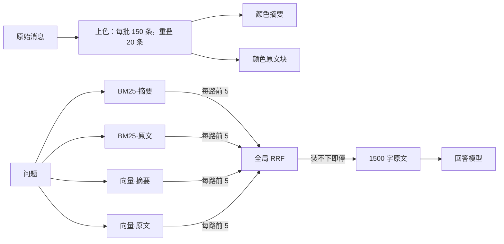
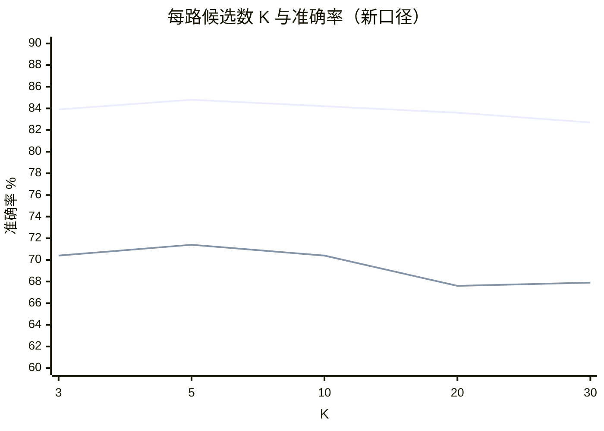

# QQ 群聊长期记忆系统：第一阶段研究报告（第二版）

> 日期：2026-11-04。第一版 [2026-11-memory-stage-report.md](2026-11-memory-stage-report.md) 原样保留。
> **第二版与第一版的区别**：
> 1. **统计口径改变**（用户决定）：只要某道题在任一方案、任一条件下回答调用返回空（多为安全拦截），整道题就被标记。标记的题保留在数据里，但所有统计都排除它们。DEV-1 标记 111 题，DEV-2 标记 118 题，清单在 `runs/<群>/blocked_questions.json`（第 1 版）。所有准确率、CI、配对比较和机制统计都按新口径重算，旧口径的准确率并列给出。
> 2. **数据描述更正**：两个开发群的时间线都有约一个月的空白；DEV-2 的消息高度集中在前 8 天；VALIDATION-1 实际只有 7 天。
> 3. **结论更正**：第一版说「每一路、每个 K 下，向量的召回都低于对应的 BM25 路」，这不准确。前 5 名内确实如此；但在 DEV-1 上取前 10、前 30 名时，向量摘要略高于 BM25 摘要。
> 4. 新口径下，几个原来「显著」的差异不再显著，见第 5.2 节。
>
> 数据来源与第一版相同：结果文档、实验台账（145 行，导出见 [memory-benchmark-ledger.md](../memory-benchmark-ledger.md)）、逐题原始记录、`bench/` 代码。凡是本报告重算的数字，都只读已有记录，没有新调用回答模型。下一阶段见 [路线图](2026-11-memory-next-stage-roadmap.md)，待确认问题见 [清单](2026-11-memory-open-questions.md)。

## 摘要

我们为 AstrBot 上的 QQ 群聊机器人设计了一套长期记忆系统：原始消息全部保留；模型把消息「上色」为可重叠、可不连续的微语境，每个颜色带一句摘要；检索时用颜色摘要和颜色原文块作索引，交给回答模型的是原文。

评测用两个真实开发群。题目是模型生成、再由另一次调用核对的跨周问答题，DEV-1 440 题、DEV-2 436 题，其中 105 题经三人人工复核。按新口径排除被拦截的题后，剩 329 题和 318 题；另在答案出现之前重问一部分题，测拒答（剩 95 题和 84 题）。

主要发现：

1. **只给摘要最差**。同为 1500 字预算，交摘要比交原文块低 21.6（DEV-1）和 11.9（DEV-2）个百分点。【证实】
2. **摘要和原文块两路关键词合并**：有筛选时显著优于只搜原文块（+3.6、+6.3）和 10 条窗口基线（+11.9、+12.3）。同为 1500 字时，与只搜原文块打平，比窗口基线高约 5 个百分点，但不稳定显著。【证实（筛选时）；1500 字时未证实】
3. **向量单独使用时，前 5 名的召回不如 BM25**，两个群都是如此。但与关键词合并后增益显著：两路 RRF + 向量两路（DV）比关键词两路高 7.3 和 7.5 个百分点。【证实】
4. **候选深度是融合的关键变量**。每路候选太多时，「多路都排得一般」的块会累加 RRF 分数，把只在一路排第 1 的证据挤出 1500 字预算。每路 3–10 个是平台；20 个时，DEV-2 显著变差。冻结版每路取 5 个：DEV-1 84.8%，DEV-2 71.4%；10 条窗口基线分别为 69.6% 和 55.7%。【证实；选 5 而不是 3 或 10 的差异不显著】
5. **证据进入上下文后，模型能用好约 95%**（DEV-1 95.9%，DEV-2 94.8%）。剩下的损失主要在证据没进来，在 DEV-2 上占 27.0% 的题。【证实】
6. **被拦截的题占约四分之一**，而且影响「同样证据、不同回答」的噪声估计：排除后，K5 和 K10「都有证据却一对一错」的题，DEV-1 从 19 题降到 6 题。【证实】
7. 审计发现了几处**实现与设计不符**：向量没有区分查询和文档，也没有加检索指令；注入的原文不带时间。见第 9.3 节。【证实存在；影响大小未测】

以上全部来自 DEV 数据，冻结版还没有在独立 TEST 集上验证。

## 证据等级

| 标记 | 含义 |
|---|---|
| 【证实】 | 两个开发群上都有逐题配对数据支持；95% CI 不跨 0 时才说「显著」 |
| 【解释】 | 有数据支持的机制解释，但没有专门做实验排除其他解释 |
| 【假设】 | 尚待检验 |

「显著」都指配对 bootstrap 95% CI 不含 0，**没有做多重比较校正**。

---

## 1. 研究背景、问题定义与系统目标

与第一版相同，此处只列要点：

- **现状**：机器人运行在 AstrBot 上，现有记忆插件是 `astrbot_plugin_memory_beyond`（Markdown 事实文件 + 按需召回 + 压缩）。
- **最终目标**：长期记忆、人物识别（按稳定 ID，不按昵称归并）、知识更新、群内梗习得、主动回忆、适当的行为适应。
- **本阶段的问题**：给定一个关于过去群聊的问题 *q* 和时间点 *t*，系统只能使用 *t* 之前的消息，在固定的注入预算内选出原始消息交给回答模型。评估回答是否正确；答案在 *t* 之后才出现时，评估是否拒答。
- **设计前提**（用户确定）：
  - 保留原文，是为了把原文交给模型。
  - 上色既是索引，也是分块方式。
  - 人物和时间是原文的元数据。
  - 本阶段不为缓存命中优化。

---

## 2. QQ 群聊记忆数据的特殊性

### 2.1 数据（含更正）

| | DEV-1 | DEV-2 |
|---|---:|---:|
| 清洗后消息 | 15,841 | 46,200 |
| 发言人 | 104 | 81 |
| 首尾跨度 | 115.7 天 | 77.5 天 |
| **有消息的天数** | **60** | **44** |
| **最长空白** | **37 天** | **30 天** |
| 按时间十等分，各段的消息数 | 5,372 / 2,325 / 0 / 0 / 43 / 33 / 2,899 / 2,940 / 1,605 / 624 | **34,748** / 8,026 / 0 / 0 / 0 / 591 / 1,446 / 121 / 62 / 1,206 |
| 可上色消息（去空、去敏感） | 14,318 | 42,971 |
| 颜色数 | 828 | 2,451 |
| 每色消息数：均值 / 中位 | 15.6 / 11 | 14.7 / 10 |
| 被颜色覆盖：占可上色 / 占全部 | 79.1% / 71.5% | 73.9% / 68.7% |
| 被覆盖的消息中属于多个颜色 | 13.8% | 13.3% |
| 原文块字数：中位 / 90 分位 | 169 / 495 | 171 / 648 |
| 颜色摘要字数中位 | 56.5 | 58 |

**更正**：两个导出的时间线都不连续，中间各有约一个月完全没有消息。DEV-2 有 75% 的消息集中在前 10% 的时间里，约 8 天。所以「约 11 周」「约 14 周」这类说法会高估实际覆盖的时间。

这对题目的影响：

- **出题按消息顺序分层抽样，因此题目集中在消息密集的时段。** DEV-2 有 345/436 题的证据落在时间轴的前 10%，DEV-1 有 234/440 题落在前 20%（按全部题统计）。
- **证据离提问时刻的「年龄」主要由空白段决定**：中位数为 96.8 天和 73.4 天，但其中约一个月是没有消息的空白。所以这批题测的是「隔了一个月沉寂期的旧事」，而不是持续活跃群里的几个月前的事。

### 2.2 题目覆盖了群的多少内容

- **检索范围是整个群**：两个群的全部消息都在记忆池里。
- **出题只用了一部分**：DEV-1 第二轮的 220 段覆盖了早于 7 天的可用消息的 60%，另有第一轮 70 段；DEV-2 的 300 段覆盖了约 28%。
- 作为证据的消息只有 831 条（DEV-1，占 5.3%）和 911 条（DEV-2，占 2.0%）。

### 2.3 其他群（核对后）

| 代号 | 用途 | 消息 | 首尾跨度 | 有消息的天数 | 最长空白 | 状态 |
|---|---|---:|---:|---:|---:|---|
| VALIDATION-1 | 原计划的验证集 | 17,938 | **7 天** | 7 | 1 天 | 未使用；出不了跨周题 |
| FROZEN-1 | 原计划的保留集 | 19,169 | 16 天 | 13 | 4 天 | 未使用 |
| **TEST（代号 9ae4cb）** | 用户 2026-11-04 指定的独立测试集 | 62,051 | 112 天 | 100 | 9 天 | **已标为 FROZEN**；开发期间不上色、不出题、不看内容 |

用户补充：DEV-1、它的前后几期群，以及 TEST 群，是**同一批核心成员在不同时间段的群**。所以：

- TEST 主要检验**时间上的外推**（同一批人、新的时间段）。它不能完全检验「换一群人还有效」。
- 这些群理论上可以合成一个跨群、跨时间的大数据集，相关的设计和防泄漏问题见路线图和清单。

### 2.4 与公开数据集的差异

与第一版相同：多人交错；短句（原文块中位约 170 字、11 条消息）；引用都很近（97% 在 1 小时内）；改名频繁（104 人中 27 人改过名）；本群特有的梗比预想的少；安全拦截。**本版补充**：安全拦截涉及约四分之一的题（第 4.4 节）。

---

## 3. 系统设计

与第一版第 3 节相同。冻结版流程是：四路检索（关键词摘要、关键词原文块、向量摘要、向量原文块），每路取前 5，全局 RRF（k=60），按名次装入 1500 字，原文块去重，带化名，**不带时间**。



---

## 4. Benchmark：数据、题型、标注与流程

4.1–4.3 与第一版相同：

- **题型**：B1 GroupMemBench 只用来验证框架；Q1 引用还原不作主分；Q2 跨周问答作为决策依据；Q3、Q5 没有鉴别力；Q9 梗实验样本小。
- **出题**：从早于截止时间 7 天以上的消息中，按消息顺序分层抽 40 条一段；出题模型每段出 0–2 题；核题模型只看证据，判断题目是否合格。
- **人工标注**：三人；105 题中剔除 1 题；判官与人工一致率 99.6%（226 次判定）；DEV-2 没有人工复核。

### 4.4 安全拦截与新统计口径

| | DEV-1 | DEV-2 |
|---|---:|---:|
| 问答实验涉及的题 | 441（含 1 道已被人工剔除的题） | 436 |
| 标记的题（任一方案、任一条件下回答为空） | **111（25%）** | **118（27%）** |
| 其中在可见条件下被拦过 | 90 | 87 |
| 只在一次调用中被拦的题 | 50 | 46 |
| 排除后的可见题 / 拒答测试题 | 329 / 95 | 318 / 84 |

- **核对**：373 次（DEV-1）和 335 次（DEV-2）空回答，在回答缓存里全都标为「返回空」，不是读取记录出错。
- **范围**：标记范围覆盖主实验、向量、打包与保底、候选深度和 Q2 第一轮问答这几组实验。GroupMemBench 的回答没有空回答。梗实验的缓存中有 10 次空回答，但它的题集不同，没有按新口径重算。
- **版本**：清单记为第 1 版。之后的新实验沿用这份清单作分母；新出现的被拦题记入新版本，不会悄悄改变旧表。
- **偏差**：排除的题很可能集中在某些话题上，比如健康、用药等容易触发安全拦截的内容。新口径下的结论只适用于不会触发拦截的题。「任一方案被拦就排除」也意味着：注入内容越多样（方案越多），被排除的题就越多。

---

## 5. 已测试方案的完整对照

### 5.1 问答主表（新口径）

「证据进入」：注入的块里至少含一条证据消息；B 组注入的是证据所在颜色的**摘要**（标 \*）。「字数」：去重后实际注入的平均字数。「旧口径」：含被拦截题的准确率。

| 组 | 检索 | 交给模型 | 筛选 / 预算 | DEV-1 准确率（95% CI） | 旧口径 | 证据进入 | 拒答 | 字数 | DEV-2 准确率（95% CI） | 旧口径 | 证据进入 | 拒答 | 字数 |
|---|---|---|---|---|---:|---:|---:|---:|---|---:|---:|---:|---:|
| A | BM25 原文块 | 原文 | 筛选 | 72.0（67.2–76.9） | 70.2 | 73.2 | 94.7 | 309 | 53.8（48.4–59.7） | 52.5 | 52.8 | 92.9 | 255 |
| B | BM25 摘要 | 摘要 | 筛选 | 49.5（44.1–55.0） | 50.0 | 70.5* | 95.8 | 62 | 43.4（38.1–48.7） | 43.1 | 54.4* | 94.0 | 57 |
| C | BM25 摘要 | 原文 | 筛选 | 66.6（61.4–71.7） | 65.7 | 68.1 | 92.6 | 247 | 54.4（49.1–60.1） | 52.5 | 52.8 | 92.9 | 199 |
| D1 | 两路 RRF（每路 30） | 原文 | 筛选 | 75.7（71.1–80.2） | 73.6 | 76.6 | 94.7 | 292 | 60.1（54.7–65.7） | 60.6 | 60.4 | 91.7 | 247 |
| D2 | 同上，筛选看摘要 + 原文 | 原文 | 筛选 | 74.2（69.6–78.7） | 72.7 | 75.7 | 92.6 | 311 | 62.0（56.6–67.3） | 59.2 | 61.6 | 92.9 | 270 |
| 基线 | BM25 10 条窗口 | 合并窗口 | 不筛选，前 5 | 63.8（59.0–69.0） | 63.9 | 69.6 | 93.7 | 550 | 47.8（42.1–53.5） | 47.2 | 52.2 | 95.2 | 618 |
| 基线 + 筛选 | 同上 | 合并窗口 | 筛选 | 67.5（62.9–72.9） | 67.3 | 69.9 | 90.5 | 144 | 50.0（44.7–55.7） | 49.3 | 51.6 | 92.9 | 136 |
| A@1500 | BM25 原文块 | 原文 | 1500 字 | 75.4（70.8–79.9） | 74.3 | 78.1 | 95.8 | 1,246 | 58.2（52.8–63.5） | 56.0 | 58.8 | 92.9 | 1,205 |
| B@1500 | BM25 摘要 | 摘要 | 1500 字 | 53.8（48.6–59.3） | 53.4 | 82.7* | 94.7 | 1,468 | 46.2（40.6–51.6） | 45.2 | 71.1* | 92.9 | 1,468 |
| C@1500 | BM25 摘要 | 原文 | 1500 字 | 70.5（66.0–75.7） | 70.9 | 72.3 | 92.6 | 1,293 | 56.3（50.6–61.6） | 55.0 | 55.0 | 94.0 | 1,284 |
| D@1500 | 两路 RRF（每路 30） | 原文 | 1500 字 | 75.4（70.8–79.9） | 75.2 | 77.2 | 92.6 | 1,265 | 60.4（55.0–65.7） | 60.3 | 61.6 | 92.9 | 1,263 |
| 窗口 10@1500 | BM25 10 条窗口 | 合并窗口 | 1500 字 | 69.6（64.7–74.8） | 70.2 | 75.4 | 91.6 | 1,439 | 55.7（50.0–61.0） | 53.4 | 59.1 | 91.7 | 1,422 |
| 窗口 5@1500 | BM25 5 条窗口 | 合并窗口 | 1500 字 | 65.0（60.2–69.9） | 65.5 | 74.5 | 94.7 | 1,464 | 50.6（45.0–56.0） | 48.9 | 63.2 | 94.0 | 1,461 |
| V 摘要 | 向量摘要 | 原文 | 1500 字 | 73.0（68.4–77.8） | 71.1 | 75.4 | 89.5 | 1,330 | 54.4（48.7–60.1） | 50.7 | 52.8 | 91.7 | 1,320 |
| V 原文 | 向量原文块 | 原文 | 1500 字 | 73.9（69.3–78.7） | 73.2 | 76.9 | 90.5 | 1,347 | 58.8（53.5–64.2） | 57.8 | 57.6 | 91.7 | 1,363 |
| DV | 四路 RRF（每路 30） | 原文 | 1500 字 | 82.7（78.7–86.9） | 79.8 | 85.7 | 90.5 | 1,318 | 67.9（62.6–73.0） | 66.3 | 69.2 | 91.7 | 1,337 |
| Dq | 两路，每路先保底 3 块 | 原文 | 1500 字 | 80.2（76.0–84.5） | 79.5 | 83.6 | 94.7 | 1,267 | 65.1（60.1–70.4） | 64.0 | 64.5 | 94.0 | 1,254 |
| DVq | 四路，每路先保底 2 块 | 原文 | 1500 字 | 83.9（79.9–87.8） | 80.9 | 87.8 | 91.6 | 1,324 | 67.6（62.3–73.0） | 66.7 | 67.3 | 91.7 | 1,285 |
| E1 四路 | 四路 RRF（每路 10），严格打包 | 原文 | 1500 字 | 84.2（80.2–88.1） | 82.0 | 87.2 | 90.5 | 1,286 | 70.4（65.4–75.8） | 70.0 | 70.4 | 91.7 | 1,276 |
| E2 四路 | 四路轮流取 | 原文 | 1500 字 | 83.9（79.9–87.8） | 82.7 | 87.8 | 89.5 | 1,309 | 71.4（66.4–76.4） | 69.3 | 70.1 | 89.3 | 1,272 |
| E3 四路 | 每路预留 375 字 | 原文 | 1500 字 | 59.9（54.7–65.3） | 58.2 | 61.4 | 90.5 | 1,473 | 52.5（47.2–58.2） | 52.1 | 51.9 | 91.7 | 1,471 |
| E4 四路 | RRF ÷ √新增字数 | 原文 | 1500 字 | 73.2（68.1–77.8） | 71.4 | 75.1 | 90.5 | 1,447 | 59.8（54.4–65.1） | 57.8 | 58.5 | 91.7 | 1,439 |
| E1 两路 | 关键词两路 RRF（每路 10） | 原文 | 1500 字 | 82.1（77.8–86.3） | 80.5 | 84.2 | 93.7 | 1,278 | 64.1（58.8–69.8） | 63.1 | 64.5 | 91.7 | 1,248 |
| E2 两路 | 轮流 | 原文 | 1500 字 | 82.1（78.1–86.3） | 80.5 | 84.5 | 92.6 | 1,273 | 66.3（61.0–71.7） | 64.5 | 65.4 | 95.2 | 1,247 |
| E3 两路 | 预留 750 字 | 原文 | 1500 字 | 76.6（72.0–81.2） | 76.1 | 77.8 | 90.5 | 1,445 | 62.6（57.2–67.9） | 61.7 | 61.6 | 94.0 | 1,445 |
| E4 两路 | RRF ÷ √新增字数 | 原文 | 1500 字 | 66.9（61.7–72.0） | 66.4 | 67.5 | 93.7 | 1,386 | 54.4（49.1–59.7） | 52.5 | 53.8 | 92.9 | 1,386 |
| K3 | 四路 RRF（每路 3） | 原文 | 1500 字 | 83.9（79.9–87.8） | 83.0 | 86.9 | 88.4 | 1,162 | 70.4（65.4–75.8） | 69.3 | 70.4 | 89.3 | 1,156 |
| **K5（冻结版）** | 四路 RRF（每路 5） | 原文 | 1500 字 | **84.8（80.9–88.4）** | 82.7 | **88.4** | 90.5 | 1,290 | **71.4（66.4–76.4）** | 70.6 | **73.0** | 92.9 | 1,281 |
| K10 | 即 E1 四路 | 原文 | 1500 字 | 84.2（80.2–88.1） | 82.0 | 87.2 | 90.5 | 1,286 | 70.4（65.4–75.8） | 70.0 | 70.4 | 91.7 | 1,276 |
| K20 | 四路 RRF（每路 20） | 原文 | 1500 字 | 83.6（79.3–87.5） | 81.1 | 86.3 | 90.5 | 1,293 | 67.6（62.9–72.6） | 66.7 | 70.1 | 92.9 | 1,316 |
| K30 | 四路 RRF（每路 30） | 原文 | 1500 字 | 82.7（78.7–86.9） | 79.8 | 85.7 | 90.5 | 1,318 | 67.9（62.6–73.0） | 66.3 | 69.2 | 91.7 | 1,337 |

所有组都在同一批题上计算（DEV-1 329 题、DEV-2 318 题），所以组间可以直接比较。

### 5.2 新旧口径下显著性发生变化的比较

| 比较 | 群 | 旧口径 | 新口径 |
|---|---|---|---|
| D@1500 − A@1500 | DEV-2 | **+4.4（+0.2，+8.5）** | +2.2（−2.2，+6.9） |
| D@1500 − 窗口基线@1500 | DEV-1 | **+5.0（0，+9.8）** | +5.8（0.0，+11.2），下界为 0 |
| D@1500 − 窗口基线@1500 | DEV-2 | **+6.9（+1.6，+12.2）** | +4.7（−1.3，+10.7） |
| A@1500 − 窗口基线@1500 | DEV-2 | 未单独算 | +2.5（−2.2，+7.5） |
| V 摘要 − D@1500 | DEV-1 | −4.1（−8.6，+0.2） | −2.4（−7.9，+2.4） |
| DVq − Dq（保底之上加向量） | DEV-1 | +1.4（−1.6，+4.3） | **+3.6（+0.9，+6.4）** |
| K30 − K10 | DEV-2 | **−3.7（−6.7，−0.7）** | −2.5（−5.7，+0.6） |

其余结论的方向和显著性都不变。

### 5.3 检索层召回（新口径，可见题）

「命中」指该路名次 ≤ K 的块里含证据消息。

| 路线 | DEV-1 R@1 | R@5 | R@10 | R@30 | DEV-2 R@1 | R@5 | R@10 | R@30 |
|---|---:|---:|---:|---:|---:|---:|---:|---:|
| BM25 摘要 | 54.7 | 72.0 | 76.3 | 83.3 | 38.7 | 56.9 | 61.3 | 71.7 |
| BM25 原文块 | **61.7** | **81.2** | **84.2** | **89.1** | **46.9** | **60.4** | **66.0** | **75.2** |
| 向量摘要 | 45.6 | 69.3 | 78.4 | 86.3 | 35.5 | 50.3 | 54.4 | 67.0 |
| 向量原文块 | 52.0 | 73.3 | 79.6 | 85.4 | 35.5 | 51.3 | 57.5 | 68.9 |
| 任一路 ≤ 5（冻结版的候选池） | | 94.2 | | | | 77.7 | | |

- **前 1 名、前 5 名**：两个群上，BM25 每路都高于对应的向量路。【证实】
- **前 10、前 30 名**：DEV-1 的向量摘要（78.4、86.3）超过 BM25 摘要（76.3、83.3）。DEV-2 上 BM25 仍然全面领先。第一版在这里的说法有误，已更正。

冻结版的证据进入率（88.4% / 73.0%）与候选池命中率（94.2% / 77.7%）之间的差，就是被 1500 字挤出的部分：5.8% 和 4.7%。

### 5.4 成本

花费是实际发生的，不受统计口径影响，与第一版相同：

| 模型 | 去重后的调用 | 输入 token | 输出 token |
|---|---:|---:|---:|
| `gemini-3.8-flash-high` | 40,500（其中 906 次返回空） | 45.2M | 9.76M |
| `gpt-6.1-sol` | 5,707 | 2.20M | 0.14M |
| 阿里云向量 | — | 0.94M | — |

截至本版，Gemini 的周额度已用掉约 80%（用户告知）。

---

## 6. 原文与摘要（新口径）

| 比较（配对，百分点，95% CI） | DEV-1 筛选 | DEV-1 1500 字 | DEV-2 筛选 | DEV-2 1500 字 |
|---|---|---|---|---|
| B 只给摘要 − A 原文 | **−22.5（−28.6，−15.8）** | **−21.6（−28.0，−15.2）** | **−10.4（−17.0，−3.8）** | **−11.9（−18.2，−5.7）** |
| C 搜摘要给原文 − A | **−5.5（−10.3，−0.3）** | −4.9（−10.0，+0.6） | +0.6（−4.7，+6.3） | −1.9（−7.2，+3.5） |
| D 两路 − A | **+3.6（+0.3，+7.0）** | 0.0（−4.3，+4.0） | **+6.3（+2.2，+10.7）** | +2.2（−2.2，+6.9） |
| D2 看摘要重排 − D1 | −1.5（−4.6，+1.8） | | +1.9（−1.6，+5.3） | |
| A∪C 至少一组答对（理论上限） | 79.6% | 85.4% | 65.7% | 70.1% |

- **只给摘要显著更差。**【证实】
- **两路合并的优势在有筛选时显著**，同为 1500 字时不显著。【证实；第一版中 DEV-2 的 1500 字比较曾显著，新口径下不再显著】
- 解释与第一版相同：摘要丢细节；摘要作为索引键有用，作为内容不行；两路检索各自找到的证据不完全重叠，A∪C 比 D 高 4–10 个百分点。【解释】

---

## 7. BM25 与 Qwen Embedding（新口径）

### 7.1 单路与合并

- **召回**：前 5 名内，BM25 每路都高于向量（第 5.3 节）；更深的名次上，DEV-1 的向量摘要略好。
- **问答**：V 摘要 − D@1500 为 −2.4（DEV-1，不显著）和 −6.0（DEV-2，CI −11.6～−0.6，显著）。
- **合并**：
  - DV − D：+7.3（+3.0，+11.6）和 +7.5（+3.8，+11.6），都显著。
  - E1 四路 − E1 两路：+2.1（−1.8，+6.1）和 +6.3（+2.8，+10.1）。
  - DVq − Dq：DEV-1 +3.6（显著），DEV-2 +2.5（−0.6，+5.3）。【证实：合并后向量有增益】

### 7.2 低词面重叠的题

各路 R@5：

| 桶 | 题数（DEV-1 / DEV-2） | BM25 摘要 | BM25 原文 | 向量摘要 | 向量原文 |
|---|---|---|---|---|---|
| 低（<0.3） | 155 / 148 | 67.1 / 50.0 | 71.0 / 44.6 | 66.5 / 39.9 | 63.9 / 39.9 |
| 中 | 164 / 150 | 75.0 / 63.3 | 89.6 / 72.7 | 70.7 / 58.7 | 80.5 / 60.7 |
| 高 | 10 / 20 | 100 / 60.0 | 100 / 85.0 | 90.0 / 65.0 | 100 / 65.0 |

前 5 名内只有一种方法找到证据的题数：

| | DEV-1 全部 | DEV-1 低重叠 | DEV-2 全部 | DEV-2 低重叠 |
|---|---:|---:|---:|---:|
| 只有向量 | 12 | 8 | 19 | 10 |
| 只有关键词 | 49 | 29 | 58 | 31 |
| 两者都有 | 249 | 106 | 170 | 63 |
| 都没有 | 19 | 12 | 71 | 44 |

- 低重叠题上，向量也没有超过 BM25。DEV-1 的摘要路两者接近（66.5 对 67.1）。【证实】
- 向量的独有贡献约占 4–6% 的题。【证实】
- 有效性的限制与第一版相同（第 9.3 节）：没有区分文档和查询、没有加指令、只测了一个模型、重叠按字符计算。**不能据此判断向量检索本身的上限。**

---

## 8. 多路融合与候选深度（新口径）

### 8.1 演变

| 方案 | DEV-1 | DEV-2 |
|---|---:|---:|
| 关键词两路，每路 30（D@1500） | 75.4 | 60.4 |
| 四路，每路 30（DV） | 82.7 | 67.9 |
| 两路，每路保底 3（Dq） | 80.2 | 65.1 |
| 四路，每路 10，严格 RRF（E1） | 84.2 | 70.4 |
| **四路，每路 5（K5）** | **84.8** | **71.4** |
| 窗口 10 条基线 | 69.6 | 55.7 |
| K5 − 窗口基线 | **+15.2（+9.7，+20.7）** | **+15.7（+10.1，+21.7）** |

### 8.2 打包方式【证实】

| 比较 | DEV-1 | DEV-2 |
|---|---|---|
| E2 轮询 − E1（四路） | −0.3（−3.3，+2.7） | +0.9（−2.2，+4.1） |
| E2 − E1（两路） | 0.0（−2.4，+2.4） | +2.2（−0.3，+5.0） |
| E3 每路预留 − E1（四路） | **−24.3** | **−17.9** |
| E4 按长度贪心 − E1（四路） | **−10.9** | **−10.7** |

E3、E4 的退化是实现缺陷（偏向短块）。第一版给出的逐题统计（E1 答对而 E3 答错的题中，绝大多数是长证据块被丢弃）是在旧口径下算的，结论不变。

### 8.3 候选深度 K【证实】



| 比较（配对，百分点） | DEV-1 | DEV-2 |
|---|---|---|
| K3 − K10 | −0.3（−2.7，+2.4） | 0.0（−3.1，+2.8） |
| K5 − K10 | +0.6（−1.8，+3.0） | +0.9（−1.9，+3.8） |
| K20 − K10 | −0.6（−3.0，+1.8） | **−2.8（−5.7，−0.3）** |
| K30 − K10 | −1.5（−4.3，+1.2） | −2.5（−5.7，+0.6） |
| K20 − K5 | −1.2（−4.0，+1.5） | **−3.8（−7.2，−0.3）** |
| K5 − K3 | +0.9（−0.9，+3.0） | +0.9（−0.9，+3.1） |

| K | 3 | 5 | 10 | 20 | 30 |
|---|---:|---:|---:|---:|---:|
| 挤出率 DEV-1 | 5.5 | 5.8 | 7.9 | 10.3 | 11.2 |
| 挤出率 DEV-2 | 4.7 | 4.7 | 12.9 | 19.2 | 22.3 |
| 证据进入率 DEV-1 | 86.9 | **88.4** | 87.2 | 86.3 | 85.7 |
| 证据进入率 DEV-2 | 70.4 | **73.0** | 70.4 | 70.1 | 69.2 |
| 证据进入时的准确率 DEV-1 | 96.2 | 95.9 | 96.5 | 96.8 | 96.5 |
| 证据进入时的准确率 DEV-2 | 96.0 | 94.8 | 96.0 | 92.8 | 94.5 |

相比 K10，逐题变化的来源（救回 / 退化）：

| 机制 | K3 DEV-1 | K3 DEV-2 | K5 DEV-1 | K5 DEV-2 | K20 DEV-1 | K20 DEV-2 | K30 DEV-1 | K30 DEV-2 |
|---|---|---|---|---|---|---|---|---|
| 证据在 K10 时被挤出，换 K 后进来 | 8 / 0 | 9 / 0 | 7 / 0 | 9 / 0 | 5 / 0 | 4 / 0 | 7 / 0 | 8 / 0 |
| 证据仍在候选里，但被挤出注入 | 0 / 6 | 0 / 5 | 0 / 3 | 0 / 3 | 0 / 8 | 0 / 8 | 0 / 12 | 0 / 14 |
| 证据只在第 K 名之后，截断后丢失 | 0 / 2 | 0 / 3 | — | 0 / 1 | — | — | — | — |
| 两边都有证据，只是内容或顺序不同 | 1 / 2 | 3 / 3 | 2 / 4 | 4 / 5 | 3 / 2 | 1 / 6 | 2 / 2 | 2 / 3 |
| 两边都没有证据 | — | 0 / 1 | — | 0 / 1 | — | — | — | 0 / 1 |

- **机制不变**：K 增大时，「多路都排得一般」的块累加 RRF 分数，把只在一路排名靠前的证据挤出预算；K 太小又会丢掉只在第 4–10 名的证据。
- **新口径下更清楚**：「两边都有证据却一对一错」的题少了很多，例如 K5 对 K10 在 DEV-1 上从 8 对 11 降到 2 对 4。说明第一版里这部分「同样证据、回答波动」有相当一部分来自安全拦截。K 的净效应几乎都来自证据能否进入。【证实】

K5 与 K3、K10 的逐题比较（新口径）：

| | DEV-1 | DEV-2 |
|---|---|---|
| **K5 对、K3 错**（共） | 7 | 7 |
| 　K3 时证据被挤出，K5 时靠其他路第 4–5 名的支持进入 | 5 | 5 |
| 　证据只在第 4–5 名 | 0 | 1（多路都有） |
| 　两边都有证据 | 2 | 1 |
| **K5 错、K3 对**（共） | 4 | 4 |
| 　K5 时证据被挤出 | 1 | 3 |
| 　两边都有证据 | 3 | 1 |
| **K5 对、K10 错**（共） | 9 | 13 |
| 　K10 时被挤出，挤在前面的块里至少有一个在各路都排第 6 名以后 | 5 | 5 |
| 　K10 时被挤出，前面的块都在某路前 5，靠第 6–10 名累加的分数排到前面 | 2 | 4 |
| 　两边都有证据 | 2 | 4 |
| **K5 错、K10 对**（共） | 7 | 10 |
| 　K5 时被挤出 | 3 | 3 |
| 　证据只在第 6–10 名 | 0 | 1（多路都有） |
| 　两边都有证据 / 都没有 | 4 / 0 | 5 / 1 |

**检验结果**：

- 两个群合并后，K5 对 K10 是 22 胜 17 负（符号检验 p≈0.52），K5 对 K3 是 14 胜 8 负（p≈0.29），都不显著。
- 选 K5 的依据仍是：它在两个群上都最高，证据进入率也最高，机制说得通。这是在同一批题上挑出来的参数。

---

## 9. 错误分析与实现问题

### 9.1 冻结版的错误构成（新口径）

| | DEV-1 | DEV-2 |
|---|---:|---:|
| 可见题 | 329 | 318 |
| 证据进入注入 | 291 | 232 |
| 　其中答错 | 12（4.1%） | 12（5.2%） |
| 证据没进入注入 | 38（11.6%） | 86（27.0%） |
| 　在候选池里但被挤出 | 19 | 15 |
| 　不在任何一路的前 5 | 19 | 71 |
| 　仍答对 | 0 | 7 |

- **证据进入后读错的题很少**：两个群各 12 题。与答对的题相比，这些题的证据位置更靠后（DEV-1 第 2.5 块对 1.5 块，DEV-2 3.3 对 1.7），证据前的干扰更多（169 字对 77 字，293 字对 84 字），而且多是低重叠题（两个群都是 12 题中占 10 题；答对的题里，低重叠只占 45% 和 40%）。【证实：分布不同；因果未证】【假设：干扰是主因】
- **DEV-2 的瓶颈在召回**：71 题（22.3%）的证据不在任何一路的前 5。
- **DEV-2 上有 7 题证据没进入却答对**：可能是证据标注不全，也可能是猜中了。【假设，可逐题核对】

### 9.2 判分

判官与人工一致率 99.6%，只在 DEV-1 上测过。被拦截的题已经排除，见第 4.4 节。

### 9.3 实现与设计不符之处

与第一版第 9.3 节相同，要点如下：

1. **向量没有区分查询和文档**：不带 `text_type` 时，结果与 `query` 模式几乎相同，所以文档实际上是按查询模式嵌入的。
2. **没有检索指令**：接口接受 `instruct` 参数，我们没有用。
3. **缓存键不含这两个参数**：直接加参数会读出旧向量。
4. 两条原文路的索引文本不一致：BM25 不含发言人，向量含化名。
5. 截断：向量原文截前 1000 字，注入时单块截到 1500 字。
6. **注入的原文不带时间**，提示词里也没有当前日期。
7. 查询只用问题文本，没有用最近几条聊天。
8. 上色不能跨批，两个群各有 1 批失败。
9. E3、E4 偏向短块。
10. 台账的 token 是「需要」量，不是实际花费。

本版补充：

11. **统计曾把安全拦截算作答错**。这会把模型和题材的问题混进对记忆系统的评价，现已统一排除。
12. **时间跨度的描述用的是首尾时间**，没有反映一个月的空白期，现已更正。

---

## 10. 统计、局限与过拟合风险

第一版第 10 节的内容仍然成立：没有做多重比较校正（约 60 组比较）；同一段 40 条消息最多出 2 题，题目之间不独立；每组只跑了一次；题目是模型生成的 SILVER 题，DEV-2 没有人工复核；出题、上色、摘要用同一个模型；K5 是在同一批题上挑出来的。

本版补充：

- **排除被拦截的题之后，样本少了约四分之一，CI 变宽**，所以有几项结论从显著变成不显著（第 5.2 节）。被排除的题可能集中在某些话题上。今后新方案的拦截情况不同，也会改变「可比的题集」，所以清单要固定版本。
- **时间分布**：题目集中在消息密集的时段，而且证据和提问之间隔着约一个月的空白。这与「持续活跃的群里几个月前的事」不是同一种难度。
- **TEST 群与 DEV-1 的核心成员相同**，所以它检验的是时间外推，不完全是跨群泛化。

---

## 11. 与相关研究的对照

与第一版第 11 节相同，下面是变化的部分。

- **GroupMemBench**：论文表 2 的跨领域平均 BM25 为 43.22%，`text-embedding-3-large` 稠密检索为 38.04%。我们的结果方向相符：前 5 名内 BM25 每路都领先，问答层面向量单路也不如关键词。但「BM25 每个深度都更强」这一点在我们的数据上不成立：DEV-1 上更深的名次，向量摘要略好。两者条件不同（英文合成数据，GPT-5 回答和判官），不比较数字。
- 其余对照（SocialMemBench、LongMemEval、Lost in the Middle、Qwen3 Embedding、Mem0、RRF）不变。

---

## 12. 结论、未解决的问题与后续计划

### 12.1 已有实验支持的结论（新口径）

1. 交给模型的应当是原文块；只给摘要显著更差（−21.6 / −11.9）。
2. 有筛选时，两路关键词合并显著优于只搜原文块和窗口基线；同为 1500 字时，这一优势没有被证实。
3. 加上向量路之后显著更好（DV − D：+7.3 / +7.5）；但单独用向量，前 5 名的召回不如 BM25。
4. 每路候选数 3–10 是平台；在 DEV-2 上，每路 20 个显著变差。冻结版比窗口基线高 15.2 和 15.7 个百分点。
5. 冻结版证据进入后的读错率约 4–5%。主要损失是证据没进入，DEV-2 上占 27.0%。
6. 安全拦截影响约四分之一的题，也是第一版里「同样证据、回答波动」的主要来源之一。
7. 判官可以代替人工判定；「引用还原」和「BM25 分数阈值判沉默」都不适合做决策依据。

### 12.2 有数据支持但未证实的解释

1. 摘要差是因为丢了细节。
2. 向量的独有贡献来自抽象提问、具体口语证据这一类题。
3. 证据进入后的读错，主要由证据前的干扰引起。
4. DEV-2 召回更难，是因为大群在密集时段的词面竞争更激烈。

### 12.3 尚待检验的假设

1. 修正 `text_type` 和指令后，向量单路能接近或超过 BM25。
2. 注入时带上时间，能减少时间类错误和误拒答。
3. 用最近几条聊天作查询时，冻结版的优势会缩小。
4. 冻结版在 TEST（同一批核心成员、新时间段）上的提升，会小于在 DEV 上的提升。
5. 现成插件在被动群聊里召回率会很低。
6. 被拦截的题有话题偏向。可以统计这些题与未被拦截的题在关键词上的差异来检验，只看统计，不外发内容。

下一阶段见 [路线图](2026-11-memory-next-stage-roadmap.md)。

## 附录：复现新口径

```bash
python -m bench.blocked <runs>/real-dev <runs>/real-dev2          # 生成标记清单（第 1 版）
python -m bench.ledger backfill --runs <runs> --ledger <runs>/ledger.jsonl
python -m bench.ledger table --ledger <runs>/ledger.jsonl --out docs/memory-benchmark-ledger.md
```

台账每一行的 `metrics` 现在都是新口径的数字。旧口径的数字保留在 `metrics.with_blocked` 里，被排除的题数记在 `metrics.blocked_excluded`。

## 参考文献

同第一版。
