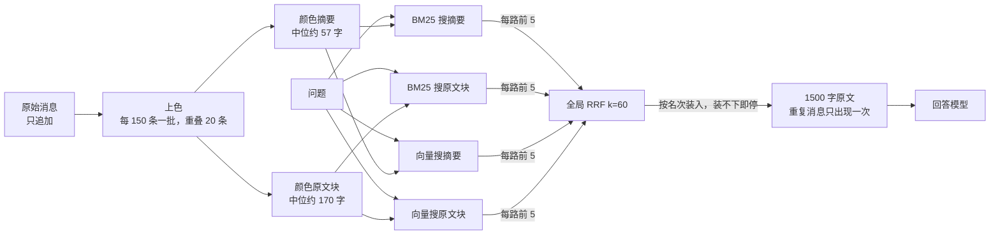
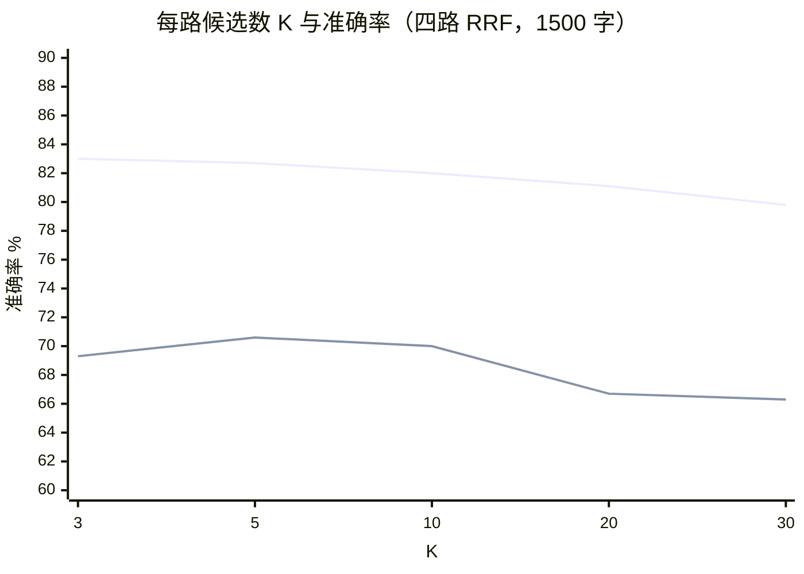

# QQ 群聊长期记忆系统：第一阶段研究报告

> 日期：2026-11-04。范围：截至检索版本冻结（D-028）的全部实验。
> 数据来源：`docs/memory-benchmark-results.md`、实验台账 `runs/ledger.jsonl`（143 行，导出见 [memory-benchmark-ledger.md](../memory-benchmark-ledger.md)）、各实验的逐题原始记录 `runs/<群>/raw/` 和 `*.json`、`bench/` 代码。凡是本报告新算的数字，都注明了「本报告离线重算」，这些数字只读已有记录，没有新调用回答模型。
> 下一阶段的计划见 [路线图](2026-11-memory-next-stage-roadmap.md)，待确认的问题和混杂因素见 [清单](2026-11-memory-open-questions.md)。

## 摘要

我们为 AstrBot 上的 QQ 群聊机器人设计了一套长期记忆系统。原始消息全部保留；模型把消息「上色」为可重叠、可不连续的微语境，每个颜色带一句摘要。检索时用颜色摘要和颜色原文块作索引，最后交给回答模型的是原文。

评测用两个真实开发群（DEV-1：15,841 条消息，104 人；DEV-2：46,200 条，81 人）。题目是 876 道模型生成并经另一次调用核对的跨周问答题，其中 105 道经三人人工复核。每题在答案可见时问一次；另抽 150 题在答案出现之前再问一次，测拒答。

主要发现（证据等级见下节）：

1. **只给摘要最差**。同为 1500 字预算，摘要交给模型比原文块低 20.9（DEV-1）和 10.8（DEV-2）个百分点。【证实】
2. **两路关键词（摘要 + 原文块）RRF 合并**优于任何单路，比 10 条窗口基线高 5.0 和 6.9 个百分点（1500 字）。【证实】
3. **向量单独使用不如 BM25**。每一路、每个 K 下，向量的证据召回率都低于对应的 BM25 路，词面重叠低的题也一样。但向量与关键词合并后，在 DEV-2 上带来显著增益（两路 → 四路 +6.9 个百分点）。【证实】
4. **候选深度是融合的关键变量**。每路取 30 个候选时，多路都排得一般的块会累加 RRF 分数，把只在一路排第 1 的证据挤出 1500 字预算；每路取 3–10 个是平台，20 以上显著变差（DEV-2）。冻结版选每路前 5：DEV-1 82.7%，DEV-2 70.6%。【证实；选 5 而不是 3 或 10 的差异不显著】
5. **证据进入上下文后，模型能用好九成以上**。冻结版证据进入注入时，准确率为 92.9%（DEV-1）和 94.6%（DEV-2）；DEV-1 答错的 28 题中有 10 题回答为空，排除这些题后为 95.4%。剩下的损失主要在证据没进来，DEV-2 上占 28.4% 的题。【证实】
6. 审计时发现了几处**实现与设计不符**，它们可能压低了某些方案的成绩：向量接口没有区分查询和文档；没有使用检索指令；注入的原文不带时间。见第 9.3 节。【证实存在；影响大小未测】

这些结论都来自 DEV 数据，冻结版还没有在独立 TEST 集上验证。

## 证据等级

| 标记 | 含义 |
|---|---|
| 【证实】 | 两个开发群上都有逐题配对数据支持；95% CI 不跨 0 时才说「显著」 |
| 【解释】 | 有数据支持的机制解释，但没有专门做实验排除其他解释 |
| 【假设】 | 尚待检验，本报告只提出检验方法 |

「显著」一律指配对 bootstrap 95% CI 不含 0，**没有做多重比较校正**（见第 10 节）。

---

## 1. 研究背景、问题定义与系统目标

### 1.1 背景

机器人部署在 AstrBot 上，通过 QQ 接入多个群。现有方案是 `astrbot_plugin_memory_beyond` 插件（Markdown 事实文件 + 按需召回 + 压缩，见 `docs/context-and-memory.md`），外加 AstrBot 的会话历史和 100 条群聊 ICL。它适合记住「某人说过的稳定事实」，不擅长回答「几周前群里那件事后来怎样了」这类问题，也不处理群内黑话的学习。

最终目标（`docs/memory-system-design.md`、`DECISIONS.md` D-024）是一个具备以下能力的群聊 Agent：长期记忆、人物识别（按稳定 ID，不按昵称归并）、知识更新、群内梗习得、主动回忆和适当的行为适应。

### 1.2 本阶段的问题定义

本阶段只研究其中的**历史证据召回与注入**：

> 给定一个关于过去群聊的问题 *q* 和时间点 *t*，系统只能使用 *t* 之前的消息，在固定的注入预算内选出一组原始消息交给回答模型。评估回答是否正确；答案在 *t* 之后才出现时，评估系统是否拒答。

没有覆盖：是否需要回忆的判断、用最近几条聊天作为查询、主动提及、人物身份、知识更新、梗的运用（第 12 节）。

### 1.3 用户确定的设计前提

（`docs/memory-options.md` 第 0 节）

- 保留原文，是为了把原文交给模型。
- 上色既是索引，也是原文的分块方式；第一层颜色是「微语境」。
- 人物和时间是原文块绑定的元数据。
- 主模型上下文很大，本阶段不为缓存命中率优化。

---

## 2. QQ 群聊记忆数据的特殊性

### 2.1 数据

数据来自用户提供的 QQ 导出，按聚合统计选群，选群时没有看内容。外发前把人名换成化名，遮蔽联系方式和长数字，扣下命中高敏感词的消息。真实数据和分组对应表不在仓库里。

| | DEV-1 | DEV-2 |
|---|---:|---:|
| 清洗后消息 | 15,841 | 46,200 |
| 发言人 | 104 | 81 |
| 时间跨度（首尾消息） | 115.7 天 | 77.5 天 |
| 可上色消息（去空、去敏感） | 14,318 | 42,971 |
| 被扣下的敏感消息 | 77 | 202 |
| 颜色数 | 828 | 2,451 |
| 每色消息数：均值 / 中位 | 15.6 / 11 | 14.7 / 10 |
| 被至少一个颜色覆盖：占可上色 / 占全部清洗后 | 79.1% / 71.5% | 73.9% / 68.7% |
| 被覆盖的消息中属于多个颜色 | 13.8% | 13.3% |
| 原文块字数：中位 / 90 分位 | 169 / 495 | 171 / 648 |
| 颜色摘要字数中位 | 56.5 | 58 |

覆盖率、跨度、多色比例和字数是本报告离线重算的。结果文档写的「约 14 周」和「覆盖 79.1%」用的是另一种口径（选群时的统计、以可上色消息为分母），两者并不矛盾。

### 2.2 与公开数据集的差异

| 特性 | 群聊实测 | 对检索的影响 |
|---|---|---|
| 多人交错 | 13% 的已上色消息属于多个颜色；同一时段常有几条话题并行 | 固定窗口会把不相关的话混在一起；单条消息又缺语境 |
| 短句 | 原文块中位约 170 字，含 11 条消息，每条平均十几个字 | 词面信号稀疏，逐条检索效果最差（Q2：单条消息 R@10 57.5%） |
| 引用近 | DEV-1 的 2,391 条引用中，97% 在 1 小时内，跨日只有 1 条 | 「引用还原」不能当长期记忆的主指标（Q1） |
| 改名 | DEV-1 的 104 人里 27 人改过名 | 按名字归并会多出 40 个身份（Q5） |
| 黑话 | 52 个候选词经人工判定：47 个说法、4 个人名外号；其中只有 8 个是本群特有 | 本群特有的梗比预想的少，「是否本群特有」的人工一致率只有 9/17–13/17 |
| 安全拦截 | 被测模型约 2% 的调用返回空 | 空回答按答错计，会混入「模型没用好证据」的错误（第 9.2 节） |

公开数据的情况：GroupMemBench 是英文合成数据，生成模型为 GPT-5（论文 §4.1）；SocialMemBench 也是合成的；LoCoMo 和 LongMemEval 主要是两人对话。它们都不包含中文群聊的短句、黑话、改名和交错。

---

## 3. 系统设计：上色、原文块、摘要与索引

### 3.1 流水线（冻结版，D-028）

### 3.2 上色

- **单位**：单条消息可以属于零个、一个或多个颜色；一个颜色可以跳过中间的无关消息（`bench/coloring.py` 的提示词）。
- **执行**：每批 150 条可上色消息，相邻两批重叠 20 条，由 `gemini-3.8-flash-high` 输出每个颜色的类型、名字、摘要和消息编号。
- **限制**：颜色无法跨批，所以最长只覆盖约 150 条连续消息；重叠区内可能产生两个相近的颜色。两个群各有 1 批失败（DEV-1 110 批中 1 批，DEV-2 331 批中 1 批）。
- **摘要**：一两句话，要求保留专有名词、人物代号、数字和黑话。

### 3.3 索引与检索

| 路线 | 索引文本 | 实现 |
|---|---|---|
| 关键词·摘要 | 颜色摘要 | BM25Okapi（与 `rank_bm25` 同参数），jieba + 从前 70% 时间习得的新词 |
| 关键词·原文 | 颜色内消息正文按行拼接，**不含发言人** | 同上 |
| 向量·摘要 | 颜色摘要 | `qwen3.7-text-embedding-flash`，768 维，余弦，暴力扫描 |
| 向量·原文 | 去掉敏感消息后的「发言人: 正文」，截前 1000 字 | 同上 |

- **时间可见性**：框架强制 `as_of`，颜色的最后一条消息早于 `as_of` 才可见（BM25 和向量用同一规则）。
- **注入**：按名次依次加入颜色块，计算的是去重后实际注入的字数；下一块放不下就停止。单个颜色超过 1500 字时截断。
- **注入格式**：每行「化名: 正文」，块与块之间用 `---` 分隔，**不带时间**。

---

## 4. Benchmark：数据、题型、标注与流程

### 4.1 题型与用途

| 编号 | 题型 | 规模 | 能否决定方案 | 原因 |
|---|---|---|---|---|
| B1 | GroupMemBench Technology | 213 题 | 否，只用来验证框架 | 英文合成 |
| Q1 | 引用还原 | 1,957 题 | 否 | 97% 的引用发生在 1 小时内 |
| Q2 / 主实验 | 跨周问答（SILVER） | DEV-1 440 题、DEV-2 436 题，另各 150 题测拒答 | **是** | 见下 |
| Q3 | BM25 分数能否判断该沉默 | 每个配置 158–262 对 | 否 | AUC 0.55–0.61，接近随机 |
| Q5 | 身份 | 104 人 | 否 | 没有同名，没有鉴别力 |
| Q9 | 梗：填词 / 四选一 / 解释 | 85 题、40 个词 | 参考 | 样本小 |

### 4.2 跨周问答题的构造（`bench/tasks/silver.py`）

1. 只从早于截止时间 7 天以上的可用消息中，按时间分层抽 40 条一段（DEV-1：第一轮 70 段 + 第二轮 220 段；DEV-2：300 段）。
2. 出题模型（`gemini-3.8-flash-high`）每段出 0–2 题，要求问法像群友随口问、尽量换说法，并写出证据消息编号。
3. 核题模型只看证据消息，判断题目是否合格（DEV-1 第二轮 367 → 335，DEV-2 481 → 436）。
4. 问题的证据中位只有 2 条消息。证据距离提问时间的中位数是 96.8 天（DEV-1）和 73.4 天（DEV-2），最短分别为 8.9 天和 21.2 天（本报告离线重算）。
5. 「词面重叠」按问题字符在证据中出现的比例分桶：低于 0.3 为低重叠，0.3–0.6 为中，0.6 以上为高。DEV-1 的低、中、高三桶分别有 200、224、16 题，DEV-2 分别有 196、213、27 题。

**已知偏差**：出题、上色、摘要都用同一个模型，问题的措辞可能天然接近摘要。

### 4.3 人工标注（第一轮，DEV-1）

- 离线 HTML 打标页，三人，每人约 133 张卡，其中 60 张重叠，用来算一致性。
- 题目：三人多数票后，105 题只剔除 1 题。原始一致率 97%；kappa 只有 0.06，这是因为几乎全是「合格」，类别极度偏斜。
- 判官：226 次人工判定与 `gpt-6.1-sol` 判官一致率 99.6%。
- 梗词条：52 词，说法 47、人名外号 4、不是梗 1；解释正确 80.9%；本群特有 8 个。
- **DEV-2 的 436 题和 DEV-1 第二轮的 335 题都没有人工复核。**

### 4.4 评测流程

- **每题两种条件**：可见（`as_of` = 数据末尾）和不可见（`as_of` = 证据第一条消息的时间，答案应为「没有记录」）。
- **回答模型**：`gemini-3.8-flash-high`。提示词要求先简短思考，最后一行写答案；记忆里没有依据时回答「没有记录」。提示词里没有当前日期。
- **判官**：`gpt-6.1-sol`，与回答模型不同家族；只看题目、标准答案和回答。
- **统计**：准确率的 95% CI 用 bootstrap；组间比较按题配对，给出 bootstrap CI 和胜负题数。
- **台账**：每组一行，记录检索对象、切块、切词、筛选、交给模型的内容、预算、模型、判官、种子、数据指纹、代码版本、分角色 token 和逐题原始记录路径；作废的实验也保留。
- **复用**：回答请求按「模型 + 系统提示 + 完整提示」的 SHA-256 缓存，完全相同的请求不再调用。逐题核对显示，125 次完全相同的注入得到的判定全部一致。候选深度实验因此复用了约一半的回答和 93% 的判定。

---

## 5. 已测试方案的完整对照

### 5.1 问答主表（准确率按可见题计）

所有数字都取自台账。「证据进入」指注入的块里至少含一条证据消息；对 B 组来说，进入的是证据所在颜色的**摘要**，而不是原文。「字数」是去重后实际注入的平均字数。拒答率在不可见的 150 题上计算。

| 组 | 检索 | 交给模型 | 筛选 / 预算 | DEV-1 准确率（95% CI） | DEV-1 证据进入 | DEV-1 拒答 | DEV-1 字数 | DEV-2 准确率（95% CI） | DEV-2 证据进入 | DEV-2 拒答 | DEV-2 字数 |
|---|---|---|---|---|---:|---:|---:|---|---:|---:|---:|
| A | BM25 原文块 | 原文 | 筛选 | 70.2（66.1–74.5） | 73.2 | 95.3 | 291 | 52.5（47.7–57.1） | 50.9 | 93.3 | 256 |
| B | BM25 摘要 | 摘要 | 筛选 | 50.0（45.5–54.5） | 70.7* | 96.0 | 61 | 43.1（38.5–47.7） | 54.1* | 92.7 | 56 |
| C | BM25 摘要 | 原文 | 筛选 | 65.7（61.4–70.0） | 68.6 | 94.0 | 237 | 52.5（47.9–56.7） | 52.8 | 92.7 | 206 |
| D1 | 两路 RRF（每路 30） | 原文 | 筛选 | 73.6（69.5–77.7） | 76.1 | 95.3 | 280 | 60.6（56.0–65.1） | 60.6 | 92.0 | 262 |
| D2 | 同上，筛选看摘要 + 原文 | 原文 | 筛选 | 72.7（68.6–77.0） | 75.9 | 94.0 | 301 | 59.2（54.6–63.8） | 58.7 | 94.0 | 267 |
| 基线 | BM25 10 条窗口 | 合并窗口 | 不筛选，前 5 | 63.9（59.3–68.2） | 69.8 | 94.7 | 550 | 47.2（42.7–51.8） | 51.1 | 94.0 | 616 |
| 基线 + 筛选 | 同上 | 合并窗口 | 筛选 | 67.3（63.0–71.6） | 70.7 | 92.0 | 139 | 49.3（44.5–53.9） | 51.1 | 92.7 | 134 |
| A@1500 | BM25 原文块 | 原文 | 1500 字 | 74.3（70.2–78.2） | 78.2 | 95.3 | 1,239 | 56.0（51.1–60.6） | 57.6 | 92.7 | 1,217 |
| B@1500 | BM25 摘要 | 摘要 | 1500 字 | 53.4（48.6–58.0） | 83.9* | 94.7 | 1,468 | 45.2（40.4–49.8） | 71.1* | 91.3 | 1,467 |
| C@1500 | BM25 摘要 | 原文 | 1500 字 | 70.9（66.8–75.0） | 74.3 | 92.0 | 1,298 | 55.0（50.2–59.6） | 55.5 | 93.3 | 1,282 |
| D@1500 | 两路 RRF（每路 30） | 原文 | 1500 字 | 75.2（71.1–79.1） | 79.1 | 92.0 | 1,268 | 60.3（55.7–64.7） | 61.9 | 92.0 | 1,251 |
| 窗口 10@1500 | BM25 10 条窗口 | 合并窗口 | 1500 字 | 70.2（65.9–74.3） | 76.8 | 90.7 | 1,441 | 53.4（48.9–58.0） | 58.3 | 85.3 | 1,419 |
| 窗口 5@1500 | BM25 5 条窗口 | 合并窗口 | 1500 字 | 65.5（61.1–69.8） | 75.4 | 92.7 | 1,464 | 48.9（44.0–53.4） | 61.0 | 89.3 | 1,461 |
| V 摘要 | 向量摘要 | 原文 | 1500 字 | 71.1（67.0–75.2） | 74.6 | 87.3 | 1,335 | 50.7（45.9–55.3） | 51.4 | 88.7 | 1,310 |
| V 原文 | 向量原文块 | 原文 | 1500 字 | 73.2（69.1–77.3） | 77.5 | 90.0 | 1,355 | 57.8（53.2–62.4） | 56.9 | 92.7 | 1,355 |
| DV | 四路 RRF（每路 30） | 原文 | 1500 字 | 79.8（75.9–83.4） | 86.6 | 89.3 | 1,327 | 66.3（61.7–70.6） | 68.1 | 90.0 | 1,315 |
| Dq | 两路，每路先保底 3 块 | 原文 | 1500 字 | 79.5（75.7–83.2） | 84.1 | 93.3 | 1,269 | 64.0（59.6–68.6） | 64.7 | 94.7 | 1,257 |
| DVq | 四路，每路先保底 2 块 | 原文 | 1500 字 | 80.9（77.3–84.5） | 87.5 | 90.0 | 1,323 | 66.7（62.4–71.1） | 67.2 | 92.0 | 1,292 |
| E1 四路 | 四路 RRF（每路 10），严格打包 | 原文 | 1500 字 | 82.0（78.4–85.5） | 87.7 | 90.7 | 1,295 | 70.0（65.4–74.1） | 69.7 | 90.0 | 1,271 |
| E2 四路 | 四路轮流取 | 原文 | 1500 字 | 82.7（79.1–86.4） | 87.9 | 91.3 | 1,301 | 69.3（64.9–73.4） | 70.0 | 90.7 | 1,276 |
| E3 四路 | 每路预留 375 字 | 原文 | 1500 字 | 58.2（53.4–62.7） | 62.1 | 91.3 | 1,473 | 52.1（47.2–56.7） | 52.5 | 90.7 | 1,472 |
| E4 四路 | RRF ÷ √新增字数 | 原文 | 1500 字 | 71.4（67.3–75.5） | 76.1 | 90.0 | 1,446 | 57.8（52.8–62.2） | 57.6 | 88.0 | 1,439 |
| E1 两路 | 关键词两路 RRF（每路 10） | 原文 | 1500 字 | 80.5（76.6–84.1） | 85.2 | 93.3 | 1,268 | 63.1（58.5–67.4） | 64.2 | 91.3 | 1,245 |
| E2 两路 | 轮流 | 原文 | 1500 字 | 80.5（76.8–84.1） | 84.8 | 92.0 | 1,266 | 64.5（59.9–69.0） | 66.1 | 94.0 | 1,256 |
| E3 两路 | 预留 750 字 | 原文 | 1500 字 | 76.1（72.0–80.0） | 79.5 | 91.3 | 1,446 | 61.7（57.1–66.1） | 61.9 | 92.7 | 1,445 |
| E4 两路 | RRF ÷ √新增字数 | 原文 | 1500 字 | 66.4（62.0–70.7） | 69.5 | 93.3 | 1,388 | 52.5（47.7–57.1） | 52.8 | 92.0 | 1,385 |
| K3 | 四路 RRF（每路 3） | 原文 | 1500 字 | 83.0（79.5–86.4） | 87.7 | 90.0 | 1,156 | 69.3（64.9–73.4） | 69.7 | 92.0 | 1,164 |
| **K5（冻结版）** | 四路 RRF（每路 5） | 原文 | 1500 字 | **82.7（79.3–86.1）** | **89.1** | 90.0 | 1,293 | **70.6（66.5–75.0）** | **71.6** | 93.3 | 1,274 |
| K10 | 即 E1 四路 | | | 82.0 | 87.7 | 90.7 | 1,295 | 70.0 | 69.7 | 90.0 | 1,271 |
| K20 | 四路 RRF（每路 20） | 原文 | 1500 字 | 81.1（77.7–84.8） | 86.8 | 91.3 | 1,303 | 66.7（62.4–70.9） | 69.0 | 90.7 | 1,301 |
| K30 | 四路 RRF（每路 30） | 原文 | 1500 字 | 79.8（75.9–83.4） | 86.6 | 89.3 | 1,327 | 66.3（61.7–70.6） | 68.1 | 90.0 | 1,315 |

\* B 组注入的是摘要，不是证据原文。

**口径说明**：

- 结果文档「打包与保底」一节把 E1 四路 DEV-1 写作 82.1%，E1/E2 两路写作 80.4%，DEV-2 的 E2 两路写作 64.4%。台账记录的准确率分别是 0.8205、0.8045、0.8045 和 0.6445，差别只来自四舍五入，没有改动历史数据。
- K30 与 DV 都是「四路、每路 30」，但实现略有不同：K30 严格打包，DV 用旧的 `within_budget`（第一个块装不下时截断它）。逐题来看，两者的回答请求 95% 完全相同，准确率也相同（79.8% / 66.3%）。

### 5.2 检索层召回（本报告离线重算）

数据来自候选深度实验的逐题记录：可见题，每路取前 30，「命中」指该路名次 ≤ K 的块里含证据消息。

| 路线 | DEV-1 R@1 | R@5 | R@10 | R@30 | DEV-2 R@1 | R@5 | R@10 | R@30 |
|---|---:|---:|---:|---:|---:|---:|---:|---:|
| BM25 摘要 | 57.0 | 74.3 | 78.2 | 84.3 | 38.3 | 56.9 | 61.2 | 72.0 |
| BM25 原文块 | **61.4** | **80.7** | **84.3** | **89.1** | **44.7** | **59.4** | **64.9** | **74.1** |
| 向量摘要 | 46.4 | 69.3 | 76.8 | 85.0 | 33.9 | 49.3 | 53.4 | 65.8 |
| 向量原文块 | 52.5 | 73.0 | 79.5 | 85.9 | 33.3 | 49.8 | 56.2 | 68.8 |
| 任一路 ≤ 5（冻结版的候选池） | | 94.5 | | | | 79.1 | | |

冻结版的证据进入率（89.1% / 71.6%）与候选池命中率（94.5% / 79.1%）之间的差，就是被 1500 字挤出的部分：5.5% 和 7.6%。

Q2 第一轮的检索层结果（106 题、只用 BM25、按消息预算计）见结果文档。要点是：在相同消息预算下，颜色块直到读 100 条消息才追平 10 条窗口；按 R@10 计，搜颜色原文块显著高于基线（+8.5，CI +1.9～+15.1）。

### 5.3 成本

| 项目 | 调用 | 输入 token | 输出 token |
|---|---:|---:|---:|
| `gemini-3.8-flash-high`，全部实验去重后（缓存中的实际调用） | 40,500 | 45.2M | 9.76M |
| 其中返回空（多为安全拦截） | 906（2.2%） | | |
| `gpt-6.1-sol` 判官，去重后 | 5,707 | 2.20M | 0.14M |
| 阿里云向量（两个群） | — | 0.94M | — |
| 上色：DEV-1 / DEV-2 | 109 / 331 | 286k / 953k | 172k / 547k |

数据来自各缓存文件的 token 字段，本报告离线汇总。Gemini 的输出 token 含思考。此外还有一轮 Claude CLI 运行作废，约 1.8 美元，不在上表中。

按单题估算（冻结版）：一次回答约 1.16k 输入、0.16k 输出 token；一次判官约 0.37k 输入；有筛选的组，每题还要多一次约 1.7k 输入的筛选调用。一个群、一组配置的完整评测约需 590 次 Gemini 调用和 440 次判官调用。

---

## 6. 原文与摘要

### 6.1 结果【证实】

| 比较（配对，百分点） | DEV-1 筛选 | DEV-1 1500 字 | DEV-2 筛选 | DEV-2 1500 字 |
|---|---|---|---|---|
| B 只给摘要 − A 原文 | **−20.2**（−25.5，−14.8） | **−20.9**（−26.6，−15.5） | **−9.4** | **−10.8**† |
| C 搜摘要给原文 − A | **−4.5**（−8.9，−0.2） | −3.4（−8.2，+1.4） | 0.0（−4.8，+4.6） | −1.0† |
| D 两路 − A | **+3.4**（+0.2，+6.1） | +0.9（−2.7，+4.8） | **+8.0**（+4.4，+11.7） | **+4.4**（+0.2，+8.5） |
| A∪C 至少一组答对（理论上限） | 78.9% | 85.7% | 65.6% | 70.6% |

† 由主表的准确率相减，没有单独算 CI。A∪C 是本报告用两组的逐题记录重算的。

### 6.2 解释

- **摘要丢细节。**【解释】B@1500 的「证据所在颜色的摘要进入注入」比例最高（83.9% / 71.1%），但准确率最低。原因是摘要中位只有约 57 字，提示词要它保留专有名词和数字，可是证据中位只有 2 条消息，一个颜色有 11 条，细节常常被概括掉。这与 GroupMemBench 的判断（记忆摄入把单个用户的历史压缩成独立事实，丢掉了群聊结构，论文 §4.2）方向一致。我们没有逐题标注摘要丢了什么，所以这仍是解释。
- **摘要作为索引键有用，作为内容不行。**【证实】C（搜摘要、给原文）在 DEV-2 上与 A 打平，两路合并 D 优于 A；A∪C 的上限比 D 高 5–10 个百分点，说明两路找到的证据有相当一部分不重叠。这和 LongMemEval 提出的「用提取的事实扩充索引键、取回原始内容」思路一致（论文摘要），但我们没有复现它的数字。
- **两个群的差异。**【解释】DEV-1 上搜原文显著好于搜摘要，DEV-2 上打平。DEV-2 消息量是 DEV-1 的近 3 倍，候选更多、BM25 原文块的 R@5 低得多（59.4% 对 80.7%）。一个可能的原因是大群里原文的词面竞争更激烈，摘要的规范化写法相对占优。

---

## 7. BM25 与 Qwen Embedding

### 7.1 单路对比【证实】

- 每个 K 下，向量路的证据召回都低于对应的 BM25 路（5.2 节表），两个群一致。
- 问答层面：同为 1500 字，V 摘要比关键词两路 D 低 4.1（DEV-1，不显著）和 9.6（DEV-2，显著）个百分点；V 原文与 A 相近。

### 7.2 低词面重叠的题（本报告离线重算）

按问题与证据的字符重叠分桶，各路 R@5：

| 桶 | 题数（DEV-1 / DEV-2） | BM25 摘要 | BM25 原文 | 向量摘要 | 向量原文 |
|---|---|---|---|---|---|
| 低（<0.3） | 200 / 196 | 68.0 / 51.5 | 69.0 / 44.4 | 65.0 / 41.8 | 64.0 / 41.3 |
| 中 | 224 / 213 | 78.1 / 61.0 | 89.7 / 70.0 | 71.4 / 54.9 | 79.0 / 56.3 |
| 高 | 16 / 27 | 100 / 63.0 | 100 / 85.2 | 93.8 / 59.3 | 100 / 59.3 |

关键词路和向量路在前 5 名内各自独有的证据（只有一种方法找到，题数）：

| | DEV-1 全部 | DEV-1 低重叠 | DEV-2 全部 | DEV-2 低重叠 |
|---|---:|---:|---:|---:|
| 只有向量找到 | 17 | 12 | 28 | 14 |
| 只有关键词找到 | 68 | 40 | 88 | 42 |
| 两者都找到 | 331 | 132 | 229 | 86 |
| 都没找到 | 24 | 16 | 91 | 54 |

- **向量在低重叠题上也没有超过 BM25。**【证实】这和「向量擅长语义改写」的直觉不同。
- **向量的价值在于互补。**【证实】只有向量找到证据的题，在 DEV-2 上占 6.4%（28 题）。两路 → 四路在 DEV-2 上 +6.9 个百分点（CI +3.4～+10.3），在 DEV-1 上 +1.6（不显著）。
- 此前对逐题结果的分析发现，向量独有救回的题多是用类别词、抽象说法提问，而证据是具体的口语。【解释】

### 7.3 这个对比的有效性受限

第 9.3 节列出的问题会影响向量路，**不能据此判断向量检索本身的上限**：

1. 没有区分查询和文档；文档是用默认模式（约等于查询模式）嵌入的。
2. 查询没有加检索指令。
3. 只测了一个向量模型。
4. 「低重叠」按字符计算，模型出题时被要求换说法，但字符重叠低不等于语义改写难。

---

## 8. 多路融合与候选深度

### 8.1 演变

| 阶段 | 方案 | DEV-1 | DEV-2 | 发现 |
|---|---|---:|---:|---|
| 主实验 | 关键词两路，每路 30（D@1500） | 75.2 | 60.3 | 合并优于单路 |
| 向量 | 四路，每路 30（DV） | 79.8 | 66.3 | 加向量有增益 |
| 向量 | 两路 + 每路保底 3（Dq） | 79.5 | 64.0 | 保底和加向量的增益相当 |
| 打包 | 四路，每路 10，严格 RRF（E1） | 82.0 | 70.0 | 候选从 30 缩到 10 比保底更有效 |
| 深度 | 四路，每路 5（K5） | 82.7 | 70.6 | 3–10 是平台 |

### 8.2 打包方式（E1–E4）【证实】

- 轮询（E2）与全局 RRF（E1）没有显著差异（四路 +0.7 / −0.7）。
- 每路预留（E3）和按长度贪心（E4）显著变差（四路 E3 −23.9 / −17.9，E4 −10.7 / −12.2）。这是**实现缺陷**，不是「保底」思路本身的结论。E1 答对而 E3 答错的题里，绝大多数是证据所在的长块被丢弃：DEV-1 113 题中 104 题，DEV-2 86 题中 70 题，被丢块的字数中位为 541–586。E3 每路只留 375 字，而 18–23% 的颜色块超过这个长度；E4 按 √字数惩罚，偏向短块。

### 8.3 候选深度 K【证实】

| 比较（配对，百分点） | DEV-1 | DEV-2 |
|---|---|---|
| K3 − K10 | +0.9（−1.6，+3.4） | −0.7（−3.4，+2.1） |
| K5 − K10 | +0.7（−1.8，+3.0） | +0.7（−1.6，+3.2） |
| K20 − K10 | −0.9（−3.6，+1.6） | **−3.2（−5.5，−0.9）** |
| K30 − K10 | −2.3（−5.2，+0.7） | **−3.7（−6.7，−0.7）** |
| K20 − K5 | −1.6（−4.5，+1.1） | **−3.9（−6.9，−1.1）** |
| K5 − K3 | −0.2（−2.0，+1.8） | +1.4（−0.5，+3.4） |

挤出率（证据在候选里却没被注入）随 K 单调上升：DEV-1 从 4.1% 升到 10.7%，DEV-2 从 6.7% 升到 22.7%。

**机制**【证实，逐题】：单路第 1 的 RRF 分是 1/61 ≈ 0.016，一个在两路都排第 12 的块是 2/72 ≈ 0.028。K 增大时，这类「多路都排得一般」的块越来越多。在 DEV-2 上，K10 → K30 新增的 20 道被挤出的题里，每题的证据块都在某一路排第 1。K 太小时则会丢掉只在第 4–10 名的独有证据：K3 相对 K10，在 DEV-2 上因此退化 3 题。

**选 K5 的依据**：K5 与 K3、K10 的差异都不显著（两群合并后符号检验 p ≈ 0.5）。选它是因为两个群上它都排第一或接近第一，证据进入率最高，机制也说得通。这是在同一批题上挑出来的参数。

---

## 9. 错误分析与实现问题

### 9.1 冻结版的错误构成（本报告离线重算）

| | DEV-1 | DEV-2 |
|---|---:|---:|
| 可见题 | 440 | 436 |
| 证据进入注入 | 392 | 312 |
| 　其中答错 | 28 | 17 |
| 　　其中回答为空（多为安全拦截） | **10** | 2 |
| 　　其中真正读错 | 18（4.6%） | 15（4.8%） |
| 证据没进入注入 | 48 | 124 |
| 　其中在候选池里但被挤出 | 24 | 33 |
| 　其中不在任何一路的前 5 | 24 | 91 |
| 　其中仍答对 | 0 | 13 |

- **DEV-1 上「证据进了却答错」的 28 题里，有 10 题回答为空。** 上一轮报告这 28 题时没有分出这一类。【证实】
- **证据进入后读错的约 4.6–4.8%。** 与答对的题相比，这些题的证据块平均位置更靠后（DEV-1 第 2.0 块对 1.5 块，DEV-2 第 3.1 块对 1.8 块），证据前的干扰字数更多（129 对 74，239 对 85），低重叠题也更多。【证实：分布不同；因果未证】这和「关键信息在中间时模型用得差」（Lost in the Middle，Liu et al., TACL）的方向一致；但我们的上下文只有约 1.3k 字，远比该论文短，机制更可能是干扰，而不是长上下文中的位置效应。【假设】
- **DEV-2 有 13 题证据没进入却答对。** 可能是其他颜色也含有答案，即标注的证据不全；也可能是猜中了。【假设，可逐题核对】
- **DEV-2 的主要瓶颈仍在召回**：91 题（20.9%）的证据不在任何一路的前 5，其中 16 题的证据消息根本没有被上色（DEV-1 是 7 题）。

### 9.2 判分与安全拦截

- 回答为空按答错计。这在所有组中一致，所以组间比较是公平的；但它会让「证据使用效率」看起来偏低。DEV-1 拦截较多，可能与题材有关，未核实。
- 判官与人工的一致率 99.6% 是在 DEV-1 的 226 次判定上测得的，DEV-2 没有人工抽查。

### 9.3 实现与设计不符之处（审计结果）

| # | 问题 | 位置 | 状态 | 可能的影响 |
|---|---|---|---|---|
| 1 | **向量没有区分查询和文档。** 请求不带 `text_type`；探测显示，接口支持该参数，不带时与 `text_type=query` 的余弦为 0.998–0.999，与 `document` 的余弦为 0.86–0.88。也就是说，**文档是按查询模式嵌入的**。 | `bench/embed.py:AliyunEmbedder._request` | 本报告新发现；用约 300 token 的探测确认 | 不对称检索可能吃亏；影响大小未测 |
| 2 | **没有检索指令。** 接口接受 `instruct` 参数（带上后 token 数从 20 增加到 47，向量也会变）。Qwen3 Embedding 论文的做法是把指令拼在查询前面，文档不加（论文 §2）。 | 同上 | 本报告新发现 | 同上 |
| 3 | **缓存键不含 `text_type`、`instruct`。** 键是「模型 + 维度 + task + 文本」，而 task 字段并不影响请求。如果直接加参数而不改键，会读出旧向量，造成缓存污染。 | `Embedder._key` | 潜在风险 | 做向量消融前必须改键 |
| 4 | 两条原文路的索引文本不一致：BM25 只用正文，向量用「化名: 正文」。 | `chunking.from_colors`、`run_vector` | 已知 | 化名（如 P012）对向量是噪声 |
| 5 | 向量原文截前 1000 字（DEV-1 1.9%、DEV-2 4.0% 的块受影响）；注入时单块截到 1500 字（0.5% / 1.6%）。 | `EMBED_CHARS`、`raw_blocks(limit=1500)` | 已知 | 影响小 |
| 6 | **注入的原文不带时间**，回答提示词里也没有当前日期。设计要求「人物和时间是原文的元数据」。 | `memory_text.raw_blocks`、`ANSWER` | 本报告新发现 | 涉及先后顺序和「后来怎样」的题可能吃亏；拒答判断缺少时间线索 |
| 7 | 查询只用问题文本，没有用最近几条聊天。 | 全部问答实验 | 设计如此 | R3 的真实用法未测 |
| 8 | 上色不能跨批（150 条，重叠 20 条），每群各失败 1 批。 | `run_color.py` | 已知 | 长线话题被切断 |
| 9 | E3、E4 偏向短块 | `retrievers/packing.py` | 已确认，未修 | 不影响冻结版 |
| 10 | 台账的 token 是每组「需要」的量，包含缓存命中，按组相加会超过实际花费 | `bench/ledger.py` | 已在文档注明 | 只影响成本解读 |

**已修复的历史问题**（结果保留在台账或记录中）：

- Q1「带最近 3 条」的 R@1 曾到 37%，原因是查询消息和目标在同一窗口。已改为排除屏幕上已有的消息。
- 判官返回无法解析时曾被算作答对；筛选提示词为空时也会被送去调用。两者都已修正后重跑。
- 双重化名导致 KeyError，已修正。
- Claude CLI 批量运行大多失败，结果作废（台账标为 void）。
- Gemini 免费层 Embedding 每天约 1000 条，不够用，所以换成了阿里云。
- 被安全拦截的请求曾长时间重试，现在返回空回答两次后即缓存为空，吞吐从每分钟 24 次升到 161 次。

---

## 10. 统计、局限与过拟合风险

### 10.1 统计方法

- 准确率的 CI 来自 bootstrap，组间比较按题配对；没有做多重比较校正。台账中问答类比较约有 60 组，按 5% 的显著性水平，即使所有方案都没有差别，也会期望出现约 3 个「显著」结果。所以单个刚过线的结果（例如 DEV-2 上 D@1500 − A@1500 的 +4.4，CI 下界 +0.2）应当谨慎看待。**两个群方向一致、且都显著**的结论更可靠。
- 题目之间并不独立：同一段 40 条消息最多出 2 题，bootstrap 按题抽样，可能低估方差。
- 每组只跑了一次（种子 0）。不过同一请求的回答是缓存的，重复调用是否会给出不同答案没有测过，模型的抽样方差也不在 CI 里。

### 10.2 数据局限

- 只有两个群，都是中等规模。更大的群下载不了，长跨度数据只来自这两个群。
- 题目都是模型生成的 SILVER 题，人工只复核了 105 题。DEV-2 没有复核。
- 出题、上色、摘要用同一个模型，问题可能偏向摘要的表达（第 4.2 节）。
- 题目只问「这段里确实说过、有具体答案的事」，证据中位 2 条消息。多跳、观点演变、知识更新、人物推断都没有覆盖。
- 拒答测试中的时间点取的是证据第一条消息，所以只测了「答案还没发生」这一种情形，没有测「有相似但无关的内容」。

### 10.3 开发集过拟合

- 本阶段所有选择，包括两路合并、加向量、每路 5 个，都是在同一批 DEV 题上做的。K5 是在 5 个候选值中挑出来的，被挑中的值有天然的乐观偏差。
- VALIDATION-1 和 FROZEN-1 两个群还没有用过，但它们的跨度只有约 2–3 周，跨周题偏少。
- **结论**：冻结版的 82.7% / 70.6% 应视为乐观估计。

---

## 11. 与相关研究的对照

所有论文结论都回查了原文（arXiv 摘要页或 HTML 全文）。论文与我们在语言、数据、模型和指标上都不同，**下面只比较方向，不比较准确率数字**。

| 研究 | 论文结论（回查位置） | 我们的结果 | 相符或不同，可能原因 |
|---|---|---|---|
| GroupMemBench（Yang et al., arXiv:2605.14498） | 跨领域平均：BM25 43.22%，Hindsight 46.01%，text-embedding-3-large 38.04%，Mem0 25.73%，GraphRAG 20.56%（表 2）；检索失败占 41–79% 的题，推理失败占 7–24%（§4.4）；记忆摄入抹去了群聊的结构和说话人信息（§4.2、§4.4）。回答和判官都用 GPT-5（§4.1、附录 I） | BM25 各路的召回都高于向量；只给摘要最差；冻结版的错误大多是证据没进入 | **相符**：BM25 很强，压缩有害，瓶颈在检索。我们复现的 Technology BM25 为 44.6%，论文表 7 为 46.00%，用的回答和判官模型都不同 |
| SocialMemBench（Owolabi, arXiv:2605.17789） | 全部网络上：全文上下文 0.369，不压缩检索 0.345，四个记忆框架 0.12–0.18（Mem0、LangMem、Graphiti、Cognee） | 原文块优于摘要约 10–21 个百分点 | **相符**：保留原文优于压缩成记忆条目 |
| LongMemEval（Wu et al., ICLR 2025） | 提出会话分解、用事实扩充索引键、时间感知的查询扩展，称都能提升召回和问答（摘要；具体数字未回查） | 摘要作为索引键有用、作为内容不行；两路合并最好 | **思路相符**：相当于「用摘要扩充键，取回原文」。我们的单元是颜色而不是会话或轮次 |
| Lost in the Middle（Liu et al., TACL） | 相关信息在长上下文中间时性能下降（摘要） | 读错的题证据位置更靠后、前面的干扰更多 | **方向相符，条件不同**：我们的上下文只有约 1.3k 字，因果关系未测 |
| Qwen3 Embedding（Zhang et al., arXiv:2506.05176） | 指令和查询拼接成一个输入，文档不加指令；支持自定义维度（§2、表 1）；论文没有报告去掉指令后的效果 | 我们没有加指令，也没有区分文档 | **我们的实现偏离了推荐用法**，所以向量的结论偏保守 |
| Mem0（Chhikara et al., arXiv:2504.19413） | 在 LOCOMO 上，相比全文上下文，p95 延迟降低 91%、token 节省 90% 以上（摘要） | 没有测 Mem0；GroupMemBench 上 Mem0 只有 25.73% | 两篇论文的结论在不同数据上相反，说明抽取式记忆的效果高度依赖场景 |
| RRF（Cormack, Clarke & Büttcher, SIGIR 2009） | 只引用公式 1/(k+rank)，k=60 | 发现候选深度会改变 RRF 的行为 | **未回查原文**，不引用该文的实验结论 |

**我们独有的发现**（在所查文献中没有找到对应结论）：

1. RRF 的候选深度会通过「多路中等名次累加」挤掉单路第一名，在 1500 字这样的硬预算下影响显著。
2. 按注入字数计算预算后，按长度惩罚和每路预留预算这两种「更聪明」的打包都显著更差。

---

## 12. 结论、未解决的问题与后续计划

### 12.1 已有实验支持的结论

1. 交给模型的应当是原文块；只给摘要显著更差。
2. 颜色块优于固定窗口（同为 1500 字，A 比窗口高 4.1 / 2.6 个百分点，D 高 5.0 / 6.9）。
3. 摘要和原文块两路关键词合并优于任一单路。
4. 在当前向量配置下，向量单独不如 BM25，但合并后有增益，DEV-2 上显著。
5. 每路候选数 3–10 是平台，20 以上变差；RRF 的尾部会挤掉强证据。
6. 冻结版的错误主要在证据没进入（DEV-2 占 28.4%），证据进入后的读错率约 5%。
7. `gpt-6.1-sol` 判官可以代替人工判定（99.6% 一致），只需按比例抽查。
8. 「引用还原」和「BM25 分数阈值判沉默」都不适合做决策依据。

### 12.2 有数据支持但未证实的解释

1. 摘要差是因为丢了细节，而不是因为写得像摘要。
2. 向量的独有贡献来自抽象提问、具体口语证据这一类题。
3. 证据进入后的读错，主要由证据前的干扰引起。
4. DEV-2 召回更难，是因为大群词面竞争更激烈。

### 12.3 尚待检验的假设

1. 修正 `text_type` 和指令后，向量单路能接近或超过 BM25。
2. 在注入中加上消息时间、在提示词中加上当前日期，能减少时间类错误和误拒答。
3. 用最近几条聊天作为查询时，冻结版的优势会缩小，因为口语查询更接近 Q1 的情形。
4. 冻结版在独立 TEST 集上的提升会小于 DEV 上的提升。
5. 现成插件（astrbot_plugin_memory、LivingMemory）在被动群聊场景中召回率会很低：前者只在机器人被调用并主动调用工具时才写入，后者的总结在机器人回复后才触发（见路线图第 2 节）。

### 12.4 未解决的问题

- 何时需要回忆、何时保持沉默（Q3 显示分数阈值无效，模型判断还没测）。
- 人物身份、别名和关系；知识更新和纠错；梗的运用；图片和表情包；长期维护和淡出。
- 跨群泄漏和记忆干扰。

后续计划和排序见 [路线图](2026-11-memory-next-stage-roadmap.md)。

---

## 附录 A：公共基准和次要题型

**GroupMemBench Technology（213 题，单条消息 BM25，前 10）**

| 题型 | 题数 | 本次 | 论文表 7 |
|---|---:|---:|---:|
| multi_hop | 41 | 41.5 | 43.90 |
| knowledge_update | 36 | 25.0（gpt 判官 27.8） | 30.60 |
| temporal | 37 | 78.4 | 73.00 |
| user_implicit | 28 | 32.1（gpt 判官 28.6） | 35.70 |
| term_ambiguity | 43 | 9.3 | 23.30 |
| abstention | 28 | 96.4 | 78.60 |
| 按题加权 | 213 | 44.6（CI 38.0–51.2） | 46.00 |

论文表 7 六项的简单平均是 47.52，不等于 46.00；所以论文的领域内平均更像是按题加权，但论文没有明说。论文称每个领域有 185 道非拒答题，加上我们数据中的 28 道拒答题，正好是 213 题。

总分接近部分来自两个方向的抵消：我们的模型更爱拒答，拒答题得分高、术语歧义题得分低。

**其他题型**：

- **Q1 引用还原**：R@10 为 8.2–17.6%。
- **Q3 BM25 分数判沉默**：AUC 0.55–0.61。
- **Q5 身份**：没有鉴别力。
- **Q9 梗**：按上下文填词时，梗表把准确率从 10.6% 提升到 15.3–17.6%（显著，样本小）；四选一时，例句和词条都提升约 14–15 个百分点。

详见结果文档。

## 附录 B：复现

命令见 `docs/memory-benchmark-results.md`「复现」一节。本报告离线重算的统计只读取 `runs/<群>/depth.json`、`abcd.json`、缓存文件和 `bench.run_abcd.prepare` 的输出，不调用模型；所用脚本是临时分析脚本，没有进入仓库。

## 参考文献

- Yang, J., Lai, K.-H., Wang, X., Chang, S., Harari, Y., Gabrilovich, E. *GroupMemBench: Benchmarking LLM Agent Memory in Multi-Party Conversations.* arXiv:2605.14498, 2026.
- Owolabi, O. *SocialMemBench: Are AI Memory Systems Ready for Social Group Settings?* arXiv:2605.17789, 2026.
- Li, Y. et al. *Locomo-Plus: Beyond-Factual Cognitive Memory Evaluation Framework for LLM Agents.* arXiv:2602.10715, 2026.
- Wu, D., Wang, H., Yu, W., Zhang, Y., Chang, K.-W., Yu, D. *LongMemEval: Benchmarking Chat Assistants on Long-Term Interactive Memory.* ICLR 2025, arXiv:2410.10813.
- Liu, N. F. et al. *Lost in the Middle: How Language Models Use Long Contexts.* TACL, arXiv:2307.03172.
- Zhang, Y. et al. *Qwen3 Embedding: Advancing Text Embedding and Reranking Through Foundation Models.* arXiv:2506.05176, 2025.
- Chhikara, P. et al. *Mem0: Building Production-Ready AI Agents with Scalable Long-Term Memory.* arXiv:2504.19413, 2025.
- Packer, C. et al. *MemGPT: Towards LLMs as Operating Systems.* arXiv:2310.08560, 2023.
- Park, J. S. et al. *Generative Agents: Interactive Simulacra of Human Behavior.* arXiv:2304.03442, 2023.
- Cormack, G. V., Clarke, C. L. A., Büttcher, S. *Reciprocal Rank Fusion Outperforms Condorcet and Individual Rank Learning Methods.* SIGIR 2009（未回查原文，只引用公式）。
- 开源项目调研：[2026-11-memory-project-survey.md](2026-11-memory-project-survey.md)、[2026-11-knowledge-acquisition-survey.md](2026-11-knowledge-acquisition-survey.md)。
