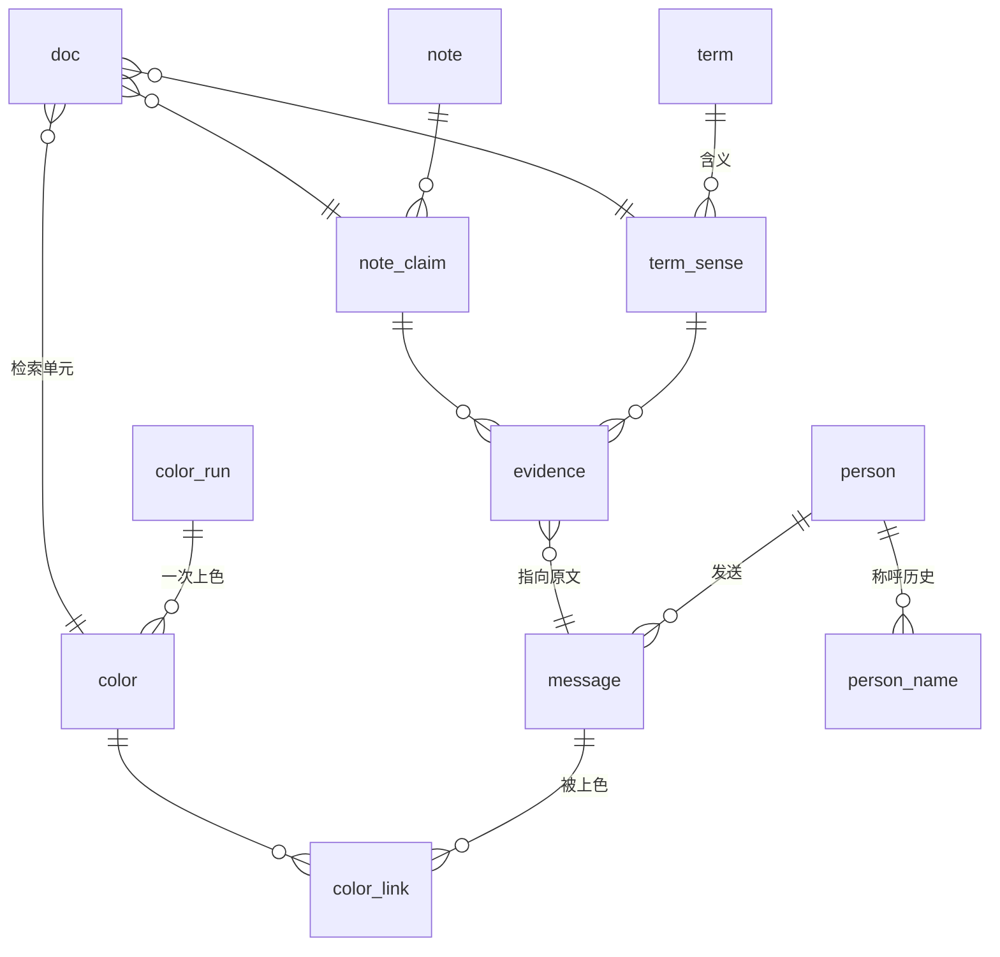

# 存储与数据模型：现状审计和统一方案

> 日期：2026-11-05。回答三个问题：现有存储是否用 SQLite；能否统一管理所有记忆对象并保留证据关系；FTS5 是否值得替换现有的关键词索引。另外讨论人物和梗是否应该单独成表，以及与 idea 的一致性。
> 证据等级同 [阶段报告](2026-11-memory-stage-report.md)：【证实】【解释】【假设】。

## 1. 现有存储审计

### 1.1 结论

- **本项目的代码没有使用 SQLite。** `bench/`、`plugins/`、`scripts/` 里都没有 SQLite 的读写，评测数据全部是 JSONL 和 JSON 文件。【证实，代码搜索】
- **机器人运行时有两套存储**，但都不在我们的代码里：
  - **AstrBot 本体**：用 SQLite 文件 `data/data_v4.db`（源码 `astrbot/core/config/default.py` 中的 `DB_PATH`），表有 `conversations`、`platform_message_history`、`personas`、`platform_sessions` 等（`astrbot/core/db/po.py`）。【源码】部署机在 Windows，本机没有这个文件，表内容未核实。
  - **memory_beyond 插件**：一条事实一个 Markdown 文件，放在 `data/plugin_data/astrbot_plugin_memory_beyond/memories/` 下，人物按 QQ 号锚定（`docs/context-and-memory.md`）。

### 1.2 各类数据现在存在哪里

| 数据 | 位置 | 格式 | 稳定 ID | 与原始证据的关系 |
|---|---|---|---|---|
| 原始消息 | `qqbot-data/reconciled/<群号>.jsonl`（仓库外） | ChatLab JSONL | **有**：QQ 消息 ID、发送者 QQ 号 | 本身就是证据 |
| 颜色（上色结果）与摘要 | `runs/<群>/colors.<模型>.jsonl` | 每行 `color_id`、`msg_ids`、`summary`、`type`、`name` | **不稳定**：`color_id` 形如 `b0c0`（第几批、第几个），依赖这次上色的切批方式；文件名只按模型区分，没有运行编号，重新上色会覆盖 | 有：`msg_ids` 指向原始消息 |
| 问题 | `runs/<群>/q2_questions.json`、`q2b_questions.json` | JSON | 有：`q2:0`、`q2b:…` | 有：`gold` 指向消息 ID |
| 梗表 | `runs/real-dev/k_tables.json` | 每条 `term`、`meaning`、`usage`、`confidence`、`learned_before` | **没有**：以词本身为键，同形异义无法区分 | **没有**：词条不记录证据消息；例句是检索时临时取的 |
| 人物 | 运行时由 `bench/sanitize.py` 生成化名 | 内存 | 化名 `P###` 按首次出现顺序分配，**每个群各编一套**；底层用 QQ 号，本身是稳定的 | 无人物表；昵称历史只在原始消息的 `groupNickname` 字段里 |
| 模型调用 | `runs/<群>/*.cache.jsonl` | 请求哈希 → 输出、token | 有：SHA-256 | 提示词里含原文，属于派生副本 |
| 向量 | `runs/<群>/embed.*.cache.jsonl` | 文本哈希 → 向量 | 有：哈希中含模型、维度和配置 | **按文本，不按块**：块的文本一变就是新向量，旧向量不会删除 |
| 逐题原始记录 | `runs/<群>/raw/<实验>/*.jsonl` | JSONL | 题号 + 方案名 | 含块编号和注入的原文 |
| 台账 | `runs/ledger.jsonl` | JSONL | 实验 + 方案名 | 指向原始记录文件 |
| 机器人的会话历史 | AstrBot 的 `data_v4.db` | SQLite | 由 AstrBot 管理 | 与我们的数据不相连 |
| 机器人的事实记忆 | memory_beyond 的 Markdown | 一事一文件 | 文件名 | 没有证据消息 |

### 1.3 问题

1. **重复存储**：
   - 原始消息的文本会出现在多处：原始导出、LLM 缓存里的提示词、逐题记录里的注入文本、打标页。缓存和日志作为派生副本是合理的，但目前没有统一说明哪一份是「源」。
   - 机器人运行时，同一句聊天会同时存在 AstrBot 的 `platform_message_history`、memory_beyond 的摘要，以及将来我们自己的消息表里。
2. **缺少稳定 ID**：
   - 颜色 ID 依赖切批，没有上色运行的版本。如果重新上色，旧实验里的块编号就对不上了。
   - 梗词条没有 ID，也没有证据。
   - 化名每个群一套，同一个人在不同群里是不同的 `P###`。这在单群评测里没问题，但做跨群的「<GROUP_SERIES>联合集」就不行。
3. **时间可见性只在检索时过滤**：BM25 的 IDF 和平均长度是用全部块算的，包括将来的块。向量和 FTS5 也一样。这泄漏的只是统计量，不是内容，影响很小，但持续增量的系统应当只用 `as_of` 之前的统计。

## 2. 统一管理：可以，而且应当

所有记忆对象都可以放进**同一个 SQLite 库**。原则是：**原始消息只追加、不修改；其他一切都是带版本的派生物，通过消息 ID 回指证据**。这延续了第一份调研报告 9.1 节的草案，把颜色运行、梗、人物、Notebook 和索引补全了。



```sql
-- 原始层：只追加
message(id INTEGER PRIMARY KEY, source TEXT, source_msg_id TEXT, chat_id TEXT, sender_id TEXT,
        ts REAL, order_key INTEGER, text TEXT, reply_to TEXT, media TEXT,
        UNIQUE(source, source_msg_id))
person(id INTEGER PRIMARY KEY, platform TEXT, platform_uid TEXT, UNIQUE(platform, platform_uid))
person_name(person_id, chat_id, name, kind, first_seen, last_seen, source_message_id)
identity_candidate(a, b, evidence_json, status, decided_by)        -- 待定的同一性，永不自动转正

-- 上色：每次运行一个 run，多个方案并存
color_run(id, model, prompt_hash, batch_size, overlap, created_at, note)
color(id, run_id, chat_id, layer, kind, name, summary, first_ts, last_ts, status)
color_link(color_id, message_id, role, PRIMARY KEY(color_id, message_id))

-- 知识：梗、Notebook
term(id, chat_scope, surface)                                        -- 同一写法一个词
term_sense(id, term_id, meaning, usage, status, valid_from, valid_to, version, created_by)
note(id, chat_scope, kind, key, title, status, version)              -- person | topic | event | state | group
note_claim(id, note_id, text, status, valid_from, valid_to, confidence, created_by, created_at, superseded_by)

-- 证据：所有派生断言都必须能回到原文
evidence(object_type, object_id, message_id, role, PRIMARY KEY(object_type, object_id, message_id, role))

-- 检索层：统一的检索单元，以及可重建的索引
doc(id, kind, ref_id, chat_id, end_ts, text, index_version)          -- kind: color_raw | color_summary | term | note
doc_fts USING fts5(body, content='')                                 -- rowid = doc.id，预先切词
doc_vec(doc_id, model_config, vector BLOB)                           -- 配置写在 model_config 里

-- 修订：所有派生物的修改留痕
revision(object_type, object_id, old_json, new_json, reason, evidence_json, at)
```

要点：

- **证据关系**：`evidence` 表把颜色、梗的含义、Notebook 的断言都连到 `message.id`。由代码检查被引用的消息存在、早于写入时间、并且不是机器人自己的发言。
- **稳定 ID**：消息按 `(source, source_msg_id)` 去重，不按内容。人物按 `(platform, platform_uid)`。颜色 ID 不再从切批位置推出，而是由数据库生成，并记录属于哪次 `color_run`。
- **检索统一**：检索只面对 `doc`。四路检索就是对 `kind ∈ {color_raw, color_summary}` 做 FTS5 和向量。梗和笔记只是增加新的 `kind`，路线和打包代码不用改。
- **索引可重建**：`doc_fts` 和 `doc_vec` 都可以从 `doc` 重新生成。`index_version` 记录切词表的版本（习得词会变）；`model_config` 记录向量配置（V0、V2、M1），避免第一阶段那种新旧向量混用的问题。
- **与 AstrBot 的关系**：AstrBot 的 `data_v4.db` 归 AstrBot 管，我们不往里写。我们的库只通过适配器读取消息事件。memory_beyond 是否保留，等新系统接入时再决定。
- **评测框架**：`bench/` 可以继续用 JSONL 跑。数据模型确定后，先写一个从现有文件导入数据库的脚本，再用第 3 节的方法确认导入前后的结果一致。

## 3. FTS5 是否值得替换现有的关键词索引

### 3.1 实测（本次，零模型调用）

在两个开发群的全部 876 题上，对摘要和原文块两个索引，把 FTS5 与现有的 BM25 逐题比较。中文先用同一个 jieba + 习得词切词器切好，以空格分隔后存进 FTS5，查询用各词的 OR。

| 指标 | DEV-1 摘要 | DEV-1 原文块 | DEV-2 摘要 | DEV-2 原文块 |
|---|---:|---:|---:|---:|
| **FTS5 找候选 + 原公式打分**：前 30 名与现有 BM25 完全相同的题 | 440 / 440 | 440 / 440 | 436 / 436 | 436 / 436 |
| FTS5 自带 bm25()：前 5 名集合与现有 BM25 相同的题 | 337（77%） | 226（51%） | 319（73%） | 216（50%） |
| FTS5 自带 bm25()：第 1 名相同的题 | 409（93%） | 400（91%） | 403（92%） | 380（87%） |
| R@5：现有 BM25 / FTS5 自带 | 74.3 / 74.5 | 80.7 / 80.7 | 56.9 / 58.0 | 59.4 / 60.3 |
| 每次查询耗时（ms）：现有 / FTS5 自带 / FTS5 + 原公式 | 0.6 / 1.5 / 2.1 | 0.9 / 2.3 / 3.7 | 1.3 / 3.4 / 5.1 | 1.8 / 5.2 / 8.3 |

实现在 `bench/retrievers/fts5.py`，等价性测试在 `tests/bench/test_fts5.py`。

### 3.2 结论

1. **能保证排序与基线完全一致，前提是只用 FTS5 找候选，打分仍用现有公式。** 876 题、两个索引，前 30 名全部相同。【证实】原因是两种方式找到的候选是同一批：都是至少含一个查询词的块。差别只在打分：FTS5 自带的 bm25() 用 k1=1.2，IDF 的处理方式也不同；现有实现与 `rank_bm25` 相同，k1=1.5，负 IDF 用平均值的 0.25 倍兜底。
2. **直接用 FTS5 自带的 bm25()，召回差不多，但排序会变**：前 5 名集合只有 50–77% 的题相同，R@5 相差在 ±1.1 个百分点以内。前 5 名一变，注入的内容就变了，历史回答缓存全部失效，需要重新测一轮。所以**如果用自带排序，就要把它当成一个新配置来评测**，不能直接沿用基线成绩。
3. **值不值得换**：
   - **对 benchmark 不值得。** 现有的内存 BM25 更快，结果也已经固定。
   - **对上线的系统值得。** 好处是持久化、增量写入（新消息不用重建全部索引）、和其他表在同一个事务里，还能用 SQL 直接做时间和群过滤。几毫秒的查询耗时完全可以接受。
   - 建议上线时用「FTS5 找候选 + 原公式打分」。这需要在库里存每个 `doc` 的词频和长度，以及全局的 IDF 统计；也可以用 FTS5 的 `fts5vocab` 表取文档频率，但仍然要用原公式算分。
4. **注意事项**：
   - FTS5 自带的分词器不会切中文，必须先切好词再存；习得词表变了就要重建，所以记录 `index_version`。
   - FTS5 的 trigram 分词器不需要预先切词，但它是另一种索引方式，要单独评测。
   - 增量系统里，IDF 和平均长度最好只用 `as_of` 之前的数据计算。现在的基线没有这样做，切换时要明确选择一种做法并记录下来。

## 4. 人物和梗要不要单独成表：与 idea 的一致性

### 4.1 idea 原文怎么说

`docs/memory-options.md` 第 0 节和选项表：

- 「**人物和时间是原文块绑定的元数据**，不是单独的检索通道，所以起点不需要多路融合。」
- P1：人物只凭稳定 ID 自动合并；P2：同一性只产生候选。
- K3：「**梗单独一张表，走同一套召回**」。

### 4.2 建议

| 对象 | 单独成表？ | 是否作为检索路线 | 理由 |
|---|---|---|---|
| **人物身份**（ID、称呼历史、同一性候选） | **是** | 否 | 这是元数据，不是检索单元。但它必须有表：跨群合并、改名、别名都依赖它。现在由化名临时生成，跨群时不可用 |
| **人物档案**（印象、关系、偏好） | 是，作为 Notebook 的 `note(kind=person)` | **待实验** | idea 没有把它当作检索通道。是否值得占用注入预算，要用人工题验证 |
| **梗词条** | **是**（idea 的起点） | 是，作为 `doc(kind=term)` 走同一套召回 | Q9 实验中，按上下文召回时，梗表显著优于原文检索（+4.7～+7.1 个百分点，样本小）；词条要补上 ID 和证据 |

所以只有一处与 idea 有出入：idea 说人物「不是单独的检索通道」，这里建议人物身份照样不作检索通道；人物档案则作为一个待验证的选项，而不是默认加入。

### 4.3 人工出题验证（建议）

同意用人工出题验证人物和梗的效果。现有的 SILVER 题几乎都是单点事实题，测不到这两类能力；用模型出题又容易自证。

| 题组 | 数量 | 例子（类型，不含真实内容） | 用来比较的方案 |
|---|---:|---|---|
| 人物识别 | 20–30 | 「某某（外号）是谁」「某某以前叫什么」「某某和谁关系好」 | 冻结版、冻结版 + 人物身份元数据、冻结版 + 人物档案 |
| 人物状态 | 10–20 | 「某某最近在忙什么」「某某现在还在做那件事吗」 | 同上；另外测时间信息（注入时带不带日期） |
| 梗的理解 | 20–30 | 给一句含梗的话，问是什么意思、在说谁或什么事 | 冻结版、冻结版 + 梗表 |
| 梗的运用 | 10 | 给一段语境，看回复是否恰当地使用或理解了梗（盲评） | 同上 |

- **形式**：沿用现有的离线打标页，「自己出题」卡片已经存在。每题写问题、答案，并搜出证据消息，这样同时能评检索。
- **数据**：用 DEV-1，因为 DEV-1 的成员也出现在 TEST 联合集里，题目可以作为将来跨群测试的参照。
- **花费**：出题人约 2–3 小时。评测每个方案每题约 1 次 Gemini 回答和 1 次判官调用；约 100 题 × 4 个方案，Gemini 约 400 次。
- **统计**：100 题左右只能检出约 10 个百分点以上的差异，所以先看方向和逐题失败原因，不急着定结论。

## 5. 决定（2026-11-05，D-030）

采用 SQLite。研究阶段不换关键词索引，保证之前实验的可信度；评测数据如果要导入数据库，先逐题证明检索结果和注入内容不变。上线时再换 FTS5，用「找候选 + 原公式打分」。

## 6. 更新（2026-11-05，D-033）：梗表分两层

用户决定：通用梗跨群共用一份，本群特有的梗只留在本群、不合并。`term.chat_scope` 为空即通用层，为群 ID 即本群层；同一写法两层都有时，本群层优先。研究用的 schema 目前仍按群存，建通用层时再改并记入 id 对照文件。详见 `DECISIONS.md` D-033。
